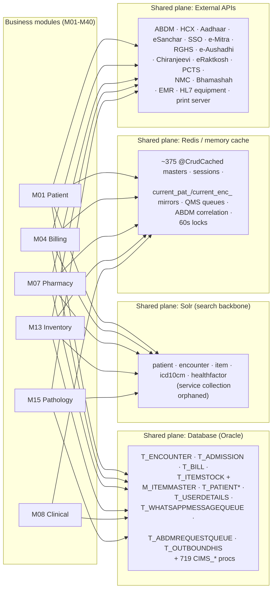
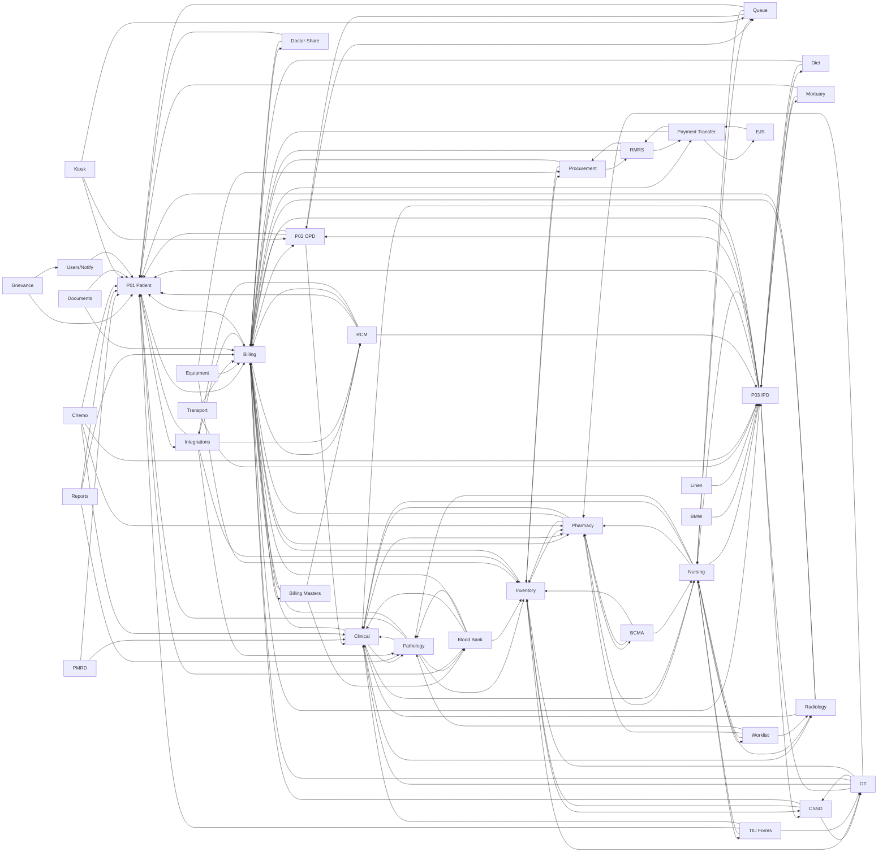
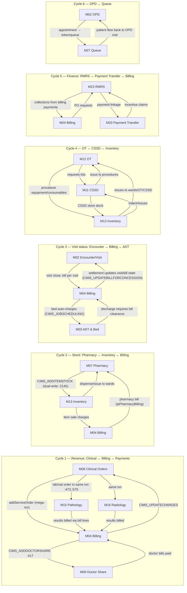
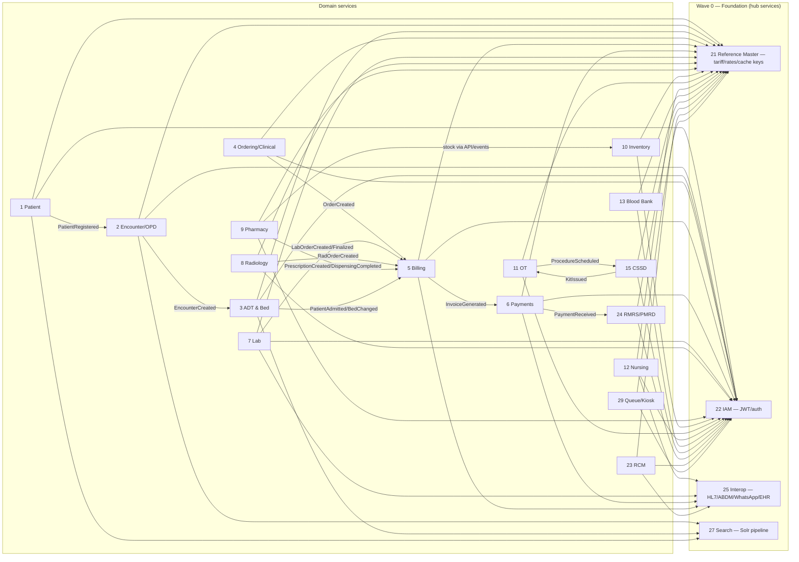

# iHMS / OHUM PAS NG — Dependency Graph & Coupling Map

> Synthesized from: `02-business-module-catalog.md` (cross-module dependency table), `_discovery/agent-10/findings.md` (§3 shared-table hotspots, §2 transaction boundaries), `04-backend-architecture.md` (service layer), `_discovery/agent-01/findings.md` (wiring). No new code exploration.
> **Status:** AS-IS evidence-based; TO-BE sections marked **PRELIMINARY**.

---

## 1. Dependency layers model

Every module (M01-M40) depends on the four shared planes below. The arrows are: **direct DB reads/writes** (including shared tables), **index writes/reads** (Solr), **cache reads** (Redis/in-memory), and **external API calls** (28+ integrations).

---

## 2. Module dependency graph (M01–M40)

Edges are the cross-module dependencies from `02-business-module-catalog.md`, renumbered to catalog-heading numbering per `MODULE-INVENTORY.md` Evidence Conflicts #1/#4. Direction: **dependent → dependency**.

> Note: M37 (Aasmaan) is standalone (no in-code deps); M39 (Commons) is a platform layer consumed by all; M34/M35/M25 are global consumers. Edges renumbered to catalog-heading numbering per `MODULE-INVENTORY.md` Evidence Conflicts #1/#4 (stale agent-02 refs corrected 2026-08-22: billing M08→M04, orders M18→M08, queue M29→M27, nursing M15→M09, pharmacy bill M17→M07, BCMA M34→M30, pathology M16→M15, radiology M21→M16; blood-bank serology M16→M15 kept ambiguous per source).

### 2.1 Module dependency table (agent-02 rows, renumbered per Evidence Conflicts #1/#4)

| Module | Depends on | Module | Depends on |
|---|---|---|---|
| M01 Patient | Masters, M38 ABDM, Billing (MRN) | M21 Transport | M03, M04 |
| M02 OPD | M01, M04, M08, M27 Queue, Masters | M22 Grievance | M01, M35 |
| M03 IPD | M01, M02, M04, M10, M09, M08, M28, M11 | M23 RMRS | M04, M14, M33, Masters |
| M04 Billing | M01-M03, M05, M07, M32, M33, M06 | M24 PMRD | M01, M08 |
| M05 Billing Masters | M04, M17, M32 | M25 Reports | All |
| M06 Doctor Share | M04, M01 | M26 Worklist | M09, M07, M15, M16 |
| M07 Pharmacy | M13, M04, M09, M08, M30 BCMA | M27 Queue | M02, M09, M01 |
| M08 Clinical Orders | M04, M15, M16, M07, M09 | M28 Mortuary/Death | M03, M01 |
| M09 Nursing | M03, M07, M08, M15, M16, M26, M27, M40 | M29 Chemo | M01, M03, M07, M08 |
| M10 Diet | M03, M04 | M30 BCMA | M07, M09, M13 |
| M11 CSSD | M13, M12, M04 | M31 Kiosk | M01, M02, M27 |
| M12 OT | M03, M08, M04, M11, M13, M07 | M32 RCM | M01, M03, M04, M38 |
| M13 Inventory | M14, M07, M11, M12, M04 | M33 Payment Transfer | M04, M36, M23 |
| M14 Procurement | M13, M04, M23 | M34 Documents | All |
| M15 Pathology | M08, M01, M04, M13, M17 | M35 Users/Notify | All |
| M16 Radiology | M08, M04, M01 | M36 EJS | M33, geo masters |
| M17 Blood Bank | M01, M08, M13, M04, M15 | M37 Aasmaan | none (standalone) |
| M18 BMW | M03 | M38 Integrations | M01, M04, M13, M15, M32 |
| M19 Linen | M03 | M39 Commons | All (platform) |
| M20 Equipment | M13, M14, M04 | M40 TIU Forms | M09, M01, M12, M08 |

---

## 3. Shared-table hotspots (DB layer)

From `_discovery/agent-10/findings.md` §3 — tables written by one context but read by many (the DB-level coupling backbone):

| Table | Written by | Read by | Assessment |
|---|---|---|---|
| **T_ENCOUNTER / T_APPOINTMENT** | Visit/OPD services | BillSummary (Solr), Pharmacy, Lab/Rad, Nursing, BloodBank, Diet, PatientSearch, OT | **Shared tenant record** — every clinical/financial module keys off opdIpdId |
| **T_ADMISSION** | ADT services | Billing, Pharmacy, Lab/Rad, Nursing, Diet, OT, BloodBank, RMRS | Shared tenant record |
| **T_BILL / T_BILLDETAILS** | Ordering/billing services | Payment/refund, Pharmacy, Lab/Rad, RCM, RMRS, reports | **Settlement spine** |
| **M_ITEMMASTER + T_ITEMSTOCK + batch** | Inventory, **Pharmacy** (dual-write `PharmacyServiceImpl.java:2140`) | Pharmacy, Lab, OT, CSSD, BloodBank, Diet, UploadFile | **Highest contention** — stock decrement is the unit of work |
| **M_SERVICEMASTER / M_TARIFFMASTER / packages** | Master services | Billing (rate lookup), all ordering modules, estimation, RCM | Shared pricing contract |
| **T_PATIENT\*** | Registration | All clinical modules, billing, ABDM, EHR, reports | Shared tenant record |
| **T_USERDETAILS / roles** | AddUserServiceImpl | Everything (auth, per-unit grants) | Cross-cutting identity |
| **T_WHATSAPPMESSAGEQUEUE/STATUS** | `AddServiceOrderServiceHelper.java:3924-3926` | `ApplicationJobs.java:1611` poller | Existing async pattern → Kafka |
| **T_ABDMREQUESTQUEUE** | `EmergencyAndWalkinVisitServiceImpl.java:1937` | `ApplicationJobs.java:1661-1688` | Existing async pattern → Kafka |
| **T_OUTBOUNDHIS / T_INBOUNDHIS** | HL7Helper | Hl7InboundMessageJob, EHRSyncJobs | Existing outbox pattern |
| **Solr collections** | `SolrUtil` + jobs (5s drainers) | Search everywhere | Cross-cutting index |
| **Redis cache keys** (itemMaster, tariffMaster, unitMaster…) | MasterCachedServiceImpl (+checkService `:6411`) | ~30 services | Read-through lookup only |

---

## 4. Service-level dependency evidence (from `04-backend-architecture.md`)

| Evidence | Meaning |
|---|---|
| 137 bean refs = 65 XML + 96 @Component (65 REST) merged in one CXF bus | No isolation boundary at all — every service can autowire every other |
| `BaseServiceImpl` (1,044 LOC) injects GenericDAO + cache + sessionCache into all services | Shared mutable plumbing |
| Field `@Autowired` everywhere, `@Lazy` used for **existing cycles** (e.g., AuthenticationServiceImpl → PatientRegApptServiceImpl) | Cycle at DI level already present |
| 1,056 endpoint methods `@Transactional(rollbackOn=Exception)` | Transaction boundaries follow methods, not domains |
| `MasterCachedServiceImpl` — 514 graph edges, 264 endpoints | **God-node**; ~30 services depend on its cache contract |
| `InventoryServiceImpl` — 250 edges · `NursingServiceImpl` — 349 edges · `UploadFileServiceImpl` — 294 edges | Hub nodes |
| 719 procs, ~30 called from Java (namedStoredProcQ); stored-proc-backed `*ResultDto` endpoints | DB-coupling hotspots (BloodBank, Radiology, Patient) |
| `AddServiceOrderServiceHelper.java:341-516` | One method spans 4+ future service boundaries (see `04-data-flow.md` H1) |

---

## 5. Circular-dependency analysis (AS-IS)

### 5.1 Cycle register with evidence

| # | Cycle | Direction evidence | Breaking direction (TO-BE, PRELIMINARY) |
|---|---|---|---|
| 1 | **Clinical ↔ Billing** (mega-txn) | Order creates bill (`AddServiceOrderServiceHelper:341-516`); billing posts charges back to orders (`CIMS_UPDATECHARGES :908-991`) | Ordering (4) emits OrderCreated → Billing (5) computes; charges become events (ChargeAdded), never a call back |
| 2 | **Billing ↔ Pharmacy ↔ Inventory** | Pharmacy writes stock (`PharmacyServiceImpl:2140`) while Inventory owns tables; pharmacy bills items (`M07→M04`); inventory items are billed (`M13→M04`) | Inventory (10) owns stock API; Pharmacy (9) consumes InventoryUpdated; Billing only sees ItemSold events |
| 3 | **Encounter ↔ Billing ↔ ADT** (visit status) | Billing updates bill/visit state (`AddPaymentServiceHelper:463`); discharge clearance (`M03→M04`); bed auto-charges job (`ApplicationJobs:283`); BillSummary reads encounter via Solr (`BillSummaryServiceImpl:811`) | ADT (3) emits BedChanged; Billing (5) consumes for auto-charges; settlement state owned by Billing, propagated via InvoiceGenerated/PaymentReceived |
| 4 | **OT ↔ CSSD ↔ Inventory** | Kit requests (`M11→M12`), issue to procedures (`M12→M11`), both consume stock (`M11/M12→M13`) | Kit lifecycle inside CSSD (15); OT (11) requests via events; stock strictly Inventory API |
| 5 | **RMRS ↔ Payment Transfer ↔ Billing** | RMRS reads collection details (`RMRSServiceImpl:1361-1366`); payment transfer claims incentives; RMRS PO requests | Payments (6) → RMRS (24) via PaymentReceived event only |
| 6 | **OPD ↔ Queue** | Appointments create tokens; queue assigns patients to doctors | Queue state (29) is ephemeral Redis/stream data; OPD (2) is source of appointment truth |
| 7 | **Billing ↔ Tariff masters (M04 ↔ M05)** | Billing reads tariff for rates (`BillServiceImpl:104`); tariff service changes rates that affect open bills | Reference (21) owns tariffs; rate snapshots on bill lines at order time; TariffChanged event invalidates cache only |
| 8 | **Billing ↔ Doctor Share (M04 ↔ M06)** | Doctor share accrued inside bill txn (`:417`); doctor share bills/payments run through billing | Share accrual becomes an InvoiceGenerated consumer inside Billing (5) as an internal read-model, not a separate cycle |
| 9 | **DI-level cycle** | `AuthenticationServiceImpl ↔ PatientRegApptServiceImpl` (resolved by `@Lazy`) | None needed — disappears with service split (IAM owns identity) |

**Structural root cause:** billing is the gravitational center (7 of 9 cycles touch M04), followed by inventory (3 cycles). Both are exactly the services agent-10 flags as god-nodes with the highest contention tables.

---

## 6. TO-BE dependency view (PRELIMINARY)

### 6.1 TO-BE resolution strategy (PRELIMINARY)

| Rule | Applies to cycles |
|---|---|
| **Events for one-way propagation**; a consumer never calls back to the producer synchronously (saga + outbox) | 1, 2, 3, 5 |
| **Single owner per shared entity**; all other contexts keep local read-models fed by events | T_ENCOUNTER (2), T_BILL (5), T_ITEMSTOCK (10), tariffs (21) |
| **Rate/price snapshots at order time** — no live re-read from tariff during billing | 7 |
| **Ephemeral state stays in Redis/streams** (queue, bed availability) with an owning service | 6 |
| **Stock API owned by Inventory; Pharmacy calls API or consumes InventoryUpdated** (open decision per `10-target-architecture.md` §7.1) | 2, 4 |
| **Internal read-models allowed inside a context** (doctor share accrual within Billing as a domain service, not a separate service) | 8 |

---

## 7. Summary: top coupling findings

1. **Billing (M04) is the gravitational center** — appears in 7 of 9 cycles and reads/writes the settlement spine (T_BILL/T_BILLDETAILS); splitting it is the highest-risk move (Wave 2).
2. **The mega-transaction `AddServiceOrderServiceHelper.java:341-516`** atomically couples Ordering, Billing, Lab, Radiology, Doctor Share, EMR and HL7 — the single hardest dependency to cut.
3. **Stock dual-write (Pharmacy → `CIMS_ADDITEMSTOCK`)** couples Pharmacy and Inventory at the row level on the most contended tables.
4. **Master-data god-node** — `MasterCachedServiceImpl` (514 edges, 264 endpoints) makes every module depend on one service's cache contract; ~30 services read `itemMaster`/`tariffMaster` keys.
5. **Encounter as universal join key** — every module keys off `opdIpdId`/`admissionId`, making T_ENCOUNTER/T_ADMISSION the coupling super-spreaders; encounter index TTL (3 days) even leaks into Solr reads (BillSummary).
6. **Existing DI-level cycles** (`@Lazy` on AuthenticationServiceImpl ↔ PatientRegApptServiceImpl) confirm cycles are already present in code, not hypothetical.
