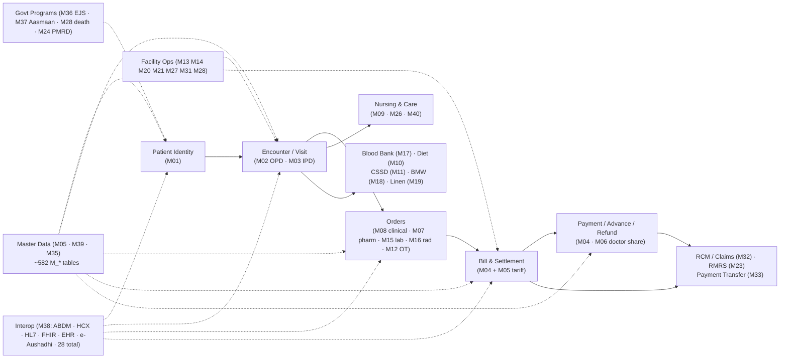

# HMIS-MODERNIZATION-BLUEPRINT — iHMS / OHUM PAS NG

> **Master integration document.** Synthesized exclusively from the completed discovery + consolidation set in this directory (documents `01`–`10`, the 19 consolidation docs, `_discovery/reconciliation-notes.md`, `_discovery/repository-snapshot.md`). No new exploration; no code changes; **no statement is invented** — each section cites its source document (e.g. "07 §1" = `07-integrations-and-search.md`).
> **Status legend:** AS-IS = verified against `D:\ihms` evidence. **PRELIMINARY** = target-side design (React, microservices, PostgreSQL, Kafka, deployment) is first-pass and under validation — nothing on the TO-BE side is final.
> **Orientation target:** a new engineering team can orient in ~30 minutes from this file; every topic has a depth pointer.

---

## 1. Executive Summary

**What the system is.** iHMS ("ohumpasng" v3.4) is a hospital management information system (HMIS) — an evolution of the DOCIT product line — deployed for the Government of Rajasthan ("RISL" overlay: e-Mitra, SSO, Jan-Aadhaar, Bhamashah, ABDM/NHCX, e-Aushadi integrations). It is a **single-module Spring Boot 2.7.5 / Java 8 monolith** (artifact `com:ohumpasng:3.4`) that runs by default as a **self-executing JAR with embedded Tomcat**; the RISL production overlay uses a WAR variant with JNDI datasource (`01 §1, §3.1`; repository-snapshot §1).

**Scale (evidence-based, all sources below):**

| Dimension | Count | Source |
|---|---|---|
| Java source files | 3,001 | repository-snapshot §2 |
| REST endpoints | 3,060 (3,003 CXF JAX-RS + 57 ABDM/HFR callbacks) | API-INVENTORY §1; agent-04 findings §1 |
| Service classes | 132 (120 wired on CXF bus) | API-INVENTORY §1 |
| @Transactional endpoints | 1,056 (1,445 annotations) | API-INVENTORY §1 |
| DB tables | ~843 (808 explicit `@Table` + ~35 convention) | 05 §3 |
| Stored-proc artifacts | 719 (`generated-procs/`; 30 confirmed live-called) | 05 §6; DEAD-CODE §2 |
| Frontend modules | 40 (`fjs-config_<module>.json`, 4,255 schema/template files) | 02 §1; agent-01 findings |
| Hash routes | 533 (`module:screen`) | agent-03 route-inventory |
| Declarative forms / templates | 1,308 schemas / 2,942 templates | 03 §1.1 |
| JS controllers | 71 flat files (business logic client-side) | 03 §1.1 |
| Business rules | 39 (36 cataloged + 3 ADDED) | BUSINESS-RULES (39 `## BR-*`); 06 §B |
| Features (traceable rows) | 289 | FEATURE-MATRIX (row count verified) |
| Scheduled jobs | ~55 across 5 job classes | 04 §7 |
| External integrations | 28 | 07 §3.1 |

**Why it must be modernized.** The stack is end-of-life and structurally unsafe: CXF 3.1.0 (2015) on Spring Boot 2.7.5, Java 8, Oracle 12c with 719 PL/SQL artifacts, a jQuery-era FAUG frontend with client-side business math, and — critically — **no backend authorization** (per-path permission check commented out; RBAC is frontend-only), **disabled password verification** by default config, and hard-coded secrets in properties (08 §1, §9; RISK-REGISTER #1/#6/#7). The frontend engine (FAUG) and vendor-era stack have no sustainable maintenance path; state-machine bugs (VisitStatus split-brain, DNR status collisions) are frozen in the data model (06 §C).

**The non-negotiables:**
1. **Solr stays.** It is the primary patient-identity query path (registration, check-in, duplicate detection, ABDM consent discovery) and is embedded in transactional flows with rollback compensation. Any modernization that replaces or drops Solr breaks registration/search UX at every hospital unit and breaks ABDM consent discovery (07 §1 — "⛔ SOLR MUST REMAIN").
2. **Business behavior is preserved, not redesigned.** The 3,060-endpoint contract, the 39 business rules, status-code dictionaries, number templates (MRNO/IPDNo/OPDNo/bill no), and print culture are the contract to reproduce (TEST-STRATEGY §1; 03 §1; 06).
3. **Strangler-fig migration is the default**; the monolith keeps running end-to-end at every step; Oracle is never unplugged until Wave 6 (STRANGLER §0).
4. **Legacy IDs must continue** (MRNO, IPDNO, bill no, HL7 control IDs) — sequence continuity is mandatory (POSTGRESQL-MIGRATION §0.2).
5. **No dual-write**: every moved table gets exactly one owner; the other side reads via API/event/CDC (STRANGLER §2.4).

---

## 2. Existing Architecture

**One monolith, four architecture generations** (`01 §1`): legacy XML-Spring + CXF JAX-RS; Spring Boot conveniences; the FAUG framework-driven frontend; plus an in-repo Node "rules engine" and a `docit.ctrl` file watchdog.

**Runtime shape** (`01 §3.2`): port 8080, context path `/IHMS`; CXFServlet at `/api/*` hosts CXF `jaxrs:server` at `/rest` → all REST under `/IHMS/api/rest/**`; static FAUG SPA served from `/**`; JPA unit `ORCL` (EclipseLink, shared cache NONE) over Oracle; `docit.ctrl` watchdog polls every 5 s, deletion = clean shutdown (App.java:273-286); MDC logging fields `meth/uri/corr/rip` (OBSERVABILITY §2).

**The FOUR routing layers (critical discovery — the API surface is not one layer):**

| # | Layer | Mechanism | Scale | Source |
|---|---|---|---|---|
| 1 | **Explicit CXF JAX-RS** | `@Path` methods on 132 service impls, wired in `services.xml` (67 XML beans + 65 component-scanned) | 3,060 endpoints; 2,322 FE URLs matched | API-INVENTORY §1, §3 |
| 2 | **Generic CRUD filter** | `CrudOperationsFilter` intercepts `/api/rest/<entity>/**`, routes to `GenericServiceImpl` CRUD over the **659 `@CrudApi` entity registry**; URL grammar incl. `/all`, `/multiple`, `/upload`, `__cufl` partial update; `crudaddMultiple` = REQUIRES_NEW per item | 1,109 FE URLs served (data-driven API layer, not dead links) | API-INVENTORY §3.1; reconciliation §1 |
| 3 | **Report dispatcher** | `IntegrationOperationsFilter` (Nashorn `reports.js` + `reports.json` configs loaded from `int.files.path`) serves `POST /api/rest/reports/<name>`; outputs HTML/PDF/CSV | 50 report keys; 44 HTML otemplates | REPORT-INVENTORY §2–§3 |
| 4 | **`/ext/api` integration gateway** | Same filter rewrites `/ext/api/<mapped>` → internal URL via `ApiIntegrationMapping` (4 live mappings), `allowedUsers` + `ROLE_INTEGRATION` gating — one of the only backend authz points | 4 mappings (login, all_departments, all_doctors, doctor_schedule) | API-INVENTORY §3.3; reconciliation §1, §5 |

**Key structural facts:**
- No Spring MVC controllers; all routing is CXF (04 §1).
- **Mega-transaction**: one `@Transactional` couples Order → Bill → Lab order → Rad order → DoctorShare → EMR → HL7 (`AddServiceOrderServiceHelper.java:341-516`) — the central decomposition bet (10 §1).
- **Master-data god-node**: `MasterCachedServiceImpl` (264 endpoints, 12,710 LOC, 514 graph edges) owns ~375 Redis cache keys consumed by ~30 services (10 §1; MICROSERVICE-CATALOG §21).
- **Hidden layers must be replicated at the ACL/gateway** before any module flip (STRANGLER §2.2): 222 frontend URLs remain unmatched and need per-URL triage (API-INVENTORY §5; UNKNOWN-005).

---

## 3. Technology Inventory

Full stack from `pom.xml` / `application.properties` (01 §2; repository-snapshot §1).

| Layer | Technology | Version | Evidence |
|---|---|---|---|
| Language | Java 8 (javax.*; Jakarta bridge only in WAR variant) | 1.8 | pom.xml:14 |
| Framework | Spring Boot (starter-parent) | 2.7.5 | pom.xml:31-35 |
| Web/REST | Apache CXF JAX-RS (+ JAX-WS dep) | 3.1.0 | pom.xml:296-322 |
| Persistence | EclipseLink JPA (Hibernate excluded; static-weaved) | 2.6.4 | pom.xml:376-379, 532-545 |
| Database | Oracle (ojdbc7); MySQL driver on classpath; PG dialect branch exists in code | 12.1.0 | pom.xml:819-823; App.java:180-184 |
| DB logic | 719 generated Oracle stored procs (`generated-procs/`) | — | 05 §6 |
| Cache (in-app) | `MemoryCacheImpl` active; Redis/Hazelcast/Ignite variants commented | — | applicationContext.xml:34-66 |
| External cache | Redis (jedis, standalone/cluster) + spymemcached/ehcache/hazelcast deps | — | application.properties:109-153 |
| Search | Solr Cloud (CloudSolrClient; spring-data-solr for annotations only) | SolrCloud 7.5.0, 3 nodes, ZK 10.10.5.151-153 | 07 §1.1; pom.xml:842-847 |
| Object storage | MinIO (**disabled by default** → filesystem fallback) | 5.0.2 | pom.xml:852-856; application.properties:750 |
| HL7 | HAPI base + structures | 2.2 | pom.xml:567-576 |
| FHIR | HAPI-FHIR (DSTU2/3/R4) + `xcg.genserv.FhirServer` (dormant — no servlet registration) | 5.7.0 | pom.xml:909-974; 04 §9 |
| ABDM | `com.ohum:abdm-client` (private Artifactory), bouncycastle, nimbus-jose-jwt | 3.0.0-SNAPSHOT | pom.xml:935-997 |
| Templates/Print | Velocity (.vm) + JasperReports (3 live jrxml) + openhtmltopdf + QZ Tray | 1.7 / 6.0.3 | REPORT-INVENTORY §1 |
| Auth | Spring Security (inert: permitAll, CSRF off) + custom auth + LDAP/AD (UnboundID, inactive) + Rajasthan SSO + OTP variants | — | 08 §2 |
| Frontend | FAUG (faug-min.js ~360 KB) + jQuery 3.x + Bootstrap 3 + highstock, fullcalendar, tinymce, fabric.js | — | 03 §1.1 |
| Mobile | ohumlite (in-repo FAUG app); patportal (gitignored/absent); queue sub-app | — | 01 §5; 03 §2.12 |
| Build | Maven; JAR default + `build_war.sh` WAR variant (risl overlay); Sonar scanner | — | 01 §3.1 |
| Ops extras | Node rule engine (`ruler/`, HTTP+ioredis); Solr/Redis/server shell check scripts | — | 01 §6 |

---

## 4. Complete Module Inventory

40 modules (M01–M40), one line each. Depth: **`MODULE-INVENTORY.md`** (per-module: purpose, submodules, features, screens, routes, APIs, BR-IDs, tables, procs, integrations, Solr/Redis, jobs, reports, security, complexity, risks, open questions). Source: `02-business-module-catalog.md`.

| ID | Module | One-line scope | Target service (§16) |
|---|---|---|---|
| M01 | Patient Management | Registration, demographics, MRN, MLC, mother–child, verification (ABHA/Aadhaar/Janaadhar) | 1 |
| M02 | OPD / Outpatient | Appointments, walk-ins, emergency, doctor schedules/check-in, referrals, camps, telemedicine | 2 (+29) |
| M03 | IPD / Admission, Bed & Discharge | Admission, bed allocation/transfer/release, discharge, clearance, attendant pass, cradles | 3 |
| M04 | Billing, Payments, Receipts & Refunds | Charge → bill → payment → receipt → refund; doctor share; credit notes; estimation | 5+6 |
| M05 | Tariff, Packages, Plans, Companies (billing masters) | Service/tariff/copay, packages, health plans, companies, concessions, order sets | 21 |
| M06 | Doctor Share & Incentives | Share calc, add/deduct, doctor bills & payments, waiver, visit charges | 5 |
| M07 | Pharmacy & Dispensing | Prescriptions, dispensing (OP/IP/ward), item sales/returns, IV/compounding, interventions | 9 |
| M08 | Clinical / Service Ordering | Service orders, consult orders, investigations, order sets, CWF/SCWF | 4 |
| M09 | Nursing | Worklist, notes, care plans, charting, shift handover, allocation, incidents, vitals | 12 |
| M10 | Diet & Kitchen | Patient diet orders, menu, kitchen production, ward lists | 14 |
| M11 | CSSD | Kit formation/preparation/sterilization, issue to procedures | 15 |
| M12 | OT & Surgery | Theatre config, scheduling, anesthesia, procedure performance, pre-billing | 11 |
| M13 | Inventory & Stores | Item master, stock/batches, indents, issue/return, reorder, expiry | 10 |
| M14 | Procurement | PR, quotations, PO, GRN/QC, rate contracts, returns to supplier | 10 |
| M15 | Pathology / Laboratory | Booking, collection, resulting, review, release, critical alerts, microbiology, KDL | 7 |
| M16 | Radiology | Booking, queue, reporting, templates, retest/reschedule, image attach | 8 |
| M17 | Blood Bank | Donor, bag lifecycle, cross-match, issue, e-Raktkosh, indents between units | 13 |
| M18 | Biomedical Waste | Waste generation/segregation, bag tracking | 19 |
| M19 | Linen & Laundry | Linen requests, status, laundry | 16 |
| M20 | Equipment & Maintenance | Asset register, complaints, PM/calibration, AMC/warranty, scrap sale | 18 |
| M21 | Transport & Ambulance | Patient/doctor transport, vehicle allocation, fuel, maintenance, trip details | 17 |
| M22 | Grievance | Tickets, escalation/history, resolution, feedback | 20 |
| M23 | RMRS (Financial/Fund Mgmt) | Authorities, heads, collections, issued payments, journal, suspense, bank | 24 |
| M24 | PMRD (Medical Records) | Encounter record (IEN), Form J1/J2/J3, uploads | 24/26 |
| M25 | Reports & BI | 46 report schemas, BI dashboard iframe | 26 |
| M26 | Worklist & Task Mgmt | Nurse task lists, goals, interventions (template-driven) | 12 |
| M27 | Queue Management | Appointment/cabin queues, tokens, doctor batch, nursing desk | 29 |
| M28 | Mortuary & Death | Mortuary boxes, death certificate, post-mortem, CDR 4A/4B | 3 |
| M29 | Chemotherapy | Chemo patient list, planning, coversheet | 9/12 |
| M30 | BCMA | Bedside barcode medication administration, IVP, missing doses | 9 |
| M31 | Kiosk (Self-Service) | Self-registration, appointment search, queue, kiosk lab upload | 29 |
| M32 | RCM / Scheme Billing | RGHS eligibility, DM/MOIC uploads, discharge verification, Chiranjeevi app | 23 |
| M33 | Payment Transfer | Payment transfer requests, incentive claims, OTP, bank accounts | 6 |
| M34 | File Management & Upload | Document capture/retrieval across all modules | 25/26 |
| M35 | User, Role & Notification | Users, roles, permissions, email/SMS templates, menu config | 22 |
| M36 | EJS (e-Jan Swasthya field app) | ASHA/ANM work, ANC/PNC/child care, checklists, incentives, geo masters | 28 |
| M37 | Aasmaan (Field App Backend) | Cases, devices, e-tickets, institutions, RSC call logs | 28 |
| M38 | Integrations (ABDM/NHCX/EHR/e-Aushadhi/Gov) | ABHA/HPR, HCX, EHR sync, e-Aushadhi, Aadhaar, Janaadhar/Bhamashah, RGHS/SIMS, KDL, MDM | 25 |
| M39 | Commons / Platform Services | Audits, config, hospital creation, MRN series, schemas designer, uploads, mortuary, corona | 21/22/26 |
| M40 | TIU/Clinical Forms Engine | 368 specialty clinical forms (tiuxmls), gender/age mapping, versioning | 4/12 |

**Module → service mapping note:** reconciliation §2 confirms the 40 frontend modules map onto the 29 service candidates; the full mapping table is in MIGRATION-WAVES §2 (e.g. masters→21, op/queue/kiosk→2+29, ip→3, nursing/careplan/charting/shifthandover/worklist/tiuxmls→12).

---

## 5. Complete Feature Inventory

**289 features** across the 40 modules, every row traceable (screen → API → BR → tables → Solr/Redis → integration → target service). Source: **`FEATURE-MATRIX.md`** (row count verified = 289) and **`TRACEABILITY-MATRIX.md`** (end-to-end chains per major feature, F01…).

| Module | Features (rows) | Module | Features | Module | Features |
|---|---|---|---|---|---|
| M01 | 14 | M15 | 13 | M28 | 4 |
| M02 | 18 | M16 | 4 | M29 | 3 |
| M03 | 17 | M17 | 11 | M30 | 4 |
| M04 | 20 | M18 | 3 | M31 | 5 |
| M05 | 9 | M19 | 2 | M32 | 5 |
| M06 | 4 | M20 | 7 | M33 | 3 |
| M07 | 16 | M21 | 5 | M34 | 3 |
| M08 | 7 | M22 | 3 | M35 | 5 |
| M09 | 17 | M23 | 5 | M36 | 4 |
| M10 | 4 | M24 | 3 | M37 | 4 |
| M11 | 6 | M25 | 3 | M38 | 9 |
| M12 | 7 | M26 | 2 | M39 | 8 |
| M13 | 15 | M27 | 6 | M40 | 3 |
| M14 | 8 | | | **TOTAL** | **289** |

Cross-cutting notes (FEATURE-MATRIX): status-code dictionaries apply across all rows (06 §A); Solr = 6 collections (5 live); ~375 `@CrudCached` Redis keys; 692 CIMS_* procs (30 live); cells without evidence are marked `-` (never invented).

---

## 6. Business Domain Map

**The primary domain spine:** patient → encounter → order → bill → payment, extended by master data, facility operations, government programs, and interop.



Domain descriptions (source: 02 M01–M40; 10 §2.1):
- **Patient → Encounter → Order → Bill → Payment**: the revenue spine; billing keys off `opdIpdId`/`admissionId` (10 §2.2; MIGRATION-WAVES §4.4). Encounter/admission keys are the shared tenant records every module reads (agent-10 §3).
- **Master data**: god-node (`MasterCachedServiceImpl`, 514 edges, ~375 cache keys); tariff/rate/service lookups gate billing, ordering, RCM (10 §1).
- **Facility operations**: inventory/procurement, equipment, transport, queue/kiosk, mortuary — self-contained domains (MIGRATION-COMPLEXITY §1 ranks 13–21/40 for the operational cluster).
- **Govt programs**: EJS (ASHA/ANC-PNC, 57 entities), Aasmaan (35 convention-mapped), Chiranjeevi/RGHS/NHCX claims (28 §2.1 svc 28, 23).
- **Interop**: 28 external integrations concentrated in Interop (25) (07 §3.1).

---

## 7. Business Rule Summary

**39 rules** by group (BUSINESS-RULES.md — 36 from the 06 catalog with preserved `BR-*` IDs + 3 ADDED from agent-06 traces; rule IDs, triggers, inputs, rules, errors, evidence, tables, APIs, UI dependencies, migration requirements, test cases in the source).

| Group | Rules | Count |
|---|---|---|
| Patient Registration | BR-PAT-001 (MRN strategy), 002 (Solr duplicate detection → BERA011/BEXA040), 003 (family coupling → BERP007) | 3 |
| OPD | BR-OPD-001 (non-residential tariff, `2L` fallback), 002 (slot collisions BERA028/BEXA029), 003 (visit number `V/<P>/<YY>/<seq>`), 004 (visit-type sequence machine), 005 (sponsor defaulting BERP008), 006 (walk-in requires doctor BERA022), 007 (payment → VisitStatus 11), 008 (MLC registration on visit — ADDED), 009 (walk-in validation gates — ADDED) | 9 |
| IPD | BR-IPD-001 (preconditions BERA022/BERB009/013/012), 002 (bed auto-allocation CAS, BEXB001), 003 (release gate BERB005), 004 (IPD number `A/<P>/<YY>/<seq>`; dead APP015), 005 (interim auto-abscond 3 days), 006 (ambulance carry-over — ADDED) | 6 |
| Discharge | BR-DIS-001 (preconditions BERB023/015/011/024/25), 002 (execution + death via CIMS_ADDBEDDISCHARGE/CIMS_UPDATEIPDISDISCHARGE), 003 (bed release, BedStatusId=6) | 3 |
| Billing | BR-BILL-001 (bill creation/numbering), 002 (doctor share %, CEILING/HALF_UP), 003 (patho/rad order auto-creation), 004 (≤3 tax buckets), 005 (co-pay/concession split — asymmetric), 006 (settlement ⇔ balances ≤ 0 + checkout), 007 (advance FIFO), 008 (refund/cancellation restore) | 8 |
| Pharmacy | BR-PHAR-001 (dispensing completes visit → VisitStatus 12), 002 (prescription closure on sale) | 2 |
| Pathology | BR-PATH-001 (sample collection locks charge removal, LEX001) | 1 |
| OT | BR-OT-001 (scheduling prerequisites BEOT004), 002 (OT pre-billing) | 2 |
| Blood Bank | BR-BLD-001 (requisition status machine 1/2/3/10), 002 (auto-decross 48 h/2880 min), 003 (bag expiry 23:00 job), 004 (requisition expiry), 005 (donor auto-cancel 72 h) | 5 |

**The riskiest cross-layer rules.** Source `06 §C` documents **FIVE** riskiest cross-layer rules (reproduced verbatim — no seventh exists in the evidence set; agent-06 additionally numbers 9 cross-layer risks R1–R9):

1. **VisitStatus 11/12 split-brain** (BR-OPD-007, BR-PHAR-001): billing writes `T_Appointment`, clinical writes `T_Encounter`; same numeric codes, two tables; kiosk/queue reads one side (`getLastVisitStatus`). Migration must unify the visit lifecycle.
2. **Non-self concession overwrite** (BR-BILL-005 R2): `getConcessionDetails` adds bill% to plan% for self company but **replaces** for non-self — silent pricing drift for corporate patients; needs a golden-master test.
3. **DNR_REJECTED == DNR_DONATED == 5**: single literal, two meanings in donor workflow; statuses ambiguous in reports/audit.
4. **Bed release hard-coded `BedStatusId=6`** (BR-DIS-003 R5): discharge SQL writes literal 6 while allocation validates against master `isrelease` — master-data change breaks release semantics; pin the contract.
5. **Dead admission failure path** (R4): Java `resultStatus==-1 → APP015` cannot fire (`CIMS_ADDADMISSIONINFORMATION` always ends 0); concurrent admission for the same patient is unguarded at DB level.

Depth: `BUSINESS-RULES.md`, `06-business-rules-catalog.md` (per-rule evidence and test cases), `STATUS-CODE-DICTIONARY.md` (A1–A9 numeric meanings with state diagrams).

---

## 8. Frontend Architecture

**FAUG** ("Form And User-interface Generator", ~360 KB minified) renders the entire HMIS UI from **schema JSON + HTML templates + jQuery**, driven by **hash routing** (`#module:screen/param1/param2`); there is no server-rendered HTML for screens (03 §1.1).

| Element | Detail | Source |
|---|---|---|
| Shell | `index.html` + `faug-min.js` (engine) + `faug-ext.js` (template compiler) + `faug-ext-globalize.js` (i18n/date) + 71 flat JS controllers | 03 §1.1 |
| Router | `fjs-config.json` — **533 routes**, `enableRouteModules: true`, lazy per-module `fjs-config_<module>.json` × 40 | 03 §1.1; agent-03 route-inventory |
| Schemas | 1,308 declarative forms (`modules/*/schemas/*.json`) with fields, validation, event chains, `dynamicAspects` conditional overrides | 03 §1.1 |
| Templates | 2,942 runtime templates (`modules/*/templates/*.html`); `<% %>`/`#js`/`!!include!!` syntax; can call any global JS function | 03 §1.1 |
| State | `gvars` (session globals seeded by login: `unit_id`, `login_user_role`, `tkn`, ~200 values) + `vars` (flow-scoped) + localStorage (printer prefs, locale) + server master caches in gvars | 03 §1.4 |
| Condition grammar | `\|<op>\|<expected>:<source>@<name>` (gvar@/object@/this@value/form@field/route@param/func:/regex) — used by dynamicAspects, validations, controlEvents | 03 §1.5 |
| API calls | Schema-declared crud ops (majority), controller `Faug.ajaxPost/get`, Web Worker XHR bridge (`w-api-call.js`, 3 workers, `cachedTime` response cache), static config fetches | 03 §1.6 |
| Auth | `POST auth/loginf` → seeds gvars; SSO (`loginsso`), OTP variants; role-based menus + `userstoreIds` store scoping | 03 §1.7 |
| **JS business-logic hotspots** (must port faithfully) | Billing math `calculateTotalBillAmount` (billing-module.js:2050 — 3 tax buckets, concession, self/non-self, package coverage); age/DOB two-way (common-module.js:1380-1818, age ≤115); validation.js; Aadhaar base64 encode before POST; wizards/state machines; printing (window.print, QZ Tray ZPL, BrowserPrint, dot-matrix plainText) | 03 §3 |
| Feature flags | Same schema renders differently per hospital config (NHNC/FPV/PCTS/kiosk/telemedicine/LMIS gvars) — React must preserve configuration-driven rendering | 03 §4 |
| Mobile | `ohumlite/` (offline FAUG app: registration/appointment/token/ABDM/billing), `queue/` sub-app, `patportal/` **absent from repo** (gitignored), `apps/` scaffolds | 01 §5; 09 §8 |
| Open frontend questions | `ext.js` backend-injected (absent from repo — UNKNOWN-006); `dynamicAspects` merge semantics (UNKNOWN-022); per-screen print path varies (03 §6) | UNKNOWN-BEHAVIOR |

API surface for reconciliation: ~3,857 unique FE URLs under `api/rest/*` (7,404 references); largest consumers nursingList (293), inventoryStockList (226), master (195) (03 §5).

---

## 9. Backend Architecture

**CXF single bus, no controller/service separation** — JAX-RS classes are both routers and business-logic containers (04 §1–§2).

| Fact | Detail | Source |
|---|---|---|
| Bus wiring | `services.xml` = source of truth: 67 XML beans + 96 `@Component` beans (65 REST) merged in one `jaxrs:server "restServices"` at `/rest`; bean id convention `*ServiceImpl` | 01 §4; 04 §1 |
| Service classes | 132 with endpoints; **1 bean verified off the bus** (`actionNotificationServiceImpl` /actionNotif, 3 endpoints — reconciliation figure of "11 unwired" could not be reproduced) | API-INVENTORY §1; DEAD-CODE §3 |
| God classes | NursingServiceImpl **300 endpoints / 17,350 LOC**; MasterCachedServiceImpl 264 / 12,710; InventoryServiceImpl 235 / 12,070; PathoOrderServiceImpl 133 / 14,280 — single file = single tx boundary | 04 §9; API-INVENTORY §2 |
| Data access | One `GenericDAO`/`GenericQuery` per service; 6 query kinds (named JPQL, native SQL, typed criteria, named proc, dynamic proc, direct EM); ~436 `getQ(` native call sites + ~2,000 raw SQL literals | 04 §4; 05 §9 |
| Transactions | `javax.transaction.Transactional` with `rollbackOn = Exception.class` on 1,056 endpoints (1,445 annotations); JpaTransactionManager; `crudaddMultiple` = REQUIRES_NEW per item | 04 §4 |
| Caching | `@Cached` master cache (MemoryCacheImpl active, expiry 86400 s); ~375 `@CrudCached` masters via CRUD filter write-through | 04 §4; 07 §2.1 |
| Aspects/filters | `ServiceLayerAspect` = the real framework (auth workflow, sequence PK assignment :697-750, audit flush, Solr sync + rollback compensation :1164-1182, background-queue contract); servlet filters Gzip → SpringSecurityConfig → IntegrationOperationsFilter/CrudOperationsFilter/SSOAuthFilter/EmitraRedirectFilter | 04 §1, §8; 05 §4 |
| Jobs | 5 job classes, ~55 `@Scheduled` (many commented); Solr index jobs 5 s, ABDM push 5 s, eRaktKosh nightly, RGHS SIMS 23:30, PCTS monthly; node guards + kill-switches in Redis | 04 §7; 07 §2.1 |
| Exceptions | `GenericApplicationException` + `ServiceJAXRSExceptionMapper`; errors NOT centralized — opaque `BEXA*` codes from resource bundles (must be retained) | 04 §6 |
| Print/report | ~60+ endpoints return raw HTML/byte[]; Velocity + Jasper embedded in API tier | 04 §9.7; REPORT-INVENTORY §4 |
| Async | `@Async` + `@Path` + `@BackgroundQueue` contract enforced by the aspect; WhatsApp report queue + ABHA push fixed-delay loops | 04 §5 |

Depth: `04-backend-architecture.md` + `_discovery/agent-04/findings.md` (full 3,060-endpoint dump in `04-api-catalog.md`).

---

## 10. Database Architecture

Single-database monolith on **Oracle 12c** (`jdbc:oracle:thin:@//10.10.7.63:1521/orcl`, schema owner `IHMSDOCITDEVMODS_PROD_V1`, HikariCP 5–10, validation `SELECT 1 FROM DUAL`). EclipseLink PU `ORCL`, shared cache OFF; Spring Data JPA repositories disabled (05 §1).

| Fact | Detail | Source |
|---|---|---|
| Table conventions | `M_<CLASS>` masters (~582), `T_<CLASS>` transactionals (~172); Aasmaan = convention-named (`AASMAANCASE`…, 35); EJS = `ANDROID_*`/`MASTER_*`/`ES_*` (57); integration temp = lowercase mixed (`t_creditNote`); native-only core = `T_REGISTRATION*`, `t_transfer`, `t_admission`, `t_patientrequisition` — **no entity mapping, DDL must be dumped from Oracle** | 05 §2, §3.6 |
| Base columns | `MBase` injects `UNITID, STATUS, CREATEDUNITID, UPDATEDUNITID, ADDEDBY, ADDEDDATETIME, UPDATEDBY, UPDATEDDATETIME, SYNCHRONIZED` into ≥750 tables | 05 §2 |
| PK / sequences | 100% manually assigned `Long` PKs from per-table `<TABLE>_seq` via AOP (`ServiceLayerAspect:697-750`); Oracle `SELECT <seq>.NEXTVAL FROM DUAL`, PG branch already coded (`NEXTVAL('<seq>')`); **no `@GeneratedValue`, no IDENTITY, no triggers** (0 anywhere) | 05 §4, §6 |
| Stored procs | 719 artifacts (692 PROCEDURE + 17 FUNCTION + 11 PACKAGE); **only 30 confirmed live-called** from Java; 473 with SYS_REFCURSOR OUT; ~689 remain for triage (DEAD-CODE §2) | 05 §6; DEAD-CODE §1–§2 |
| Oracle-specific SQL (Java) | TRUNC 102 · SYSDATE 70 · NEXTVAL 30 · DUAL 27 · DECODE 25 · TO_DATE 24 · ROWNUM 19 · TO_CHAR 6 · NVL 6 · LISTAGG 2 · MERGE INTO 2 · TO_TIMESTAMP 2 · FETCH FIRST 1 | 05 §5 |
| Oracle-specific SQL (procs) | ROWNUM 486 · TO_CHAR 474 · SYSDATE 287 · NEXTVAL 190 · NVL 84 · TRUNC 17 · TO_DATE 11 · DECODE 6 · CONNECT BY 1 | 05 §6 |
| Base64 PII | `@EncodeAsBase64`/`Base64Data` decoded on fetch (GenericDAO:566-578); 4 base64 helper functions in procs; `phi.encryption.enabled=false` today | 05 §8; POSTGRESQL-MIGRATION §6.4 |
| Boolean-as-char | `MBase.STATUS` is Java Boolean → Oracle NUMBER; procs write char `'1'/'0'` (OCCUPIED, IsClosed…); PG branch uses `'t'/'f'` — per-table decision matrix required | 05 §8; POSTGRESQL-MIGRATION §2 row 8 |
| Shared-root hubs | T_Encounter (52 refs), T_OUTBOUNDHIS (47), M_UNITMASTER (45), T_PATIENT* (~30), district_mst (22) | 05 §7 |
| Dual-dialect branches | 9 sites already PG-aware (`indexOf("oracle")`) | 05 §1 |

Depth: `05-database-catalog.md`, `_discovery/agent-05/findings.md`, `POSTGRESQL-MIGRATION.md`.

---

## 11. Integrations

**28 external integrations** (07 §3.1 inventory table = source of truth; direction/protocol/trigger/config keys/classes per row there).

| # | Integration | Direction | Protocol | Status notes |
|---|---|---|---|---|
| 1 | **ABDM** (HIP/HIU/CM/HFR/HPR/PHR/ABHA) | Both | HTTPS + JWE/JWS, FHIR R4, callbacks | Largest surface (~50 endpoints, 8 async jobs, DB queue + 5 s retry, node-sharded 8 servers); milestones M1/M2 gated |
| 2 | **HCX** (claims/pre-auth) | Out (+callbacks) | HTTPS, JWE | JWE key files; depends on ABDM gateway |
| 3 | Aadhaar/Janaadhaar/biometric | Out | HTTPS + local RD device | Registration-critical; sync-in-tx |
| 4 | e-Mitra | Both | HTTPS + AES | Kiosk online appointment |
| 5 | EJS (ASHA/outreach) | Both | REST + portal | Incentive schedule job |
| 6 | Chiranjeevi Yojana | Out | HTTPS | Admission/discharge, INSURANCESCHEMEID=2 |
| 7 | RGHS + SIMS | Both | HTTPS | Nightly push 23:30 |
| 8 | e-Aushadhi (RMS) | Both | REST (SOAP-style) + Basic auth | Indent lifecycle + 18:00 stock sync; hard-coded creds; 10 s timeout; `reTriggerEAushadhiIndent` AOP hook |
| 9 | EHR/EWD | Out | File dir + REST | **Disabled** (dup `ehr.sync.schedule` conflict) |
| 10 | HL7 v2 (HAPI) | Both | HL7 pipe via DB queue | Outbound created in-txn (`Outboundhis`); **inbound job disabled**; no active outbound sender found |
| 11 | Embedded FHIR server | In/out | FHIR R4 (HAPI) | Dormant — bean without servlet registration (UNKNOWN-009) |
| 12 | TIUXML (tele-ICU docs) | Out | XML files | Discharge/clinical events |
| 13 | MinIO (S3) | Out | S3 | **Disabled by default** → filesystem fallback |
| 14 | eSign (C-DAC) | Out | REST | **No Java caller found** (UNKNOWN-010) |
| 15 | SMS/WhatsApp (eSanchar) | Out | REST + queue table | 15-min poll (14:00–07:00), max trigger 5 |
| 16 | SSO (Rajasthan) | In | REST/SOAP token | No server-side password check; `__token` cookie |
| 17 | Print server | Out | WebSocket ws://localhost:8182 | QZ Tray client |
| 18 | Backman DxH 500 (equipment) | In | Vendor OLIS jar | No src reference (UNKNOWN-010) |
| 19 | Jeevanvahini (108) | Both | HTTPS | Emergency push/fetch |
| 20 | Mera Aspataal | Out | Batch export | Feedback |
| 21 | eRaktkosh | Out | HTTPS | Scheduled + user; nightly |
| 22 | NMC (statistics) | Out | REST + DB staging | Nightly |
| 23 | PCTS (maternal) | Out | SOAP (asmx) | Monthly |
| 24 | Kaysons (wholesaler) | Out | REST via RMSC | Through e-Aushadhi |
| 25 | Scan/print app | Out | HTTPS local | Document scan |
| 26 | Bhamashah | Out | HTTPS | Patient lookup |
| 27 | eUpkaran (lab equip) | Out | REST | User-triggered |
| 28 | EXT LIMS (state lab) | Out | DB staging | Disabled (`ISEXTLMISENABLED`) |

**Detail notes (07 §3.2):** ABDM = ~50 endpoints/8 jobs, Redis correlation store (`ABDM_REQ_/ABDM_RES_`), DB queue `ABDMRequestQueue`, node-sharded processing; HCX = coverage-eligibility + pre-auth JWE bundles; HL7 = outbound sync-in-tx, inbound dormant; WhatsApp = write-behind queue drained 15 min; SSO = external token validation then local cache token with `session.timeout` TTL, hard-coded mobile key.

**Failure-mode summary (07 §3.3):** silent degradation (Solr down → empty results; MinIO disabled → filesystem; eSign unwired; HL7 inbound disabled; EHR disabled); hard-coded secrets in properties; synchronous remote calls inside DB transactions; config ambiguity (dual cache impl, dual `ehr.sync.schedule`, dual Solr naming, sandbox-vs-prod ABDM blocks).

---

## 12. Solr Architecture — ⛔ MUST REMAIN

**Non-negotiable in the target architecture** (07 §1): primary query path for patient identity search (registration, OPD/IPD check-in, ABDM consent linking, duplicate detection), master lookup for ICD-10/health factors/pharmacy items, and embedded in transactional flows with explicit rollback compensation.

| Fact | Detail | Source |
|---|---|---|
| Deployment | SolrCloud **7.5.0, 3 nodes**, ZK 10.10.5.151-153:2181, 2-shard collections, DR rsync scripts, per-minute health checks, midnight restart cron | 07 §1 |
| Client | Raw SolrJ `CloudSolrClient` (spring-data-solr used only for `@SolrDocument` annotations; repositories disabled) | 07 §1.1 |
| Collections | **6 configured, 5 live**: `patient` (~100-field PatientSolrView), `encounter` (~45 fields, `id = <encId>_E / <admId>_A`), `item`, `icd10cm`, `healthfactor`; **`service` orphaned** (no indexer/reader — drop) | 07 §1.2 |
| Realtime indexers | patient/encounter written in-transaction by 6+ services (registration, walk-in, admission, blood bank, requisition, EJS, ABDM, discharge-death); commits commented → relies on autoSoftCommit | 07 §1.3 |
| Batch drainers | item/icd10cm/healthfactor via flag (`SOLR_STATUS=0`) 5 s fixedDelay jobs; nightly `indexMissingPatientsInSolr` backfill (18:00–07:00, batch 1000, node-gated) | 07 §1.3, §1.5 |
| **Encounter retention** | **3-day rolling window** (`solr.encounter.retain.days=3`, `closeDailyEncountersJob` deletes docs) — record-retention risk; target: archive collection instead of delete | 07 §1.2, §1.7 |
| Search APIs | 15 SolrUtil methods with **load-bearing edismax boosts** (mrno^18, mobile^16, janaadhar^17…), reverse-MR search, ABDM matching (mobile+DOB ±1yr, Levenshtein ≤3), unit-scoped encounter search | 07 §1.4 |
| Failure semantics | Solr down → silent empty results (`handleSolrException`); DB fallback only for registration consistency check (≤15 hits); Redis `current_pat_/current_enc_` mirrors (100 s TTL) hide soft-commit lag | 07 §1.6 |
| Rollback compensation | tx failure → aspect deletes Solr doc + Redis keys (ServiceLayerAspect:1164-1182) | 07 §1.3 |
| Target improvements (PRELIMINARY) | explicit commit tuning + indexing queue; circuit breaker + degrade-to-DB; managed schema; archive vs delete; replace rsync DR + restart cron; version bump 7.5.0 → 9.x keeping boost semantics | 07 §1.7 |

**Migration rule (STRANGLER §2.6):** Search service (27) owns all collections; during transition Solr is **dual-written by design** (legacy in-txn writes + event pipeline) — the one sanctioned dual-write, mirroring today's realtime+drainer reality.

---

## 13. Redis Architecture

All keys prefixed `cache.database.prefix=risl_2233` (07 §2.1). **Caveat: the checked-in cache bean is `MemoryCacheImpl`**; RedisCacheImpl/RedisClusterCacheImpl exist but are **commented out** in applicationContext.xml — while `risl_2233` prefix + staging cluster config (10.68.180.49:7001-7006, `risl_stag_new`) prove Redis was/is the intended prod store. Multi-node prod on MemoryCacheImpl = per-node divergent master data, tokens, Solr mirrors (07 §2.2 — deployment-config risk).

| Key family | Owner | TTL | Purpose |
|---|---|---|---|
| `current_pat_<id/mrno>`, `current_enc_<encId_E/A>` | SolrUtil | **100 s** | Patient/encounter **Solr mirrors** (hide soft-commit lag; re-added on each index write) |
| `<masterName>` (~375 `@CrudCached` masters) | CrudOperationsFilter write / MasterCachedServiceImpl read | 3600/86400 | Master-data cache (genderMaster, planMaster, bedMasterMap, itemcategory…) |
| `<token>` → UserView; `UNQ_SESS_USER_<userId>` | SSOAuthFilter / DefaultAuthenticationImpl | `session.timeout` (30 min) | **Sessions** — opaque bearer tokens, single-session eviction |
| `ABDM_REQ_/ABDM_RES_`, `ABDM_PAT_AUTH_`, `ABDM_SES_TKN`, `HIP/HIU_ABDM_KEYS`, `ABHANUM_<healthIdNumber>` | CommonABDMUtil | varies | ABDM correlation store, JWT, DH key material (365 d) |
| QMS room token queues (`pushToQ/removeFromQ`, `<qName>_S` counters, `*_time`) | QMSUtil / QueueManagmentServiceImpl | to day-end | Queue/token live state |
| `CDD_<opdipdid>` discharge lock, `INV_RI_<indentId>` receive lock | ServiceLayerAspect | 60 s | Transaction locks |
| `DOCHKOUT_yyyyMMdd` job guard; `disableAutoDemoAuth`, `disablePatientIndexing`, `disableCreatePackageFromGlobal` | ApplicationJobs | to midnight / manual | Job guards + kill-switches |
| `nogzip_masterdata_for_` / `gzip_masterdata_for_` | RequestResponseInterceptor | — | Gzip response cache |
| Serialization | Kryo (RedisCacheImpl); Jedis pool max-active 200 | — | |

**Memory-vs-Redis ambiguity (07 §2.2):** `sessionCache` = same bean as `cacheImpl`; ehcache only in GzipFilter; no Spring `@Cacheable` usage. **Target (PRELIMINARY):** decide one topology (standalone vs cluster) and enforce; promote/drop `current_pat_/current_enc_` mirrors; typed JSON structures instead of Kryo; replace ~375 reflective `@CrudCached` with declared cache + pub/sub invalidation; Redis stays **read-through cache only, never source of truth** (10 §4).

---

## 14. Security Architecture

**Opaque bearer tokens** (Base64 of UUID) in cache; issued by a custom CXF filter/interceptor stack — **not** Spring Security (inert: `permitAll`, CSRF off, `SessionCreationPolicy.NEVER`) and **not** JWT (nimbus is ABDM-only) (08 §1–§2).

| Area | Detail | Source |
|---|---|---|
| Login variants | Form (`/auth/loginf`, client-sha256), OTP (`loginotp`), Rajasthan SSO (`SSOAuthFilter`, no server-side password check), Mobile SSO (AES), LDAP/AD (unwired: `ldap.auth.enabled=false`), patient portal (role hardcoded "Administrator"), external API (`loginJ` unit apiKey), `/int/*` ROLE_INTEGRATION (only real backend role gate) | 08 §2.2 |
| Request auth | `IntegrationOperationsFilter` (referer allowlist + token → UserTrxContextHolder; **bypass: `secretTokenForOnlineAppointment` = global user id=1**) → `ServiceLayerAspect.handleWorkflow` (401 if no view; `@NotSecure`/`@Login` run as fake user id=1; sliding 30-min expiry) | 08 §2.3 |
| **RBAC: frontend-only** | Server ships `permissions[]` (dotted paths); `checkPermissionForSplash` hides `data-roleM` elements (**2,078 unique keys**); the **backend per-path permission check is commented out** (ServiceLayerAspect:421-426) — any valid token can call any business API | 08 §3 |
| Permission data model | T_USERROLEMASTER → t_role_enabledpermission → M_ModulePermissionMaster (path/apiMethod/apiPath — **DB data, not in repo**); permission-tree editor exists; plumbing complete, enforcement off | 08 §3.3–§4 |
| Audit | Manual, service-authored event queue (**59 files / 568 call sites**) flushed per request: T_AUDIT, T_TRX_HISTORY (~60 eventIds), T_LOGIN_AUDIT, T_ABDM_AUDIT, T_APPOINTMENT_CHANNEL; annotation-driven audit vestigial (10 annotations, handler never invoked); MBase identity stamping on every save | 08 §5 |
| Password | **Verification disabled** (`PasswordValidator.attempt` returns true; `auth.pwd.manager=password`); storage = reversible obfuscation (`encryptDecryptUserKey`), not hashing; policy columns exist but unenforced; **daily test-user backdoor** `test.user.internal.001` | 08 §7 |
| Transport | CSRF disabled; token also accepted as query param (leakage); CORS bean targets `/rest/**` (prefix mismatch with `/api/rest`); weak CSP (`unsafe-inline/unsafe-eval`); referer allowlist active; HSTS/XSS headers set | 08 §8 |
| Top risks | (1) no backend authorization (5/5 sev/prob), (2) password no-op, (3) shared token bypass, (4) test-user backdoor, (5) fake user id=1, (6) secrets in repo, (7) reversible passwords, (8) CSRF/token-in-query | 08 §9 |

**Target direction (PRELIMINARY):** server-side authorization first (revive path check or gateway policy keyed on Role→M_ModulePermissionMaster); replace shared-secret bypass; real password comparator (bcrypt/PBKDF2); purge secrets to vault; standardize audit (outbox → audit topic); HttpOnly+Secure cookies; fix CORS prefix; promote role/permission rows to versioned reference data in IAM (08 §10).

---

## 15. Target React Architecture — PRELIMINARY

Source: `09-react-migration-design.md`. **Principle: map legacy screens 1:1 first, never invent features; clinical speed first, cosmetic changes second.** All of this section is target-side design — PRELIMINARY.

| Area | Design |
|---|---|
| Stack | React 18 SPA (Vite), TypeScript strict, feature-sliced dirs; React Query (server state) + Zustand (session globals = legacy `Fg.g()` equivalents: `unit_id`, `duz`, `isNhnc`, `app_type_w`, printer prefs); react-hook-form + zod (`useSchemaForm` from schema JSON); react-router v6 with legacy hash-compatible paths | 
| Routing map | `/m/:module/:page/:params*` — one route per legacy page; route list generated from template scan (`routes.generated.ts`); ~290 distinct route targets (704 refs; 300 of them generic masters); legacy in-page params become real URL params; lazy-load per module | 
| Composition rule | legacy schema `crud` ops → API client + `useSchemaCrud`; `events` chains → `useSchemaEffects`; controlEvents → hooks (`usePatientLookupField`); viewer → `DataTable` + `useServerTable`; controller functions → pure functions/hooks | 
| Reusable components | **37 cross-cutting components** cataloged, each with legacy source + API + business-rule dependency: PatientSearch, PatientBanner, DataTable, ClinicalForm, ApprovalPanel, PrintDialog/PrintService, SignatureCapture, VitalRangeSlider, Partograph, GrowthChart, ScheduleBoard, QueueBoard, BedBoard, TiuxmlRenderer, RoleGate, TokenFlow, ReportEmbed, CascadingSelects… (09 §3) |
| API client | one generated module per legacy resource family (~1,842 endpoints mapped); typed fetch wrappers with `X-Request-ID` idempotency + optional TTL cache (legacy w-api-call semantics), error envelope normalization; **server contract unchanged** |
| Hooks | `useSchemaForm`, `useSchemaEffects`, `useSchemaCrud`, `useServerTable`, `usePatientLookup`, `usePrint`, `useSignaturePad`, `useWebcam`, `useBarcodeScanner`, `useVitals`, `useChartConfig`, `useRoleAccess`, `useTokenQueue`, `useUnitContext`, `useOnlineSync` (09 §4) |
| Design system | tokens from legacy CSS: primary `#01A080`/deep teal `#00715b`; 8 status-badge colors; icon font → SVG with same names; 12-col grid; digital-7 for token/counter screens; responsive breakpoints from `mobile-responsive.css`/`ipad-tablet-responsive.css`; a11y fixes (real buttons, aria, focus trap, contrast) without visual change (09 §9) |
| Print strategy | 3 tiers: browser print (`@media print` from `print.css`), QZ Tray (labels, SJCL signing, legacy localStorage printer prefs), server-assisted (reserve hook — `print.server.url` unresolved, mark unknown) (09 §7) |
| Mobile | ohumlite/queue/offlinedashboard re-pointed to the same React core with feature-flagged routes; PWA offline cache + write-behind queue with `X-Request-ID` replay (09 §8) |
| UX modernization | 16 evidenced problem→target items, e.g. 60-field walk-in split into stepped sections on the same route; cascading selector chain → single cascade component; 12 appointment badge categories → filter chips; lab/inventory stage screens → one stage-parameterized worklist (09 §11) |
| Migration sequencing | core platform → OP pilot → IP+billing → pharmacy+nursing → patho/rad → inventory → rest → mobile shells (09 §12) |
| Risks/unknowns | faug-min.js internals unverified; `print.server.url`; masters list is server-config-driven; ABDM UI may be superseded by SDK; BCMA scanner hardware; charting app port depth (09 §13) |

---

## 16. Target Microservice Architecture — PRELIMINARY

**29 candidate bounded contexts** (10 §2.1; MICROSERVICE-CATALOG.md = per-service: capability, legacy modules, owned data, PG objects, APIs, events, Redis/Solr, integrations, security, dependencies, migration strategy). **All service names are candidates under validation.**

| # | Service | Owned entities/tables (select) | Wave | Top legacy sources |
|---|---|---|---|---|
| 1 | Patient Identity & Registration | T_REGISTRATION(+DETAILS), T_PATIENTSPONSOR, T_PATIENT_ABDM | 3 | PatientServiceImpl, PatientServiceHelper, CIMS_ADDPATIENTREGISTRATION* |
| 2 | Appointment & Encounter (OPD) | T_APPOINTMENT, T_ENCOUNTER, T_PATIENTTOKEN | 3 | EmergencyAndWalkinVisitServiceImpl, QueueManagmentServiceImpl |
| 3 | ADT & Bed | T_ADMISSION, T_BEDRESERVATION, T_TRANSFERREQUEST, T_MLCDETAILS | 3 | PatientTransferDischargeServiceImpl, CIMS_ADDADMISSIONINFORMATION |
| 4 | Ordering & Prescription (Clinical) | T_PATIENTADVICE, T_PATIENTEORDER, T_PATIENTMEDICATION, T_EMRDETAILS | 4 | AddServiceOrderServiceImpl+Helper (mega-txn) |
| 5 | Billing & Settlement | T_BILL, T_BILLDETAILS, T_CHARGE, T_CHARGES_TEMP, T_DOCTORSHARE | 4 | BillServiceImpl, CIMS_ADDBILL |
| 6 | Payments & Refunds | T_PAYMENT, T_PAYMENTMODEDETAILS, T_ADVANCE, T_REFUND, T_RECEIPT | 4 | AddPaymentServiceImpl+Helper, CIMS_ADDPAYMENT chain |
| 7 | Lab (Pathology) | T_PATHORDERBOOKING(+DETAIL), T_PATHOPATIENTPARAMETERDETAILS | 3 | PathoOrderServiceImpl (god class), CIMS_ADDPATHORDERBOOKING |
| 8 | Radiology | T_RADORDERBOOKING(+DETAILS) | 3 | RadiologyServiceImpl |
| 9 | Pharmacy & Dispensing | T_PRESCRIPTIONMASTER, T_ITEMSALE, T_PRESCRIPTIONDISPENSEDETAILS | 5 | PharmacyServiceImpl, CIMS_ADDITEMSTOCK (dual-write hotspot :2140) |
| 10 | Inventory & Procurement | M_ITEMMASTER, T_ITEMSTOCK, T_ITEMBATCHMASTER, T_PURCHASEORDER, T_GRN*, T_INDENT | 5 | InventoryServiceImpl (god class), InventoryEAushadiIntegrationImpl |
| 11 | OT & Surgery | T_OTSCHEDULE(+DETAILS), T_SURGERYDETAILS, T_ANESTHESIANOTES | 3 | OTSchedulerServiceImpl |
| 12 | Nursing & Inpatient Care | T_NURSENOTE, T_PATIENTVITALS, T_NURSETASKDETAILS | 3 | NursingServiceImpl (300 endpoints) |
| 13 | Blood Bank | T_BLOODBAG, T_BLOODCOMPONENT, T_BLOODREQUISITION, T_BLOODDONOR | 3 | BloodBankServiceImpl, eRaktkosh jobs |
| 14 | Diet | T_DIETORDER, T_DIETITEMSCHEDULEDETAILS, T_TODAYDIETITEMMENU | 2 | DietServiceImpl |
| 15 | CSSD | T_CSSDKITFORMATION, T_STERILIZATION*, T_PROCEDURECSSD* | 3 | CSSDServiceImpl |
| 16 | Linen & Laundry | T_LINENREQUEST(+DETAILS) | 2 | LinenLaundryServiceImpl |
| 17 | Transport | T_TRANSPORTREQUEST(+DETAILS), M_AMBULANCEMASTER | 2 | TransportServiceImpl |
| 18 | Equipment Management | T_EQUIPMENT, T_EQPCOMPLAINT(+RESOLUTION), T_EQPPM* | 2 | EquipmentServiceImpl |
| 19 | Bio-Medical Waste | T_BIOMEDICALWASTE(+DETAILS) | 2 | BioMedicalWasteManagementServiceImpl |
| 20 | Grievance & Feedback | T_PATIENTCOMPLAINTS, T_PATIENTGRIEVANCE* | 2 | ComplaintDetailsServiceImpl, QuetionnaireServiceImpl |
| 21 | **Reference Master Data** | M_* (~582), CONFIG_APPLICATION, geography, **cache-key ownership** (~375 keys) | 1 | **MasterCachedServiceImpl (god-node, 514 edges)** |
| 22 | Security & IAM | T_USERDETAILS, T_USERROLES, T_USERROLEMASTER, M_MODULEPERMISSIONMASTER | 0 | AuthenticationServiceImpl, DefaultAuthenticationImpl |
| 23 | RCM & Claims | T_ELIGIBILITYCHECK, T_ADMISSION_TID, T_NHCX_REQUEST(+DETAILS) | 4 | RcmServiceImpl, NHCXServiceImpl |
| 24 | RMRS & PMRD (Treasury) | T_RMRSCOLLECTION, T_AUTHORITYMASTER, T_HEADSMASTER, T_ACCOUNTING* | 5 | RMRSServiceImpl |
| 25 | Interop & Notifications | T_OUTBOUNDHIS, T_INBOUNDHIS, T_ABDMREQUESTQUEUE, T_WHATSAPPMESSAGEQUEUE/STATUS | 5 | HL7Helper, ABDMController, IntegrationServiceImpl (~165 endpoints) |
| 26 | Reporting & Analytics | T_REPORTMASTER, stats/archive tables | 5 | ReportServiceImpl, IntegrationOperationsFilter (dispatcher) |
| 27 | Search & Index (Solr) | *(owns the 6 Solr collections; no PG tables)* | 1 | SolrUtil (index/search/sync), dto/solr views |
| 28 | Govt Programs (EJS/Aasmaan/Chiranjeevi) | ANDROID_*, ES_*, MASTER_*, AASMAAN*, BENEFICIARY_ENROLMENT_IHMS | 5 | Ejs* services, AasmaanCaseServiceImpl |
| 29 | Queue & Kiosk | T_PATIENTQUEUE, T_OPDSTATIONMASTER, T_TABLETMAPPING | 2 | QueueManagmentServiceImpl, QMSUtil |

**Shared-data rules (10 §2.2, MICROSERVICE-CATALOG §7):** no direct cross-service DB access; **no shared tables in PG**; borrowed data (patient identity, encounter/admission keys, tariff rates, stock, bill settlement state) = read-models fed by events or REST; cache keys have a **single owner (Reference)**; critical-cutover tables T_ENCOUNTER/T_BILL/T_ITEMSTOCK follow freeze→event-forward→backfill→cut-reads.

**Communication matrix (10 §4, condensed; S=sync REST, E=event, R=read):**
- Clinical→Billing: **REST phase 1 → Kafka InvoiceGenerated phase 2** (today atomic mega-txn)
- Billing→Payments: Kafka InvoiceGenerated + REST settlement update
- Lab/Rad→Billing: Kafka LabOrderCreated/RadOrderCreated (post-saga)
- Lab→Interop: Kafka LabResultFinalized (replaces WhatsApp poller)
- Patient/OPD/ADT→Search: Kafka PatientRegistered/EncounterCreated/PatientAdmitted (replaces in-txn Solr calls)
- ADT→Billing: Kafka BedChanged (replaces CIMS_JOBSCHEDULING poll)
- Payments→RMRS: Kafka PaymentReceived
- All→IAM: REST token introspect; All→Reference: REST read + Redis owned keys + Kafka MasterDataChanged
- Search→consumers: REST /search API; Interop→external: HTTP (HL7, ABDM, WhatsApp, FHIR)
- Domain services→Redis: **never write source-of-truth**, cache/lookup/short-lived only

**Ownership conflicts to resolve before DDL (POSTGRESQL-MIGRATION §1.1):** M_BEDMASTER/M_WARDMASTER (ADT vs Reference — recommend ADT for hot-write bed state), M_ITEMMASTER (Inventory vs Reference — Inventory owns tables, Reference owns cache-key contract), M_STAFFMASTER/M_DOCTORMASTER (IAM vs Reference), T_ITEMSALE (Pharmacy owns; Billing reads).

---

## 17. Target PostgreSQL Architecture — PRELIMINARY

Source: `POSTGRESQL-MIGRATION.md` (full type mapping §2, construct catalog §3, case-sensitivity §4, indexing §5, per-module mapping §7). 10 §3 design principles.

| Design pillar | Decision |
|---|---|
| Schema-per-service | 29 schemas `ihms_<service>` (ihms_patient, ihms_encounter, ihms_adt, ihms_billing, ihms_master…); ~843 tables redistributed; **no shared tables across schemas**; borrowed data = read-model via events/REST |
| Type mapping (key rows) | NUMBER(19)→BIGINT (EJS BigInteger→NUMERIC(38)); money→NUMERIC(19,2) (never FLOAT — doctor-share CEILING/HALF_UP and tax rules); **numeric state codes → SMALLINT + CHECK, NOT boolean** (VisitStatus 3/4/6/9/10/11/12, bill Status=1, blood 1/2/3/10, DNR 1–11); DATE→semantic split (date-only = DATE; audit/event timestamps = TIMESTAMP(3) without tz — app writes GMT, GST boundary 2017-07-01); CHAR(1)/NUMBER booleans → BOOLEAN only where Java Boolean and no proc cross-talk, else keep CHAR(1) (per-table decision matrix); CLOB→TEXT (base64 PII is ASCII-safe — never bytea unless binary proven) |
| Sequences | **Keep explicit per-table sequences for all legacy tables** (`CREATE SEQUENCE "<t>_seq" START WITH GREATEST(last_number, MAX(id)+1) CACHE 20`); the AOP (`tab.name() + "_seq"`) and 190 proc NEXTVALs depend on them; new tables may use `BIGINT GENERATED BY DEFAULT AS IDENTITY`; numbering functions (MRNO/OPDNo/IPDNo/BillNo via `cims_getlatestautocodeandincremetitbyone`) port as PG functions, not IDENTITY |
| Construct migration | TRUNC 102→date_trunc; SYSDATE 70→now(); ROWNUM 19→LIMIT (**audit implicit ordering**); DUAL 27→remove; DECODE 25→CASE; NVL→COALESCE; MERGE INTO→ON CONFLICT; LISTAGG→string_agg; TO_DATE/TO_CHAR fmt diffs (xff→.US); CONNECT BY (1, non-live proc)→WITH RECURSIVE; ~400 rewrite sites total |
| Stored procs | Port only the **30 live-called** to PL/pgSQL (REFCURSOR OUT→RETURNS refcursor/TABLE; 389 IN OUT→INOUT; 504 EXCEPTION blocks verified); base64 helpers first; ~689 others stay Oracle reference until their module migrates; **0 triggers — no trigger conversion work; target must add explicit constraints** |
| Case-sensitivity | Quoted identifiers to preserve exact case (`"M_ADMISSIONTYPE"`); case-mixed (`t_creditNote`, `T_AdmissionDetails` in procs) must be quoted; current PG branch passes unquoted `NEXTVAL('<seq>')` which fails for mixed-case — switch to quoted; reconcile names against Oracle catalog dump |
| Indexing | No PG full-text (Solr owns search); OLTP only: T_REGISTRATION (UNITID,ADDEDDATETIME)/(MRNO)/(PATIENTID); T_ENCOUNTER + partition-by-year open question; T_BILL (ENCOUNTERID,BILLNO,ISSETTLED); T_ITEMSTOCK (ITEMID,STOREID) + **row-level locking** (SELECT…FOR UPDATE same as legacy procs); FK indexes on every FK column (UnitID is on nearly every query) |
| Concurrency | T_ITEMSTOCK decrement = row-lock; bed OCCUPIED CAS; settlement idempotent (settled ⇔ balances ≤ 0) |
| Data migration mechanics | `pg_dump`-compatible DDL from converted entities; per-wave idempotent backfill; sequence reseed to max(id)+1; base64 loaded verbatim (decode stays app-side) |
| Open questions | master/transactional entity-count deltas between 05 and 10 (582 vs 609; 165 vs 137); 720 artifacts vs 719 files; GMT-vs-local writes; audit-schema ownership (single `ihms_audit` vs per-service); T_ENCOUNTER/T_BILL volume → partitioning |

---

## 18. Kafka/Event Architecture — PRELIMINARY

Source: `KAFKA-EVENT-CATALOG.md`. **Selection rule:** a candidate becomes an accepted event only when legacy evidence shows ≥2 independent consumers/side-effects, or it replaces a proven DB-poll async pipeline; everything else stays synchronous REST until a saga/outbox exists.

**Accepted events (12, E-01…E-12):**

| Event | Producer | Consumers (evidence) | Justification |
|---|---|---|---|
| E-01 PatientRegistered | Patient svc | Search(Solr), Interop/HL7, ABDM, Notifications(WhatsApp) | 4+ consumers, today sync-in-tx |
| E-02 EncounterCreated | OPD | Search(Solr encounter), HL7 A45, Queue, ADT, ABDM | 4+ side effects in one method |
| E-03 PatientAdmitted | ADT | HL7 A01, Solr, Billing (bed charges — currently polled), ABDM, clinical modules | replaces CIMS_JOBSCHEDULING poll |
| E-04 PatientDischarged | ADT | Billing final settlement, EHR files (currently scheduled), Solr clear, Grievance, Reporting | 4+ consumers incl. scheduled job |
| E-05 LabResultFinalized | Lab | WhatsApp report (**replaces T_WHATSAPPMESSAGEQUEUE poller**), EHR, Search, Blood Bank serology | direct poller→event replacement |
| E-06 PrescriptionCreated | Clinical/Pharmacy | Pharmacy dispense list, Billing, Nursing | removes cross-service table coupling |
| E-07 InvoiceGenerated | Billing | Payments, DoctorShare, RCM, HL7 ORM, WhatsApp bill PDF, EMR, Search | 6+ consumers — **phased: internal first (outbox), external after saga** |
| E-08 PaymentReceived | Payments | Billing settlement, RMRS treasury, RCM, Notifications | 4+ consumers; replay-safe by recomputation |
| E-09 InventoryUpdated | Inventory (+Pharmacy via API) | Procurement reorder, Solr item drainer, EAushadhi, Pharmacy/OT/CSSD | ordering required per (item, store, batch) |
| E-10 MasterDataChanged (incl. TariffChanged, PackageChanged) | Reference | All services (cache invalidation), Search drainers, Billing | replaces per-node write-through + 5 s drainers |
| E-11 BedChanged (PRELIMINARY) | ADT | Billing (bed auto-charges), Search | weakest of the set; keep job as fallback |
| E-12 RefundIssued (PRELIMINARY) | Payments | Billing restore, Notifications, Reporting | after E-07/E-08 land |

**Rejected/deferred candidates (11 groups in catalog §3; 6 domain-internal flows grouped in one row):** the **mega-txn (Order→Bill→LabOrder→RadOrder→DoctorShare→EMR→HL7) is REJECTED for now — must remain synchronous REST** (ACID unit; splitting without a designed saga creates partial-bill/lost-charge states; gating item for all revenue events); LabOrderCreated/RadOrderCreated DEFERRED (same-tx with billing); ChargeAdded REJECTED (single-consumer in mega-txn); AppointmentBooked REJECTED phase 1; Solr addBean REJECTED (becomes consumer of E-01…E-09, not a topic); HL7 outbound REJECTED as topic (Interop consumes domain events; keep outbox table); BloodRequisitionCreated/ClaimSubmitted/IncentiveComputed DEFERRED; KitIssued/SterilizationCompleted/TransportRequested/EquipmentComplaintRaised/BMWRecorded/GrievanceRaised REJECTED phase 1 (single-domain); ReportGenerated REJECTED (REST + ELT read-models).

**Outbox pattern (§4):** transactional outbox per PG schema (domain rows + outbox in one PG tx — solves today's "Solr/HL7 inside Spring tx"); relay via `pg_logical`/Debezium-class CDC → Kafka; envelope `{eventId, eventType, version, occurredAt, producerService, entityId, partitionKey, payload, idempotencyKey}`; **all consumers idempotent (at-least-once — legacy already is via SOLR_STATUS/SYNCHRONIZED flags)**; choreographed saga for Order→Bill→Payment reusing `CIMS_SETTLEDBILLCANCELLATION/CIMS_UNSETTLEDBILLCANCELLATION` as compensation; `patientId`-keyed stream preserves legacy single-DB ordering during strangler.

**Poller→event migration (§5):** WhatsApp 15-min poll → topic + quiet-hours filter (14:00–07:00 window becomes config, max-trigger-5 → retry policy + DLQ); ABDM 5-s poll, node-sharded (8 servers) → **Kafka consumer groups** (partitions replace server sharding; Redis correlation keys stay as Interop state store); HL7 outbox → keep PG outbox with idempotent senders. Dual-run steps: freeze new poller work → dual-run (poller drains pre-T0, Kafka consumes new) → drain + delete queue tables after 7 days at depth 0 → reconcile.

---

## 19. Migration Strategy

**Default: strangler fig** — big-bang only with written justification per module (STRANGLER §0, §7). The monolith runs end-to-end at every step; Oracle is never unplugged until Wave 6.

| Pillar | Decision | Source |
|---|---|---|
| Gateway routing | New API gateway fronts both sides at `/IHMS/api/rest/**`; **default-legacy, flip-per-module**; contract preservation mandatory: `*`→json extension default, CXF path semantics, PHI-encrypted params passed through untouched, `X-Request-ID` propagation, context path `/IHMS`; routing changes = config + feature flags, per-route rollback one command away | STRANGLER §2.1, §4 |
| **4 routing layers replication** | ACL/gateway must reproduce all four layers (explicit JAX-RS, generic CRUD 659-entity filter with `MBase.validate` + REQUIRES_NEW batch + cache invalidation, report dispatcher, `/ext/api` ROLE_INTEGRATION gateway) before any flip; 222 unmatched URLs triaged per module flip | STRANGLER §2.2; API-INVENTORY §3 |
| Hybrid sequence | **Phase A frontend-first, all modules** (React SPA calls legacy APIs unchanged through gateway — REST contract is the stable interface); **Phase B backend-first per wave** (new service behind the already-React UI; new-backend-behind-old-UI both directions); **Phase C backend-first within Wave 4** (saga shadow-tested against legacy mega-txn before any billing screen flips) | STRANGLER §3 |
| CDC protocol (Oracle→PG) | Initial bulk (idempotent, preserve IDs + quoted case) → incremental (Debezium-class → Kafka → ON CONFLICT apply, lag monitored) → per-table cutover: **(a) freeze writes old side → (b) event-forward new writes (outbox) → (c) backfill + CDC drain → (d) cut reads → (e) verify → (f) rollback armed**; strictest execution on T_ENCOUNTER/T_BILL/T_ITEMSTOCK | STRANGLER §2.5, §5 |
| **No dual-write** | every moved table = one owner; other side reads via API/event/CDC; the legacy Pharmacy→T_ITEMSTOCK dual-write is resolved by design (Inventory-owned stock API, Wave 5); Redis stays cache-only; **Solr is the one sanctioned dual-write during transition** (legacy in-txn + event pipeline, rollback compensation preserved) | STRANGLER §2.4, §2.6 |
| Token continuity | opaque bearer token format is the shared contract; new services accept it; gateway introspects without changing shape/TTL/invalidation; **no JWT migration mid-strangler**; resolve MemoryCacheImpl-vs-Redis first | STRANGLER §2.8 |
| Proc strategy | convert only extraction-path procs to service code with same tx boundaries, then PG; untouched procs stay on Oracle until their module moves; ~689 unused = triage as dead-code candidates | STRANGLER §7; DEAD-CODE §2 |
| Rollback | per-module flip-back (route config, seconds); triggers = data divergence threshold / module SLO breach / clinical incident / saga compensation failure / integration message loss; scripted rehearsal before each wave; global rollback exists only until Wave 2; irreversible steps gated by long observation windows | STRANGLER §6 |
| Event sync | outbox on PG + legacy queue tables stay on Oracle with pollers running until Wave 5; Interop runs as integration broker (Wave 0 relay) | STRANGLER §2.7 |

---

## 20. Migration Waves

Source: `MIGRATION-WAVES.md` (scoring matrix §2, wave plan §3, constraints §4, Gantt §5). **Wave boundaries are gate-based (exit criteria), not calendar-based; each wave includes a rollback rehearsal.**

| Wave | Items | Rationale (evidence) | Key exit criteria | Depends |
|---|---|---|---|---|
| **0 — Foundation** | API gateway (TO-BE); IAM (22); master cache contract freeze; Kafka + outbox relay; CDC Oracle→PG; observability platform; Solr index ownership decision; CI/CD; docit.ctrl watchdog replacement | God-node cache contract + token contract are platform preconditions; 3 proven DB-polled pipelines make event backbone viable | 100% traffic legacy-parity via gateway; token flow intact; cache contract frozen; CDC on 3 pilot tables; structured logs `meth/uri/corr/rip` end-to-end; IAM extracted; docit.ctrl replaced by orchestration liveness | none |
| **1 — Reference & Masters** | Reference Master Data (21); Search pipeline (27); masters frontend (300 config-driven screens) | Highest-coupling node after IAM; master-owned Solr collections; generic CRUD surface (1,109 URLs) | M_* on PG (quoted 1:1, sequences preserved); ~375 cache keys served + MasterDataChanged live; CRUD-filter parity; Solr event-fed; reindex + reconcile; rollback rehearsal | W0 |
| **2 — Operational** | Queue/Kiosk (29); Linen (16); Diet (14); Transport (17); Equipment (18); BMW (19); Grievance (20) | Lowest coupling/risk cluster; self-contained tables; no money; builds strangler muscle | 7 PG schemas live; screens via gateway; 2× rollback rehearsals; 5-day reconciliation green; QMS Redis state unsplit | W0, W1 |
| **3 — Clinical** | 3a: Patient (1), OPD (2), ADT (3) · 3b: Lab results (7), Rad results (8), Nursing (12) · 3c: OT (11), CSSD (15), Blood Bank (13) | Shared tenant records + event streams precede all care modules; unmapped T_REGISTRATION needs proven data-migration rigor; Lab/Rad **order booking stays in monolith until W4** (inside mega-txn) | PatientRegistered/EncounterCreated/PatientAdmitted/LabResultFinalized streams live end-to-end; MRNO/IPDNO continuity; dup-patient + bed-CAS + discharge/death parity; Solr written only via events; T_ENCOUNTER/T_ADMISSION reconciliation green | W0–W2 |
| **4 — Financial / Revenue Spine** | Ordering (4) + Billing (5) + Payments (6) + RCM (23) | **The mega-transaction bet** — deliberately deferred until platform + clinical flows proven; ordering↔billing inseparable (one ACID unit today) | mega-txn decomposed into choreographed saga + outbox + compensation (reusing cancellation procs); InvoiceGenerated/PaymentReceived/LabOrderCreated/RadOrderCreated live; bill-no/tax/concession/share/advance/refund parity (BR-BILL-001..008); settlement state machine exact; **no dual-write**; Lab/Rad booking cuts over here | W0, W1, W3; booking cutover in-wave |
| **5 — Highly-Integrated** | Pharmacy (9) + Inventory (10); Interop (25); Reporting (26); RMRS (24); Govt Programs (28) | Stock dual-write resolution gates Pharmacy/Inventory (move together); Interop consumes-all (needs W4 events); Reporting = read-model over everything; treasury/govt downstream of payments | Stock single-writer API (PharmacyServiceImpl:2140 path retired); integration jobs migrated with cron parity; Interop on PG with **in-flight message continuity**; report dispatcher emulated (Nashorn replaced); regulatory SLAs met; 222 URLs triaged; Solr 3-day retention gap closed | W4, W3, W0–W1 |
| **6 — Monolith Retirement** | Final procs/routes; FAUG off; Oracle decommission; dead-code triage; sequence/ID final sync; rollback-switch removal | only 30/719 procs confirmed live; 222 unmatched URLs; T_REGISTRATION schema truth; logs hygiene | Oracle read-only 1 month → decommissioned; rollback switch removed after 90-day observation; SLOs green; audit retention archived | all |

**Sequencing constraints (WAVES §4, condensed):** master data first (514-edge god node); IAM/token contract before anything; Solr index ownership decided early; encounter/admission events before clinical/financial; billing cannot move before ordering and vice versa (one tx → same wave); payments after billing; Pharmacy+Inventory together; Interop last despite centrality (it is the consumer); Reporting read-model only; **frontend-first, module-by-module** (frontend migration does NOT gate backend extraction and vice versa); triage before retirement; critical cutover tables T_ENCOUNTER/T_BILL/T_ITEMSTOCK.

**Open decisions that can re-order waves (WAVES §6):** stock ownership (Pharmacy per-store vs Inventory API); encounter/bill partitioning; regulatory-reporting SLA; audit stream placement; Oracle coexistence duration (hybrid-read reporting option); multi-unit tenancy schema decision.

---

## 21. Data Migration Strategy

Source: `POSTGRESQL-MIGRATION.md` §6 + STRANGLER §5. Per wave, per module:

| Phase | Activity | Anchors |
|---|---|---|
| P0 Baseline | Oracle schema dump (incl. unmapped tables `T_REGISTRATION*`, aasmaan names), row counts, sequence `LAST_NUMBER`s, column-case audit | 05 §3.6, §4 |
| P1 Initial bulk | Idempotent backfill to PG; quoted case-preserved tables; preserve `<table>_seq` + reseed; CLOB→TEXT; NUMBER(19)→BIGINT; boolean/char flag audit | 05 §8 |
| P2 Incremental | CDC Oracle→PG (Debezium/LogMiner — TO-BE choice); idempotent `INSERT … ON CONFLICT` apply; lag monitoring; **legacy has no CDC today — events sourced from app-level changes, not redo logs** | STRANGLER §2.5 |
| P3 Cutover | freeze writes → drain CDC → flip writes (outbox) → cut reads → verify (row counts, checksums, spot business transactions); strictest on T_ENCOUNTER/T_BILL/T_ITEMSTOCK | STRANGLER §5 |
| P4 Post-cutover | dual-read comparison window (5 business days precedent); drift reports; sequence continuity check; arm/disarm rollback | WAVES §5 |

**Sequence reseed (§2.1):** per-table `CREATE SEQUENCE "<t>_seq" START WITH GREATEST(last_number, MAX(id)+1) CACHE 20` — run after initial load, before dual-write; keep a manifest; exclude `autoSequence=false` entities (e.g. `FrequentItem` hashed ID); numbering (MRNO/OPDNo/IPDNo/BillNo) via ported `cims_getlatestautocodeandincremetitbyone` function.

**PII handling (§6.4):** base64 columns load **verbatim** (TEXT-safe) — decode stays app-side (GenericDAO:566-578); port the 5 base64 helper functions to PL/pgSQL **first** (migration utilities use them); re-verify `phi.encryption.enabled` before cutover (encryption/decryption must happen in-app, not ETL); **do not migrate secrets into PG** — vault them (gate for PG connectivity config); confirm which CLOBs hold base64 PII vs plain text.

**Dual-read reconciliation:** nightly row-count + checksum jobs per moved table; centers on T_ENCOUNTER/T_REGISTRATION families (05 §7).

---

## 22. Testing Strategy

Source: `TEST-STRATEGY.md`. **Legacy is the oracle** — every equivalence question is answered against the running legacy (QA Oracle 10.10.7.63:1521/orcl) or captured artifacts; suspect legacy behavior (BR-BILL-005 overwrite, DNR collision) is captured as characterization first, then divergence is a documented decision.

| Layer | Share | What it proves | Tooling |
|---|---|---|---|
| L0 Golden DB snapshots | 5% | Schema + reference data + sequence state equivalence (Oracle vs PG) | dumps, data-diff scripts |
| L1 Contract tests (record/replay) | 35% | Request/response equivalence per endpoint family (132 families; keyed by `classPath/methodPath`; ≥1 fixture/family; CRUD entity-group tests over 659 entities; report-dispatcher config fixtures) | capture proxy + replay harness |
| L2 Characterization tests (UI) | 25% | FAUG screen behavior ported 1:1 — JS business logic (billing math, age/DOB, validation.js, dynamicAspects, Aadhaar base64) via browser automation of flagship screens; replay against React: same visible values + same API sequence + same gvars | Playwright/Puppeteer |
| L3 DB golden tests | 20% | Proc parity (30 live procs + ~32 trace-evidenced, Oracle vs plpgsql diff), native-SQL row-set diffs (prioritize 9 dual-dialect sites + TRUNC/SYSDATE/ROWNUM hotspots), sequence continuity, date-midnight boundaries, boolean semantics | Oracle↔PG dual-run + diff |
| L4 Unit tests (new code only) | 10% | New-service internals | JUnit/TestNG |
| L5 Integration + non-functional | 5% | 28-integration matrix (fixture/stub/failure-injection per row), Solr parity (5 collections, 15 search methods incl. boost semantics, retention, rollback compensation), load/concurrency, security | per-integration harness |

**Solr verification (§3.4):** index-parity, query-equivalence (edismax bq weights load-bearing), failure-mode (degrade loudly vs legacy silent), retention (3-day window), rollback-compensation (no orphan docs).

**CI gates (G1–G7):** lint/build per commit; contract replay nightly (coverage gate 132/132 families); DB golden on schema change (row-set diff ≠ 0); Solr parity nightly; characterization smoke nightly (5 flagship screens); integration matrix weekly; regression-risk gate nightly (any BR-* rule without ported tests blocks the affected module). Coverage targets: 100% of 39 BR-* rules automated; 100% of families; 100% of 30 live procs golden-tested; ≥90% of 659 CrudApi entities.

**Regression priority (§6):** Billing (1) → Admission/IPD+bed (2) → Discharge (3) → Pharmacy dispensing (4) → Patient registration (5) → OPD (6) → Blood bank (7) → Patho/Rad (8) → OT (9) → Masters/CRUD (10) → god services (11) → jobs (12) → integrations (13) → security (14).

**Test data:** Oracle→PG fixture pairs from minimal deterministic seed SQL; **anonymization** (deterministic pseudonyms preserving duplicate-detection semantics; valid-format dummy identity numbers preserving checksums; DOB shifted by fixed offset; never commit raw PII); secrets never in fixtures.

---

## 23. Deployment Strategy

Target topology — **PRELIMINARY** (10 §1; OBSERVABILITY; STRANGLER §2.1; MIGRATION-WAVES §3 Wave 0):

```
Browser / Kiosk / Mobile (React SPA — static build)
        │  HTTPS
        ▼
API Gateway (TO-BE: Kong/Envoy/APISIX or Spring Cloud Gateway)
   ├─ default-legacy routing during strangler; flip-per-module
   ├─ token passthrough (opaque bearer), X-Request-ID → trace propagation
   ├─ 4 routing-layer emulation (explicit / CRUD / reports / ext-api)
   └─ readiness-gated flips (service not-ready → traffic stays on legacy)
        │
        ├─► 29 microservices (PRELIMINARY)  — per-service PG schema, outbox → Kafka
        ├─► Legacy monolith shard (unchanged, JAR or WAR) — until Wave 6
        └─► Shared services: Redis · Kafka (+DLQ) · SolrCloud (MUST REMAIN) · MinIO
             · PostgreSQL (per-schema) · Oracle (until Wave 6) · LDAP/SSO (external)
```

| Concern | Design (PRELIMINARY) |
|---|---|
| Platform-neutral | Containerized (K8s or docker-compose — TO-BE decision); React = static build served via CDN/web server; no legacy packaging constraints carried forward |
| Observability | Structured JSON logs with legacy field names `meth/uri/corr/rip` first-class; W3C `traceparent` E2E via gateway + OpenTelemetry agent on the legacy shard (no code change); Prometheus + Grafana; legacy signals preserved: generic-query statistics thresholds (size 100 / time 1000 ms), `perf.current.db.locks` gauge, cache stats, Solr ops metrics, job registry for all 55 crons, business pipelines (WhatsApp/ABDM/HL7/Solr sync/eAushadhi) with lag/DLQ metrics; **`docit.ctrl` watchdog → orchestrator liveness + graceful drain** (retain control-file equivalent during transition) |
| Health | Spring Boot Actuator `/health/live` + `/health/ready` (DB, outbox, Kafka producer, Solr degraded-mode, Redis, consumer) per service; equivalent live/ready endpoints on the legacy shard; readiness gates the gateway route flip |
| Alerting | PagerDuty-class pages for clinical-path outages (registration, billing, search, dispensing); SLOs baseline: patient search P95, registration latency, bill settlement, WhatsApp/ABDM success, CDC lag; the 118 MB/day error-log burst becomes an alert, not a file; synthetic watchman transaction (login → search → temp visit) against legacy through the whole window |
| Audit | outbox → audit topic → append-only store; T_AUDIT/T_TRX_HISTORY/T_LOGIN_AUDIT/T_ABDM_AUDIT parity; MBase audit columns kept in PG (SYNCHRONIZED doubles as CDC flag) |
| CI/CD | per-service pipelines; feature flags + release train (Wave 0 exit criterion); route changes are config, gated, one-command rollback |
| Print | QZ Tray + Zebra BrowserPrint + dot-matrix flows are client-side; modern-browser restrictions must be re-architected (e.g. server-side spooling) — REPORT-INVENTORY risk 7 |
| Coexistence | route-level telemetry (% legacy vs new per module), dual-read comparison metrics, CDC lag + outbox depth dashboards — the migration itself is an observed process |

---

## 24. Risk Register

Top 20 by severity × probability (source: `RISK-REGISTER.md`, rows 1–20 in order; full register has 40 rows with evidence and mitigations).

| # | Risk | Sev | Prob | Mitigation (summary) |
|---|---|---|---|---|
| 1 | **No server-side authorization** — permission check commented out; any token calls any API | 5 | 5 | Re-enable path check or gateway policy; characterize current permissive behavior, then enforce |
| 2 | **Hidden JS business logic** — billing math, validation, state machines client-side | 5 | 5 | Browser-automation characterization; move authoritative math server-side with golden-master decisions (BR-BILL-005) |
| 3 | **Stored-proc logic** — 719 procs, ~30 confirmed live; porting risk | 5 | 5 | Golden tests for live procs before port; plpgsql with REFCURSOR; classify the rest |
| 4 | **VisitStatus 11/12 split-brain** — same codes, two tables; kiosk reads one side | 5 | 5 | Unify visit lifecycle; state-transition tests on both tables; kiosk contract tests |
| 5 | **Non-self concession overwrite** (BR-BILL-005 R2) — bill% replaces plan% for non-self | 5 | 4 | Golden-master test + explicit pricing decision; never silently "fix" |
| 6 | **Secrets in repo + browser** — DB/LDAP/SSO/MinIO keys; shared token in fjs-config; test-user backdoor | 5 | 5 | Purge to vault; per-integration credentials; remove backdoor + shared token before cutover |
| 7 | **Password verification disabled** — `PasswordValidator` no-op | 5 | 5 | Real comparator (bcrypt/PBKDF2) + enforce policy columns |
| 8 | **222 unmatched frontend URLs** — unknown routes may hide live behavior | 4 | 4 | Individual triage before migration; contract-test any that resolve |
| 9 | **Solr sync inside DB transactions** — latency blocks registration; silent empty results; 3-day retention | 4 | 4 | Keep Solr, decouple via queue; circuit breaker + DB fallback; archive instead of delete |
| 10 | **Encounter Solr 3-day retention** — post-discharge lookups unreachable | 4 | 3 | Archive collection decision; record-retention compliance review |
| 11 | **T_REGISTRATION schema truth** — core patient tables have NO entity mapping | 4 | 4 | Dump DDL from Oracle early; fixture the schema before PG mapping |
| 12 | **Oracle date truncation semantics** — TRUNC/SYSDATE vs PG date_trunc; timezone/GMT | 4 | 5 | Golden tests at midnight/UTC boundaries; date library abstraction |
| 13 | **Sequence ID collision risk** — per-table sequences recreated in PG | 4 | 4 | Seed from Oracle LAST_NUMBER; concurrency golden tests; monitor gaps |
| 14 | **Cross-module transactions** — single tx spans admission+bed+advance+charges (1,056 tx endpoints) | 4 | 4 | Service-boundary redesign; lock-timeout + contention tests |
| 15 | **Numeric status codes untyped** — magic literals; DNR_REJECTED==DONATED==5; BedStatusId=6 hard-coded | 4 | 4 | Typed enums + state-machine definitions; golden tests pin literals |
| 16 | **Shared tables** — T_Encounter (52 refs), T_OUTBOUNDHIS (47), M_UNITMASTER (45) | 4 | 3 | Boundary design around hubs; constraint + index port per table |
| 17 | **Session state in cache** — tokens in MemoryCacheImpl (per-node divergence in multi-node prod) | 4 | 4 | Decide one cache topology; migrate sessions to shared store with revocation; secure cookies |
| 18 | **Cache implementation ambiguity** — Memory vs Redis vs cluster (risl_2233 prefix proves Redis intended) | 4 | 3 | Verify deployed XML; unify config |
| 19 | **Implicit permissions** — `@NotSecure`/`@Login` run as fake user id=1 (audit contamination) | 4 | 3 | Explicit anonymous context; audit ADDEDBY assertions |
| 20 | **Batch jobs** — 55 schedules, 14 tx methods, long locks; job SQL Oracle-only | 4 | 4 | Port + golden-test job SQL; idempotency + boundary tests (abscond 3 d, decross 2880 min, donor 72 h) |

Top 10 by sev×prob (register §bottom): #1, #2, #3, #6, #7, #4 (all 25) · #5, #12 (20) · #9, #11 (16).

---

## 25. Open Questions

Top 15 from `UNKNOWN-BEHAVIOR.md` (30 items registered with evidence / observed behavior / missing info / impact / verification method; the rest are listed there).

| # | Unknown | Impact if wrong |
|---|---|---|
| UNKNOWN-001 | **VisitStatus initial value** — never set in Java; DB column default governs | State-machine init wrong → kiosk/queue misreads; monotonic guards assume baseline |
| UNKNOWN-002 | **Visit lifecycle split-brain semantics** — which code sequence a visit experiences across both tables | Wrong unification breaks kiosk queues or checkout logic |
| UNKNOWN-003 | **DNR_REJECTED == DNR_DONATED == 5 collision** — which paths treat 5 as rejected vs donated | Donor status misreporting; ERaktkosh sync pollution |
| UNKNOWN-004 | **`orderValidationPeriod` = 72 meaning** — QA 72 h vs risl artifact 24 h/72 h duplicate key | Wrong expiry window expires valid blood requisitions or keeps stale ones live |
| UNKNOWN-005 | **222 unmatched frontend URLs** — live-but-unparsed / CRUD-resolved / typo-dead / missing | Dropping a live URL breaks a screen silently; keeping a dead URL preserves a wrong contract |
| UNKNOWN-006 | **ext.js injection mechanism** — backend-injected, default inert, set only by the test-user backdoor | Hidden per-deployment behavior; depends on the backdoor account |
| UNKNOWN-007 | **persistenceContext.xml runtime role** — PU `ZDocit-HIS-SQL-Server-PU` appears unused | A second EMF could hijack the datasource in some packaging; or pure dead weight |
| UNKNOWN-008 | **MemoryCacheImpl vs RedisCacheImpl active impl** — repo config vs deployment evidence | Multi-node prod on memory cache = divergent master data, sessions, Solr mirrors |
| UNKNOWN-009 | **FhirServer reachability** — bean without servlet registration | If live and dropped → NDHM/ABDM FHIR consumers break |
| UNKNOWN-010 | **eSign & Backman OLIS runtime wiring** — configured, no in-repo caller | False expectation, or silently broken signing/lab-equipment flows |
| UNKNOWN-011 | **T_Appointment.VisitStatus column-type drift** — guarded cast vs plain compare | PG `to_number`/lexical mismatch silently changes state-machine guards |
| UNKNOWN-012 | **Batch/expiry ordering inside CIMS procs** — selection algorithm invisible to Java | Wrong expiry-priority after port → dispensing older stock first (drug-safety) |
| UNKNOWN-013 | **Report config source of truth** — runtime path vs repo copy may drift | Golden tests run against the wrong config; unversioned report changes |
| UNKNOWN-014 | **Permission semantics of data-roleM (2,078 keys)** — M_ModulePermissionMaster rows are DB data, absent from repo | Target IAM must reproduce 2,078 keys + parent derivation; partial enforcement locks out screens |
| UNKNOWN-015 | **Proc usage of ~659 unconfirmed procs** — live/transitive/legacy-only unknown | Porting 659 unnecessary PL/SQL blocks inflates effort; skipping live ones breaks flows |

Cross-cutting resolution gates: `UNKNOWN-BEHAVIOR.md` gives the verification method per item (DB dumps, runtime probes, browser automation, ALL_DEPENDENCIES queries, deployed-config inspection).

---

## 26. Monolith Retirement Criteria

Evidence-based exit checklist for Wave 6 (MIGRATION-WAVES §3 Wave 6, §4.11; STRANGLER §7; DEAD-CODE §1; API-INVENTORY §5). Oracle is decommissioned **only** when all of the following are met:

| # | Criterion | Evidence basis / current state |
|---|---|---|
| 1 | **Oracle decommission** | Oracle read-only for 1 month, then decommissioned; last procs retired; `IHMS.log` writers gone; rollback switch removed after 90-day observation; SLOs green; audit retention archived (T_TRX_HISTORY etc.) — WAVES §6 exit criteria |
| 2 | **~689 unused procs dispositioned** | Only 30 of 719 procs confirmed live-called; remaining ~659 UNKNOWN + ~32 trace-evidenced must each be classified (live / transitively live / legacy-only) via ALL_DEPENDENCIES + grep + runtime monitoring, then archived to `legacy/` reference — never deleted blindly (DEAD-CODE §1–§2, §8) |
| 3 | **222 unmatched URLs triaged** | Every unresolved frontend URL dispositioned (real endpoint → route; typo → fix; dead → retire) before the modules they touch flip; logged in UNKNOWN-005 (reconciliation §1; API-INVENTORY §5) |
| 4 | **T_REGISTRATION migration** | `T_REGISTRATION`/`T_REGISTRATION_DETAILS`/`T_Registration_Int` schema extracted from Oracle (DDL dump), migrated to `ihms_patient`, sequence-reseeded, temp/permanent MRN promotion verified, Solr patient backfill reconciled — core identity cannot be carried by guesses (05 §3.6; UNKNOWN-016; RISK #11) |
| 5 | **Mega-transaction cutover** | Order→Bill→Lab→Rad→DoctorShare→EMR→HL7 saga live with outbox + compensation; bill-number continuity; `InvoiceGenerated/PaymentReceived/LabOrderCreated/RadOrderCreated` streams live; settlement state machine exact; no dual-write on bill tables (WAVES §4 exit criteria; KAFKA §3) |
| 6 | **Solr ownership** | Search service owns all collections; Solr written **only** via events from new services (no direct `addBean`); 3-day encounter retention gap closed (archive collection); full reindex + reconciliation script green; edismax boost semantics preserved (WAVES §1, §3; STRANGLER §2.6) |
| 7 | **`docit.ctrl` replacement** | Watchdog kill-switch replaced by orchestrator liveness/readiness + graceful drain; control-file equivalent retained only during transition, removed at retirement (OBSERVABILITY §5) |
| 8 | **Security remediation complete** | Server-side authorization enforced; password comparator real; secrets in vault (no backdoor, no shared token, no plaintext creds in properties/browser); session/cache topology unified (single documented impl); token query-param leakage removed (RISK-REGISTER #1/#6/#7/#17/#18; 08 §9) |

---

*End of blueprint. Companion entry-point: `README.md` in this directory. Target-side sections (§15–§18, §20–§23) are PRELIMINARY first-pass designs pending validation.*
