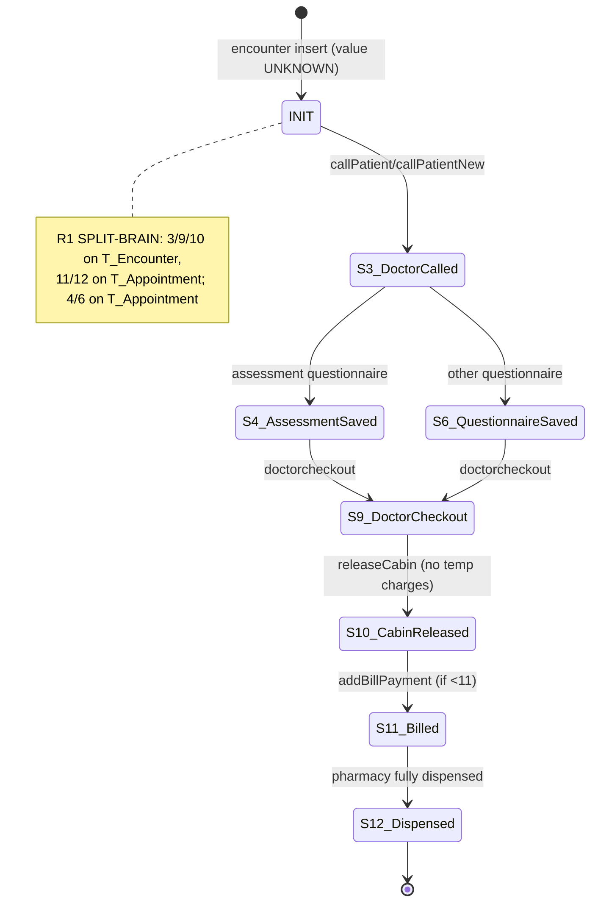
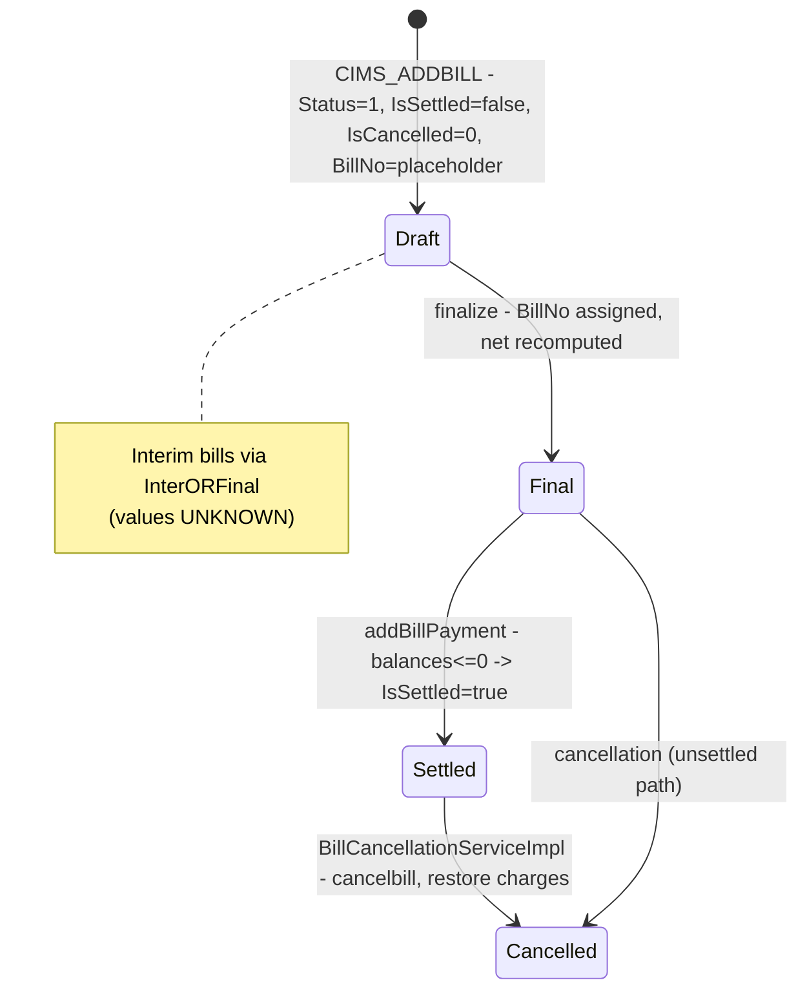
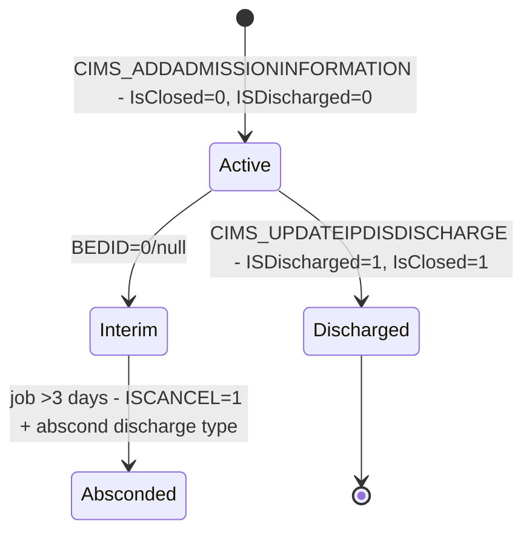
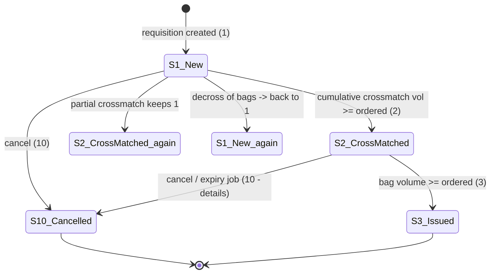
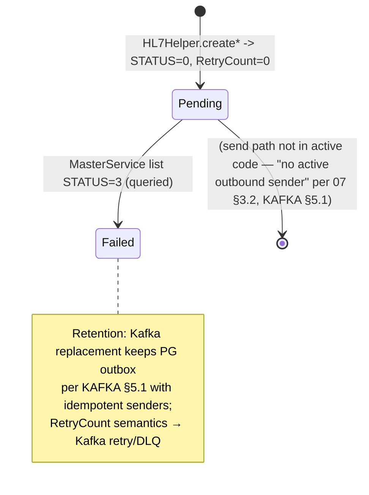
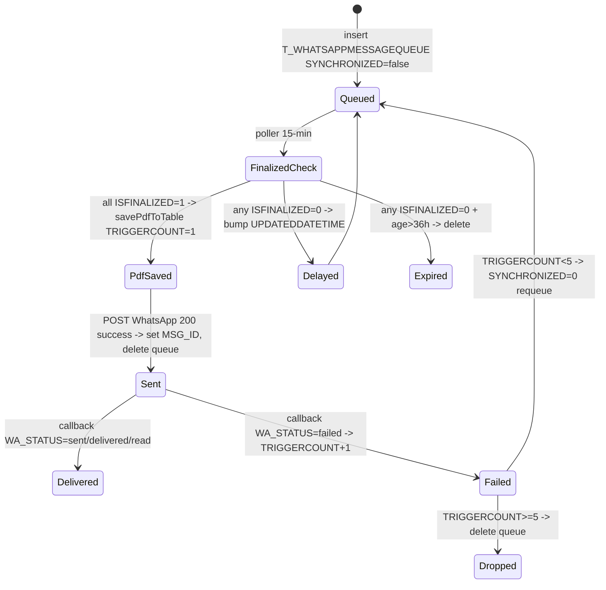
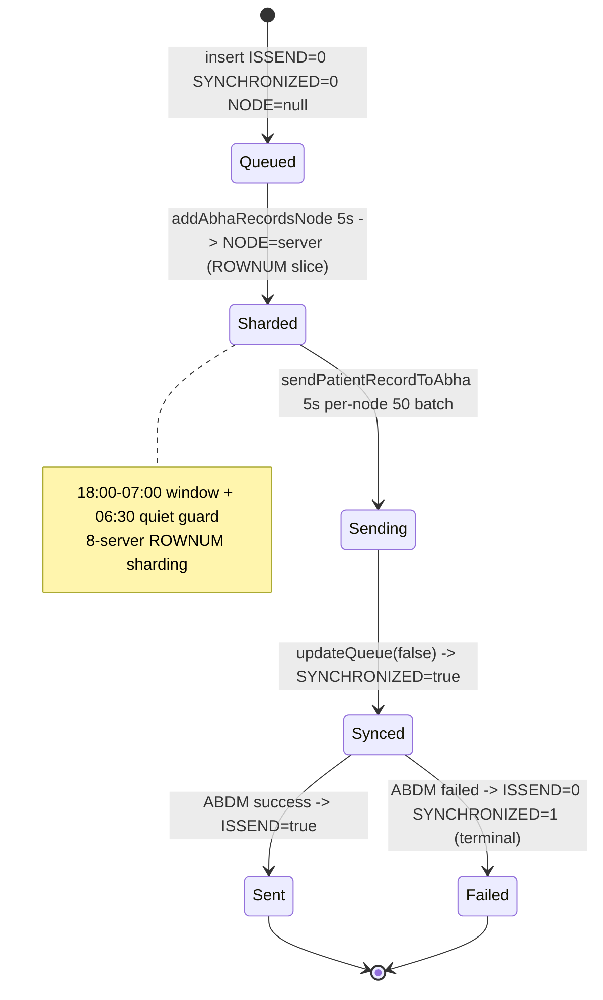

# STATUS CODE DICTIONARY (iHMS / OHUM PAS NG)

**Synthesized from:** `06-business-rules-catalog.md` §A (A1–A9) + `_discovery/agent-06/findings.md` §1.10 + workflow traces. Every numeric meaning is backed by code (constants / `setStatus` / SQL literals / proc defaults). **No meaning is guessed**: rows without code-level meaning are marked **UNKNOWN meaning** with the verification method required to pin them down.
**Conventions:** `→` = state transition direction (approximate; "Previous" = known sources that set the state to this code, "Next" = known destinations). R = risk reference from `_discovery/agent-06/findings.md`.

---

## 1. VisitStatus — `T_Encounter.VisitStatus` / `T_Appointment.VisitStatus`

> **Warning (RISK R1):** codes 3/9/10 are written to **T_Encounter**; codes 11/12 are written to **T_Appointment**. Same numeric space, two tables, different rows. Kiosk/queue reads the appointment side (`getLastVisitStatus`, `EmergencyAndWalkinVisitServiceImpl.java:1861-1866`).

| Entity | Column | Code | Meaning | Set where (file:line) | Previous | Next | Notes |
|---|---|---|---|---|---|---|---|
| T_Encounter | VisitStatus | 3 | Doctor called patient (consult started) | `updateCallPatientData` / `updateCallPatientDataNew` — `EmergencyAndWalkinVisitServiceImpl.java:2017,2363` | (initial) | 4, 6, 9… | ascending-only per findings §1.10 |
| T_Appointment | VisitStatus | 4 | Patient-assessment questionnaire saved | `QuetionnaireServiceImpl.java:107` | 3 | 6/9… | written on appointment side |
| T_Appointment | VisitStatus | 6 | Other (non-assessment) questionnaire saved | `QuetionnaireServiceImpl.java:109` | 3, 4 | 9… | |
| T_Encounter | VisitStatus | 9 | Doctor checkout / compound-med pre-visit RX | `updateDoctorCheckout` — `EmergencyAndWalkinVisitServiceImpl.java:2270,2351` | 3, 4, 6 | 10 | also set by compound-medication pre-visit prescription (`:2351`) |
| T_Encounter | VisitStatus | 10 | Cabin released (only when no pending temp charges — RISK R8) | `releaseCabin` — `EmergencyAndWalkinVisitServiceImpl.java:2146` | 9 | 11 (appointment side) | R8 gating |
| T_Appointment | VisitStatus | 11 | Bill paid / encounter checked out | `addBillPayment` — `AddPaymentServiceHelper.java:477,820` | <11 (only advances if <11) | 12 | kiosk/queue "billed" signal |
| T_Appointment | VisitStatus | 12 | Pharmacy fully dispensed for visit | `dispenseItemSale` — `MedicationServiceImpl.java:812` | 11 | (terminal) | only when no undispensed item sales remain |
| T_Encounter | VisitStatus | (initial) | **UNKNOWN meaning** — "initial value set by UI/DB default" (findings §1.10) | encounter insert (`CIMS_ADDENCOUNTER`-family / UI default) | — | 3… | **Verify:** inspect the encounter-insert SQL/entity default and DB row data for earliest-status distribution |
| T_Encounter | visitstatus2 | `"2"` | Default on walk-in visit (string column) | `addwalkinVisitNew` — `EmergencyAndWalkinVisitServiceImpl.java:1039` | — | `"9"` | string, not numeric |
| T_Encounter | visitstatus2 | `"9"` | Compound-medication visit | `addwalkinVisitNew` — `EmergencyAndWalkinVisitServiceImpl.java:1141` | `"2"` | — | |

---

## 2. Bill — `T_Bill`

| Entity | Column | Code | Meaning | Set where (file:line) | Previous | Next | Notes |
|---|---|---|---|---|---|---|---|
| T_Bill | Status | 1 | Active bill | `addservicecharge` — `AddServiceOrderServiceHelper.java:224` | — | (see states) | other numeric values **UNKNOWN meaning** — **verify:** `CIMS_ADDBILL.sql`/data for Status values ≠ 1 |
| T_Bill | IsSettled | false→true | Settled only when Self & NonSelf balances ≤ 0 | `addBillPayment` via `CIMS_UPDATEBILLFORCONCESSION` — `AddPaymentServiceHelper.java:438-463` | false | true | settlement is balance-driven, not payment-count-driven |
| T_Bill | IsCancelled | 0 | Insert default (not cancelled) | `CIMS_ADDBILL` proc default — `generated-procs/CIMS_ADDBILL.sql:87,129` | — | (cancellation) | values ≠ 0 **UNKNOWN meaning** — **verify:** proc set paths |
| T_Bill | cancelbill | (marker) | Bill cancellation marker | `BillCancellationServiceImpl` — `BillCancellationServiceImpl.java:455-467` | — | — | column values not enumerated |
| T_Bill | InterORFinal | (flag) | Interim vs final bill | `addservicecharge` — `AddServiceOrderServiceHelper.java:338` | — | — | values **UNKNOWN meaning** — **verify:** literals in finalize paths |
| T_Bill | IsPharmacy | 0 | Default non-pharmacy bill | proc default — `generated-procs/CIMS_ADDBILL.sql:13` | — | 1 (pharmacy bill) | |
| T_Bill | changeAmount | (amount) | Cash change recorded when `invstopdpostbilling` | `AddPaymentServiceHelper.java:480-506` | — | — | config-gated |

---

## 3. Charge — `T_Charges` / `T_CHARGES_TEMP`

| Entity | Column | Code | Meaning | Set where (file:line) | Previous | Next | Notes |
|---|---|---|---|---|---|---|---|
| T_Charges | IsBilled | true | Charge billed at finalize; `T_ITEMSALE.BillID` set | `AddServiceOrderServiceHelper.java:344-345,636` | false | true | |
| T_Charges | IsCancelled | true | Charge cancelled (removeCharge, bill cancel) | `AddServiceOrderServiceHelper.java:3862`; `BillCancellationServiceImpl.java:489` | false | true | |
| T_CHARGES_TEMP | IsTemp / table split | — | Un-consumed charges live in temp table | `AddServiceOrderServiceImpl.java:2233-2241` | — | T_Charges | consumed flag governs move |
| T_Charges | `*BeforeFinalization` | (snapshot) | Snapshot used to restore amounts on bill cancellation | `BillCancellationServiceImpl.java:488-509` | — | — | R6: missing snapshot breaks restore |
| T_Charges | Consumed | true | Direct (non-temp) charge, e.g. OT pre-billing | `AddServiceOrderServiceImpl.java:2202-2204` | — | — | BR-OT-002 |

---

## 4. Admission — `T_Admission` / `T_AdmissionDetails`

| Entity | Column | Code | Meaning | Set where (file:line) | Previous | Next | Notes |
|---|---|---|---|---|---|---|---|
| T_AdmissionDetails | ISDischarged | 0→1 | Discharge completed | `CIMS_UPDATEIPDISDISCHARGE` — `generated-procs/CIMS_UPDATEIPDISDISCHARGE.sql` | 0 | 1 | also closes T_TransferRequest |
| T_AdmissionDetails | IsClosed | `'0'`→`'1'` | Admission closed (char) | same proc | `'0'` | `'1'` | default 0 at insert |
| T_Admission | ISCANCEL | 1 | Auto-abscond (interim, no bed > 3 days) | `updateAbscondInterimAdmissionStatusJob` — `ApplicationJobs.java:1007-1016` | 0 | 1 | + DISCHARGETYPEID + ABSCONDDATETIME |
| T_Admission | BEDID | 0/null | Interim (un-bedded) admission marker | query predicate — `ApplicationJobs.java:1008` | — | bedId | also used in allocation checks |
| T_Discharge | IsDeath | (flag) | Death discharge | `PatientTransferDischargeServiceImpl.java:752-758` (type `IsExpired=1`) | — | — | proc also sets `T_Registration_Details.isdeath=1` (`CIMS_ADDBEDDISCHARGE.sql:24-41`) |
| T_Registration_Details | isdeath | 1 | Patient dead | `CIMS_ADDBEDDISCHARGE` proc; brought-dead registration (`PatientServiceHelper.java:825-829`) | 0 | 1 | |

---

## 5. Bed — `M_BedMaster`

| Entity | Column | Code | Meaning | Set where (file:line) | Previous | Next | Notes |
|---|---|---|---|---|---|---|---|
| M_BedMaster | OCCUPIED | false/true | Occupancy flag — atomic CAS update | admission/discharge/transfer — `PatientRegAdmissionServiceImpl.java:344`; `PatientTransferDischargeServiceImpl.java:789` | false | true | CAS: `UPDATE ... SET OCCUPIED=true WHERE OCCUPIED=false` |
| M_BedMaster | BedStatusId | 6 | Released (free after discharge/transfer) | discharge/transfer — `PatientTransferDischargeServiceImpl.java:790,3811,4162,5082,5186` | 0/… | 0 | **hard-coded literal — RISK R5** (master `isrelease` governs allocation) |
| M_BedMaster | BedStatusId | 0 | Reset to available | cancel/transfer ops — `PatientTransferDischargeServiceImpl.java:1074,1096,1102,3831` | 6 | — | |
| M_BedMaster | BedStatusId | 5 | Occupied/retained predicate | read query — `BedManagementServiceImpl.java:1859` | — | — | label **UNKNOWN meaning** — **verify:** M_BedStatusMaster seed data |
| M_BedMaster | BedStatusId | 1, 3 | Free-bed predicates | read queries — `BedManagementServiceImpl.java:1864,2763` | — | — | full label set **UNKNOWN meaning** — **verify:** M_BedStatusMaster seed data (values 2, 4, 7+ un-evidenced) |
| M_BedStatusMaster | isrelease | true/false | Governs whether status allows allocation | gate at admission — `PatientRegAdmissionServiceImpl.java:1293-1300` (BERB005) | — | — | master-data semantics |

---

## 6. Payment — `T_Payment.TransactionType` & payment modes

| Entity | Column | Code | Meaning | Set where (file:line) | Previous | Next | Notes |
|---|---|---|---|---|---|---|---|
| T_Payment | TransactionType | 2 | Bill payment | `AddPaymentServiceHelper.java:270` | — | — | |
| T_Payment | TransactionType | 3 | Advance refund | `AddRefundServiceImpl.java:89` | — | — | requires advance balance > 0 (`BEXAR002`) |
| T_Payment | TransactionType | 4 | Bill refund | `BillCancellationServiceImpl.java:347` | — | — | |
| T_Payment | TransactionType | 1 | **UNKNOWN meaning** | — | — | — | **Verify:** search all `transactionType` literals; only 2/3/4 evidenced |
| T_PaymentModeDetails | paymentModeId | 7 | Advance adjustment used as payment mode | `AddPaymentServiceHelper.java:317` | — | — | recorded via `CIMS_ADDPAYMENTADVANCEDETAILS` |
| T_PaymentModeDetails | paymentModeId | >1 | Non-cash mode — requires bankId/number | rule — `AddPaymentServiceHelper.java:367-374` | — | — | 0/null for cash; specific mode IDs (card/cheque/online) **UNKNOWN meaning** — **verify:** M_PAYMENTMODETYPE seed data |
| T_Payment | (mode amounts) | — | Modes capped at remaining bill amount | rule — `AddPaymentServiceHelper.java:376-384` | — | — | |

---

## 7. Blood requisition & bag — `T_PATIENTREQUISITION(DETAILS)`, `T_BLOODBAG`

| Entity | Column | Code | Meaning | Set where (file:line) | Previous | Next | Notes |
|---|---|---|---|---|---|---|---|
| T_PATIENTREQUISITION(DETAILS) | requisitionStatus | 1 | NEW / cross-match pending (or partial) | creation; re-opened by decross/expiry — `BloodBankServiceImpl.java:6302`; `ApplicationJobs.java:7675,804` | — | 2 | |
| T_PATIENTREQUISITION | requisitionStatus | 2 | Fully cross-matched (cum. vol ≥ ordered vol) | `updateRequisitionStatus` — `BloodBankServiceImpl.java:6302` | 1 | 3 | volume-based, not count-based |
| T_PATIENTREQUISITION | requisitionStatus | 3 | Fully issued (bag vol ≥ ordered vol) | `updateRequisitionStatus` — `BloodBankServiceImpl.java:6312` | 2 | — | |
| T_PATIENTREQUISITION | requisitionStatus | 10 | Cancelled / expired | cancel; `updateExpiredBloodRequisitionStatusJob` — `BloodBankConstants.java:33`; `ApplicationJobs.java:743` | 1, 2 | — | **R7 asymmetry:** job writes *details* 10; header 10 constant only used at creation/cancel |
| T_PATIENTREQUISITIONDETAILS | requisitionStatus | 10 | Expired (job path) | `ApplicationJobs.java:743` | 1 | — | + `isorderexpired=true`, reason "Order is expired" |
| T_BLOODBAG | isbagexpired | true | Expired on expiry date | `updateExpiryStatusOfTheBloodBagsJob` (23:00 daily) — `ApplicationJobs.java:785` | false | true | issued bags skipped |
| T_BLOODBAG | crosSMatched | false | Auto-decrosed after 2880 min | `decrossBloodBag` (daily 00:00) — `ApplicationJobs.java:1055`; `BloodBankServiceImpl.java:7666-7667` | true | false | requisition back to 1 |
| T_BLOODBAG | (issue filters) | — | Issuable = `isreserved=false, isbagextracted=false, isdiscard=false, isdiscarded=false, isissued=false, istested=true, iscrossmatched=false` | read query — `BloodBankServiceImpl.java:2273-2277` | — | — | predicate set |
| T_BLOODBAGDECROSS | reason | 0 | Decross reason (auto-decross) | `ApplicationJobs.java:1061` | — | — | other reason codes **UNKNOWN meaning** — **verify:** M_BLOODDISCARDREASON/decross masters |

---

## 8. Donor — `BloodDonorRegistration(details).donationStatus` (`BloodBankConstants.java:8-17`)

| Entity | Column | Code | Meaning | Set where (file:line) | Previous | Next | Notes |
|---|---|---|---|---|---|---|---|
| T_BLOODDONORREGISTRATION | donationStatus | 1 | DNR_NEW — new registration | registration | — | 2/3/7 | |
| T_BLOODDONORREGISTRATION | donationStatus | 2 | DNR_FIT — fit (med exam ok) | medical exam | 1 | 4 | |
| T_BLOODDONORREGISTRATION | donationStatus | 3 | DNR_UNFIT — **also DNR_VOLUNTORY (same literal!)** | medical exam / registration type | 1, 2 | 5 | **collision — ambiguous in reports/audit (06 C.3)** |
| T_BLOODDONORREGISTRATION | donationStatus | 4 | DNR_ACCEPTED — accepted | after fit + screening | 2 | 5/7/10/11 | |
| T_BLOODDONORREGISTRATION | donationStatus | 5 | DNR_REJECTED **and** DNR_DONATED — **collision** | rejection / post-donation | 4 | — | **RISK: one code, two meanings (06 C.3)** |
| T_BLOODDONORREGISTRATION | donationStatus | 7 | DNR_CANCELLATION — cancelled (incl. auto-cancel of inactive donors) | `donor.cancellation.schedule` job — `ApplicationJobs.java:832-848`; manual | 1, 2 | — | 72h no-action rule (BR-BLD-005) |
| T_BLOODDONORREGISTRATION | donationStatus | 10 | DNR_PERM_UNFIT — permanently unfit | medical exam | 2 | — | |
| T_BLOODDONORREGISTRATION | donationStatus | 11 | DNR_TEMP_UNFIT — temporarily unfit | medical exam | 2 | — | |
| T_BLOODDONORREGISTRATION | donationStatus | 6, 8, 9 | **UNKNOWN meaning** | — | — | — | **Verify:** `BloodBankConstants.java` full list + donor seed data; only 1,2,3,4,5,7,10,11 evidenced |

---

## 9. Other enums & GST (`GenericConstants.java:47-188`, `BaseServiceImpl.java:521-533`)

### Authorization (payor/insurance) — `GenericConstants.java:47-60`
| Code | Meaning |
|---|---|
| 0 | ACCEPTED |
| 1 | APPROVED |
| 2 | PARTIALAPPROVED |
| 3 | REJECTED |
| 4 | FAILED |
| 5 | NEW |
| 6 | CANCEL |
| 7 | SUBMITTED |
| 8 | QUERIED |

### Medication order / patient medication — `GenericConstants.java:167-188`
| Entity group | Code | Meaning | Note |
|---|---|---|---|
| Medication order | 1 | ACTIVE | "not referenced in services — consumed by integrations/EHR side" (findings §1.10) |
| Medication order | 2 | DISCONTINUE | |
| Medication order | 3 | EXPIRED | |
| Patient medication | 1 | ORDERED | |
| Patient medication | 2 | TAKEN | |
| Patient medication | 3 | MISSED | |
| Patient medication | 4 | SKIPPED | |

### NHCX — `GenericConstants.java`
| Group | Code | Meaning |
|---|---|---|
| Request type | 0..4 | INSURANCEPLAN..COMMUNICATION (individual labels not enumerated in evidence) |
| Request status | 0 | ACCEPTED |
| Request status | 1..2 | (intermediate states — exact labels not evidenced) |
| Request status | 3 | FAILED |

### GST applicability — `BaseServiceImpl.java:521-533`
| Condition | Meaning |
|---|---|
| `isGSTApplicable=true` (property) AND transDate ≥ `2017-07-01 00:00:00` | GST applies; tax engine active (BR-BILL-004) |

---

## 10. Interop queues — `T_OUTBOUNDHIS`, `T_WHATSAPPMESSAGEQUEUE`/`T_WHATSAPPMESSAGESTATUS`, `T_ABDMREQUESTQUEUE`

> Closes DISCOVERY-GAPS.md G-05. Each queue's semantics are evidenced by entity defaults + job/poller literals; Kafka replacements per `KAFKA-EVENT-CATALOG.md` §5.1. No meanings guessed — values without writer evidence are marked **UNKNOWN**.

### 10.1 `T_OUTBOUNDHIS` — HL7/EHR outbox (`STATUS` + `RetryCount`, 47 refs per `05 §3.2`)

Entity: `com.ohum.models.transactionals.Outboundhis.java:29` (`@Table T_OUTBOUNDHIS`) — `STATUS Long :69`, `RetryCount Long =0 :66`, `SYNCHRONIZED Boolean =false :78`, `MSGID` PK. Referenced in `HL7Helper.java` (22 create-sites), `MasterServiceImpl.java:699-700`, `BaseServiceImpl.java:713`, `05-database-catalog.md:62-65`.

| Column | Code/Value | Meaning | Set where (file:line) | Next | Notes |
|---|---|---|---|---|---|
| STATUS | 0 | Pending / new message | `HL7Helper.java:473,732,1067,1395,1557,1779,1985,2165,2390,2786,3124,3442,3649,3870,4060,4154,4432,4690,4938,5174,5424,5634` (all 22 `create*HL7Message` set `setStatus(0L)`) + `MasterServiceImpl.java:746` `saveOutboundById` | 3? | initial on every create |
| STATUS | 3 | Failed / needs resend (UI list filter) | read query `MasterServiceImpl.java:699-700` `WHERE status=:status` with `status=3` | — | no writer for 1/2 evidenced → **UNKNOWN** |
| RetryCount | 0 | Initial (never retried) | entity default `Outboundhis.java:67` + all creates leave `0` | — | **UNKNOWN** increment path — no `setRetryCount(n>0)` found; column exists but writer not evidenced |
| SYNCHRONIZED | false→? | Outbox sync flag | entity default `false` `:78` | — | transition to `true` not evidenced in current code; job `EHRSyncJobs.java` operates on separate `IHMSDOCITTMP` tmp tables, not `T_OUTBOUNDHIS` |

Kafka mapping: `KAFKA-EVENT-CATALOG.md:245` — `T_OUTBOUNDHIS` retained as PG outbox with idempotent senders; `RetryCount` → Kafka retry config + DLQ; Interop consumes domain events (E-01..E-04) → writes outbox → sends HL7.

### 10.2 `T_WHATSAPPMESSAGEQUEUE` + `T_WHATSAPPMESSAGESTATUS` — WhatsApp lab reports (15-min poll, max-trigger 5)

Entities: `WhatsappMessageQueue.java:22` (`T_WHATSAPPMESSAGEQUEUE`, `extends MBase`, cols `PATIENTID, OPD_IPD_ID, BILLID, OPD_IPD, ISOUTSOURCE, CATEGORYID, MSG_ID` + `SYNCHRONIZED`) and `WhatsappMessageStatus.java:21` (`T_WHATSAPPMESSAGESTATUS`, `TRIGGERCOUNT=0L :62`, `MSG_ID, MOBILENO, FILENAME, REPORT, WHATSAPPMESSAGEQUEUEID, WA_STATUS, WAMID, ERROR_MSG`).

**Poller:** `ApplicationJobs.java:1598` `@Scheduled(cron="0 0/15 0-6,14-23 * * ?")` `triggerWhatsappReportsInQueue()` → `1615` `SELECT id FROM T_WHATSAPPMESSAGEQUEUE WHERE SYNCHRONIZED=false ORDER BY UPDATEDDATETIME ASC` paginate 100, loop capped 480s (`1637`), gated on `Unitmaster.enableWhatsApp` (`1601-1602`). Only when `14:00-23:59` or `00:00-06:59` (KAFKA §5.1 window).

**Per-queue processing:** `PathoOrderServiceHelper.java:1130` `sendCategoryWiseReportOnWhatsApp()` — checks `ISFINALIZED` via `1134` join; if any `ISFINALIZED=0`, either delete queue if `UPDATEDDATETIME` older than 36h (`1234-1236`) else bump `UPDATEDDATETIME` (`1239-1240`); if all finalized, `CommonUtilServiceImpl.java:6067` `savePdfToTable()` creates `WhatsappMessageStatus` with `TRIGGERCOUNT=1` (`6080`), `FILENAME`, `REPORT` bytes, `WHATSAPPMESSAGEQUEUEID`, then `IntegrationServiceImpl.java:1282-1320` `sendCertificateOnwhatsapp*` POSTs to `whatsAppUrl`; on HTTP 200+`status=success` + `msg_id`, updates `T_WHATSAPPMESSAGESTATUS.MSG_ID` (`1313`) and deletes queue (`1320`).

| Table. Column | Value | Meaning | Set where | Next | Notes |
|---|---|---|---|---|---|
| T_WHATSAPPMESSAGEQUEUE.SYNCHRONIZED | false | Queued / pending send | insert via `WhatsappMessageQueue` ctor (`PathoOrderServiceHelper.java:3924` `new WhatsappMessageQueue(patientId,opdIpdId,billId,opdIpd,isOutsource,categoryId)`, `AddServiceOrderServiceHelper.java:3924`) | true/delete | false is the poll predicate |
| T_WHATSAPPMESSAGEQUEUE.SYNCHRONIZED | true (commented) | Would mark sent | commented out `IntegrationServiceImpl.java:1318` `SYNCHRONIZED=true` | — | actual path deletes row instead of flipping |
| T_WHATSAPPMESSAGESTATUS.TRIGGERCOUNT | 1 | First attempt saved | `CommonUtilServiceImpl.java:6080` | 2..5 | |
| T_WHATSAPPMESSAGESTATUS.TRIGGERCOUNT | n→n+1 | Retry on WhatsApp `failed` callback | `IntegrationServiceImpl.java:1504` | delete vs requeue | guard `if(triggerCount.compareTo(wams.getTriggerCount()) >=0)` `:1498` |
| T_WHATSAPPMESSAGESTATUS.WA_STATUS | `sent`/`delivered`/`read` etc. | WhatsApp delivery state | `IntegrationServiceImpl.java:1484` `setWaStatus(status)` | — | from `WhatsAppBusinessAccountPayload.status` `:1473` |
| T_WHATSAPPMESSAGESTATUS.WA_STATUS | `failed` | Send failed — triggers retry logic | `:1492-1507` | requeue or drop | requeues `SYNCHRONIZED=0` `:1506` if `triggerCount < max`, else deletes `:1510` |
| T_WHATSAPPMESSAGEQUEUE catch (36h) | `UPDATEDDATETIME` age >36h | Stale queue expiry | `PathoOrderServiceHelper.java:1234` | delete | avoids infinite requeue when results never finalize |

Max-trigger: `whatsApp.max.trigger.count=5` (`artifacts/risl/application.properties:507`, `application.properties:1130`, injected at `IntegrationServiceImpl.java:181`, `ApplicationJobs.java:209`).

Kafka mapping: `KAFKA-EVENT-CATALOG.md:243` — `lab-result-finalized` + `invoice-generated` topics replace poller; Interop consumer generates PDF + calls WhatsApp API; max-trigger 5 → retry×5 + DLQ; quiet-hours window → consumer quiet-hours filter.

### 10.3 `T_ABDMREQUESTQUEUE` — ABDM consent/record push (5-s poll, 8-node sharding)

Entity: `ABDMRequestQueue.java:29` (`T_ABDMREQUESTQUEUE`, `extends MBase`, cols `PATIENTID, OPDIPD, OPDIPDID, REF_ID, HITYPESJSON, SENDALL=false, ABDMHFRID, ISSEND=false :55, NODE null :60, ERROR`).

**Shard assigner:** `ApplicationJobs.java:1658` `@Scheduled(fixedDelay=5000)` `addAbhaRecordsNode()` — guard `!isBetweenTimeRange()` → return (`1662`, window `18:00-07:00` per `1645`); query `1665` `SELECT count(*) FROM T_ABDMREQUESTQUEUE WHERE ISSEND=0 AND SYNCHRONIZED=0 AND NODE IS NULL AND ADDEDDATETIME < TRUNC(SYSDATE)`; splits `count` across `abdmServers` (`1668` `split(",")`, 8 servers) via `1678` `UPDATE SET NODE='server' WHERE ... AND ROWNUM <= assignCount`.

**Sender:** `ApplicationJobs.java:1685` `@Scheduled(fixedDelay=5000)` `sendPatientRecordToAbha()` — guards `isBetweenTimeRange` / `isNearingEnd 06:30-07:00` (`1688-1703`, plus `disableAutoDemoAuth` flag); query `1705` `SELECT q FROM ABDMRequestQueue q WHERE q.isSend=false AND q.synchronizedd=false AND q.node=:node ORDER BY q.id DESC` paginate 50; per queue `abdmUtil.updatePatientRecordQueue(q,false)` (`1713`) → `CommonABDMUtil.java:2661` `setSynchronizedd(true)` pre-send; then `abhaServiceImpl.patientRecordSendToAbha` (`1714`); on `res=true` → `updatePatientRecordQueue(q,true)` → `2659` `setIsSend(true)`.

| Table. Column | Value | Meaning | Set where | Next | Notes |
|---|---|---|---|---|---|
| ISSEND | false | Not yet sent | entity default `ABDMRequestQueue.java:57` | true | poll predicate |
| SYNCHRONIZED | false | Not yet sharded/processing | `MBase` default | true | shard+send guard |
| NODE | null | Unsharded | default null `:60` | `<server>` | `addAbhaRecordsNode` assigns via ROWNUM |
| NODE | `<abdmServers[i]>` | Sharded to server | `ApplicationJobs.java:1678` | — | 8 servers, lowercased |
| ISSEND | true | ABDM linked successfully | `CommonABDMUtil.java:2659` | terminal | via `sendPatientRecordToAbha` success |
| SYNCHRONIZED | true | Processing/failure terminal | `CommonABDMUtil.java:2661` | — | pre-send flip; on failure left `ISSEND=false` + `SYNCHRONIZED=true` → no requeue (verified behavior) |

Kafka mapping: `KAFKA-EVENT-CATALOG.md:244` — `patient-registered`/`patient-admitted` + domain events replace poller; node sharding → Kafka consumer groups (partitions replace server sharding); Redis correlation keys `ABDM_REQ_/ABDM_RES_` stay as Interop state store.

---

## Unresolved / verification checklist
| Item | Status | Verification method |
|---|---|---|
| Initial T_Encounter.VisitStatus value | UNKNOWN | encounter-insert SQL/entity default; DB earliest-status distribution |
| T_Bill.Status values ≠ 1 | UNKNOWN | `CIMS_ADDBILL.sql` + bill table data |
| T_Bill.InterORFinal values | UNKNOWN | finalize/interim literals in `AddServiceOrderServiceHelper` |
| BedStatusId full label set (1,3,5 + un-evidenced 2,4,7…) | UNKNOWN | M_BedStatusMaster seed data (labels are master data, not code) |
| T_Payment.TransactionType = 1 | UNKNOWN | all `transactionType` literals (only 2/3/4 found) |
| Payment mode IDs for card/cheque/online | UNKNOWN | M_PAYMENTMODETYPE seed data |
| Donor statuses 6, 8, 9 | UNKNOWN | `BloodBankConstants.java` + donor seed data |
| NHCX request status 1–2 labels | UNKNOWN | `GenericConstants.java` NHCX block |
| T_TRANSFERREQUEST status values | UNKNOWN | transfer request seed/status literals (only `IsClosed='1'` evidenced) |
| Prescription/nursing/task status code lists | UNKNOWN | DB seed scripts — flagged in 02-business-module-catalog.md:701 ("UNKNOWN-14 code lists") |
| Inventory indent/PO/GRN status codes | UNKNOWN | DB seed scripts (agent-06 did not cover inventory) |
| T_OUTBOUNDHIS.STATUS values 1,2 (and RetryCount increment) | UNKNOWN | writers for STATUS=1/2 + RetryCount increment not found; verify via HL7 send-job + DB data distribution (only 0 and queried 3 evidenced) |
| T_WHATSAPPMESSAGEQUEUE.STATUS (MBase) + T_WHATSAPPMESSAGESTATUS.WA_STATUS full enum | PARTIAL | WA_STATUS `failed` vs `sent/delivered/read` evidenced; full WhatsApp callback enum from `WhatsAppBusinessAccountPayload` needs seed/callback log |
| T_ABDMREQUESTQUEUE ISSEND/SYNCHRONIZED terminal-failure no-requeue | VERIFIED (no requeue on failure) | `CommonABDMUtil.java:2661` pre-send SYNCHRONIZED=true + ISSEND stays false = terminal; confirm intended vs bug via DB queue depth sampling |
