# C1 — System Context: iHMS / OHUM PAS NG

> **Document type:** C4 Level 1 (System Context) — synthesized from existing discovery docs (no new code exploration).
> **Inputs:** `01-system-landscape.md`, `_discovery/agent-01/findings.md`, `07-integrations-and-search.md` (§3), `08-security-rbac-audit.md`, `02-business-module-catalog.md`, `10-target-architecture.md` (TO-BE).
> **Status:** AS-IS evidence-based; TO-BE sections marked **PRELIMINARY**.

---

## 1. Purpose

Describe the iHMS system as a single box: who interacts with it (human actors) and which external systems it depends on (28+ documented integrations), for both the AS-IS monolith and the preliminary TO-BE service landscape.

**System in one line (AS-IS):** a single-module Spring Boot 2.7.5 / Java 8 monolith serving a FAUG (framework-driven) jQuery SPA from its own classpath, exposing ~3,000 REST endpoints through one CXF JAX-RS bus (`/IHMS/api/rest/**`), backed by Oracle + 719 stored procedures, Solr Cloud search, and a Redis/in-memory cache — deployed for the Government of Rajasthan (RISL overlay: SSO, Jan-Aadhaar, Bhamashah, ABDM, e-Aushadhi).

**System in one line (TO-BE, PRELIMINARY):** a React SPA behind an API Gateway fronting ~29 candidate microservices (schema-per-service PostgreSQL), event-driven via Kafka, retaining Solr as the search backbone and Redis as cache-only.

---

## 2. AS-IS Context Diagram (C1)

```mermaid
flowchart TB
    subgraph Actors["Human Actors (roles)"]
        A1["Registration Clerk"]
        A2["Front Office / Appointment Desk"]
        A3["Doctor"]
        A4["Nurse / Ward In-charge"]
        A5["Pharmacist / Dispensing Clerk"]
        A6["Lab Technician / Pathologist"]
        A7["Radiologist / Rad Technician"]
        A8["Cashier / Billing Officer"]
        A9["Accountant / Finance (RMRS)"]
        A10["Store In-charge / Purchase Officer"]
        A11["Blood Bank Officer"]
        A12["CSSD / OT Staff"]
        A13["Dietician / Kitchen Staff"]
        A14["Grievance Officer / Social Worker"]
        A15["Maintenance / Biomedical Engineer"]
        A16["System Admin"]
        A17["Patient (portal / kiosk / mobile)"]
        A18["ASHA / ANM Field Worker (EJS)"]
        A19["RCM Officer / Nodal Officer"]
        A20["MRD Clerk"]
    end

    subgraph Sys["iHMS / OHUM PAS NG (AS-IS)"]
        M["Spring Boot 2.7.5 monolith (JAR or WAR)
            CXF JAX-RS @ /IHMS/api/rest/**
            FAUG SPA served from classpath:/public/
            3,003 REST endpoints | 132 service classes"]
    end

    subgraph Ext["External Systems & Infrastructure"]
        E1["ABDM Gateway (ABHA/HIP/HIU/HPR/PHR/HFR)"]
        E2["HCX / NHCX (insurance claims)"]
        E3["Aadhaar / Janaadhaar / Biometric RD"]
        E4["eSanchar SMS / OTP / WhatsApp"]
        E5["Rajasthan SSO + LDAP/AD (10.10.5.71:636)"]
        E6["e-Mitra (online appointments)"]
        E7["Chiranjeevi Yojana"]
        E8["RGHS + SIMS"]
        E9["e-Aushadhi / RMSC + Kaysons"]
        E10["EMR/EHR openMDWS (EWD)"]
        E11["HL7 equipment (KDL lab, Backman DxH500)"]
        E12["Print server (ws://localhost:8182)"]
        E13["MinIO object storage (disabled)"]
        E14["eSign C-DAC (unwired)"]
        E15["eRaktkosh / PCTS / NMC"]
        E16["Jeevanvahini 108 / Mera Aspataal"]
        E17["Bhamashah / Janta (MDM)"]
        E18["Rule engine (Node, localhost:8000)"]
        E19["Oracle 12.1 (10.10.7.63:1521/orcl)"]
        E20["SolrCloud 7.5.0 (3 nodes, ZK 10.10.5.151-153)"]
        E21["Redis (oracle.sms:6379 / cluster)"]
        E22["Scan/print app (localhost:4443)"]
    end

    A1 --- Sys
    A2 --- Sys
    A3 --- Sys
    A4 --- Sys
    A5 --- Sys
    A6 --- Sys
    A7 --- Sys
    A8 --- Sys
    A9 --- Sys
    A10 --- Sys
    A11 --- Sys
    A12 --- Sys
    A13 --- Sys
    A14 --- Sys
    A15 --- Sys
    A16 --- Sys
    A17 --- Sys
    A18 --- Sys
    A19 --- Sys
    A20 --- Sys

    Sys --- E1
    Sys --- E2
    Sys --- E3
    Sys --- E4
    Sys --- E5
    Sys --- E6
    Sys --- E7
    Sys --- E8
    Sys --- E9
    Sys --- E10
    Sys --- E11
    Sys --- E12
    Sys --- E13
    Sys --- E14
    Sys --- E15
    Sys --- E16
    Sys --- E17
    Sys --- E18
    Sys --- E19
    Sys --- E20
    Sys --- E21
    Sys --- E22
```

### 2.1 Human actors (AS-IS)

Actors are role names evidenced in code/UI config; the actual role list is DB-driven (`T_USERROLEMASTER`), with ~30 names referenced in code (`08-security-rbac-audit.md` §4.1). Backend authorization is **authentication-only** — RBAC lives in the frontend (`data-roleM` keys).

| # | Actor | Interacts via | Primary modules (M-codes) |
|---|---|---|---|
| 1 | Registration clerk | Browser SPA | M01 Patient, M31 Kiosk |
| 2 | Front office / appointment desk | Browser SPA | M02 OPD, M27 Queue |
| 3 | Doctor | Browser SPA, mobile (ohumlite) | M08 Orders, M40 TIU forms, M12 OT, M28 Death |
| 4 | Nurse / ward in-charge | Browser SPA, BCMA scanner | M09 Nursing, M26 Worklist, M30 BCMA, M03 IPD |
| 5 | Pharmacist / dispensing clerk | Browser SPA | M07 Pharmacy, M13 Inventory |
| 6 | Lab technician / pathologist | Browser SPA + KDL instruments | M15 Pathology, M16 Radiology |
| 7 | Radiologist | Browser SPA | M16 Radiology |
| 8 | Cashier / billing officer | Browser SPA | M04 Billing, M06 Doctor Share |
| 9 | Accountant / finance | Browser SPA | M23 RMRS, M33 Payment Transfer, M04 |
| 10 | Store in-charge / purchase officer | Browser SPA | M13 Inventory, M14 Procurement, M20 Equipment |
| 11 | Blood bank officer | Browser SPA | M17 Blood Bank |
| 12 | CSSD / OT staff | Browser SPA | M11 CSSD, M12 OT |
| 13 | Dietician / kitchen | Browser SPA | M10 Diet |
| 14 | Grievance officer / social worker | Browser SPA | M22 Grievance, M01 (social worker) |
| 15 | Maintenance / biomedical engineer | Browser SPA | M20 Equipment, M21 Transport |
| 16 | System admin | Browser SPA | M35 Users/roles, M39 Commons |
| 17 | Patient | kiosk, ohumlite (offline mobile), patportal (patient portal — absent from repo), WhatsApp | M31 Kiosk, M02 self-appointment, ABDM PHR |
| 18 | ASHA/ANM field worker | EJS field app | M36 EJS |
| 19 | RCM / nodal officer | Browser SPA | M32 RCM, M38 Integrations |
| 20 | MRD clerk | Browser SPA | M24 PMRD |

Evidence: `02-business-module-catalog.md` (per-module "Actors"), `08-security-rbac-audit.md` §4.1, `01-system-landscape.md` §5 (ohumlite/patportal).

### 2.2 External systems & infrastructure (AS-IS)

| # | System | Direction | Protocol / trigger | Status | Evidence |
|---|---|---|---|---|---|
| 1 | ABDM Gateway (ABHA/HIP/HIU/HPR/PHR/HFR/CM) | Both | HTTPS REST + JWE/JWS, FHIR R4, callbacks; ~50 endpoints, 8 async jobs, Redis correlation + `T_ABDMREQUESTQUEUE` pollers (5s) | Active (sandbox+prod configs) | 07 §3.1#1 |
| 2 | HCX / NHCX (claims, pre-auth) | Out + callbacks | HTTPS REST, JWE (nimbus-jose-jwt) | Active | 07 §3.1#2 |
| 3 | Aadhaar / Janaadhaar / biometric RD | Out | HTTPS REST + local RD device HTTP | Active | 07 §3.1#3 |
| 4 | eSanchar (SMS/OTP/WhatsApp) | Out | HTTPS REST + `T_WHATSAPPMESSAGEQUEUE` poller (15 min window) | Active | 07 §3.1#15 |
| 5 | Rajasthan SSO | In | SOAP token lookup via SSOAuthFilter → local opaque token | Active | 08 §2.2; 07 §3.1#16 |
| 6 | LDAP/AD | Out | UnboundID, `ldap.auth.enabled=false` — **not active** | Inactive (shipped) | 08 §2.2 |
| 7 | e-Mitra | Both | HTTPS REST + AES, kiosk appointments | Active | 07 §3.1#4 |
| 8 | Chiranjeevi Yojana | Out | HTTPS REST (INSURANCESCHEMEID=2) | Active | 07 §3.1#6 |
| 9 | RGHS + SIMS | Both | HTTPS REST, scheduled + eligibility | Active | 07 §3.1#7 |
| 10 | e-Aushadhi / RMSC (+ Kaysons wholesaler) | Both | HTTPS REST (SOAP-style, Basic auth), indent lifecycle + stock sync | Active | 07 §3.1#8, #24 |
| 11 | EMR/EHR openMDWS (EWD) | Out | File-based + REST, `ehr.sync.schedule` **currently disabled** | Dormant | 07 §3.1#9 |
| 12 | HL7 v2.x equipment (KDL, Backman DxH500, CPOE/Pyxis) | Both | HAPI v2.5 via DB queue (`T_INBOUNDHIS`/`T_OUTBOUNDHIS`); inbound pickup **disabled** | Dormant in checked-in config | 07 §3.1#10 |
| 13 | Print server | Out | WebSocket `ws://localhost:8182`, qz-tray signing | Active | 07 §3.1#17 |
| 14 | MinIO (S3) | Out | S3 SDK, `minio.enabled=false` → filesystem fallback | Disabled by default | 07 §3.1#13 |
| 15 | eSign (C-DAC) | Out | HTTPS REST — **no Java caller found** | Unwired | 07 §3.1#14 |
| 16 | eRaktkosh (blood bank) | Out | HTTPS REST, scheduled nightly | Active | 07 §3.1#21 |
| 17 | PCTS / NMC / EXT LIMS (state reporting) | Out | SOAP/REST/DB staging, scheduled (PCTS monthly, NMC nightly, EXT LIMS disabled) | Mixed | 07 §3.1#22,#23,#28 |
| 18 | Jeevanvahini (108 ambulance) | Both | HTTPS REST, emergency case push/fetch | Active | 07 §3.1#19 |
| 19 | Mera Aspataal | Out | batch export, feedback window | Active | 07 §3.1#20 |
| 20 | Bhamashah (scheme DB) | Out | HTTPS REST, patient lookup | Active | 07 §3.1#26 |
| 21 | Janta / MDM master data | Out | REST (MdmServiceImpl) | Active | 07 §3.1; 02 M38 |
| 22 | eUpkaran (lab equipment) | Out | REST | Active | 07 §3.1#27 |
| 23 | Rule engine (`ruler/`) | Out | Node HTTP + ioredis, `rules.engine.url=localhost:8000` | Dev tool | 01 §6 |
| 24 | Scan/print app | Out | HTTPS local `localhost:4443` | Active | 07 §3.1#25 |
| 25 | Oracle 12.1 | Backend | JDBC thin `10.10.7.63:1521/orcl` (QA) / JNDI `jdbc/orcl` (WAR) | Backbone | 01 §3.2 |
| 26 | SolrCloud 7.5.0 | Backend | 3 nodes, ZK 10.10.5.151-153; 6 collections (5 live) | **Load-bearing** | 07 §1 |
| 27 | Redis | Backend | standalone `oracle.sms:6379` or 6-node cluster; prefix `risl_2233` | Ambiguous impl (MemoryCacheImpl checked in) | 07 §2 |
| 28 | TIUXML file exchange | Out | XML templates → files (tele-ICU/CPRS documents) | Active | 07 §3.1#12 |
| 29 | Embedded FHIR server (HAPI R4) | In/out | FHIR R4, `genFhirServer` bean — **no servlet registration found** | Dormant flag | 04 §1, §9 |

### 2.3 Context risks (AS-IS, evidence-first)

1. **28+ integration points, several dormant** (HL7 inbound, EHR sync, eSign, EXT LIMS) create false operational expectations (`07-integrations-and-search.md` §3.3).
2. **Synchronous remote calls inside DB transactions** — Solr writes, HL7 outbound persistence, e-Mitra/Aadhaar lookups block the primary flow (`07` §3.3).
3. **Secrets in plaintext** across `application.properties`/pom.xml and hard-coded auth tokens (eAushadhi Basic auth, WhatsApp keys, SIMS AuthKey, SSO mobile key) (`07` §3.3; `08` §9).
4. **Frontend-only RBAC + no password verification** — context boundary has no server-side authorization (`08` §3, §7).

---

## 3. TO-BE Context Diagram (C1) — PRELIMINARY

```mermaid
flowchart TB
    subgraph Actors2["Human Actors (roles — unchanged from AS-IS)"]
        B1["Registration Clerk"]
        B2["Front Office"]
        B3["Doctor"]
        B4["Nurse"]
        B5["Pharmacist"]
        B6["Lab Technician"]
        B7["Radiologist"]
        B8["Cashier / Billing"]
        B9["Finance / RMRS"]
        B10["Store / Purchase"]
        B11["Blood Bank Officer"]
        B12["OT / CSSD Staff"]
        B13["Dietician"]
        B14["Grievance / Social Worker"]
        B15["Bio-Medical Engineer"]
        B16["System Admin"]
        B17["Patient (portal / kiosk / mobile)"]
        B18["ASHA / ANM (EJS)"]
        B19["RCM Officer"]
        B20["MRD Clerk"]
    end

    subgraph Sys2["iHMS (TO-BE, PRELIMINARY)"]
        G["API Gateway
            (authN, rate-limit, routing)"]
        SVC["~29 microservices (candidate)
            schema-per-service PostgreSQL"]
        K["Kafka event backbone"]
        SE["Solr search pipeline service"]
    end

    subgraph Ext2["External Systems (retained)"]
        F1["ABDM Gateway"]
        F2["HCX / NHCX"]
        F3["Aadhaar / Janaadhaar"]
        F4["eSanchar SMS/WhatsApp"]
        F5["Rajasthan SSO + LDAP/AD"]
        F6["e-Mitra"]
        F7["Chiranjeevi"]
        F8["RGHS + SIMS"]
        F9["e-Aushadhi / RMSC"]
        F10["EMR/EHR"]
        F11["HL7 equipment"]
        F12["Print server"]
        F13["MinIO"]
        F14["eSign"]
        F15["eRaktkosh / PCTS / NMC"]
        F16["Jeevanvahini / Mera Aspataal"]
        F17["Bhamashah / Janta"]
        F18["PostgreSQL"]
        F19["Redis (cache only)"]
        F20["Kafka cluster"]
        F21["Solr 9.x"]
    end

    B1 --- Sys2
    B2 --- Sys2
    B3 --- Sys2
    B4 --- Sys2
    B5 --- Sys2
    B6 --- Sys2
    B7 --- Sys2
    B8 --- Sys2
    B9 --- Sys2
    B10 --- Sys2
    B11 --- Sys2
    B12 --- Sys2
    B13 --- Sys2
    B14 --- Sys2
    B15 --- Sys2
    B16 --- Sys2
    B17 --- Sys2
    B18 --- Sys2
    B19 --- Sys2
    B20 --- Sys2

    Sys2 --- F1
    Sys2 --- F2
    Sys2 --- F3
    Sys2 --- F4
    Sys2 --- F5
    Sys2 --- F6
    Sys2 --- F7
    Sys2 --- F8
    Sys2 --- F9
    Sys2 --- F10
    Sys2 --- F11
    Sys2 --- F12
    Sys2 --- F13
    Sys2 --- F14
    Sys2 --- F15
    Sys2 --- F16
    Sys2 --- F17
    Sys2 --- F18
    Sys2 --- F19
    Sys2 --- F20
    Sys2 --- F21
```

### 3.1 TO-BE context notes (PRELIMINARY)

| Topic | TO-BE position | Rationale / evidence |
|---|---|---|
| External systems | **All 28 retained**; HL7 inbound, EHR sync, eSign decision needed (dormant today) | `07` §3.3 |
| Solr | **Non-negotiable** — search stays, hardened (explicit commit, indexing queue, circuit breaker, Solr 9.x) | `07` §1 preservation note |
| Redis | Cache/lookup + short-lived state only; **never source of truth**; single explicit topology | `10-target-architecture.md` §4; `07` §2.3 |
| DB | PostgreSQL schema-per-service (strangler; Oracle coexistence during transition) | `10` §3, §5 |
| Events | Kafka replaces DB-queue+poller patterns (WhatsApp/ABDM/HL7 outbox) | `10` §2.1; agent-10 §4.3 |
| IAM | JWT-based, server-side authorization re-enabled (fix AS-IS frontend-only RBAC) | `08` §10.1 |
| Search consumers | Patient identity search, ICD-10/health-factor/item lookup, ABDM consent discovery | `07` §1 |

---

## 4. Traceability

| Concept | Source documents |
|---|---|
| System description, deployment, tech stack | `01-system-landscape.md` §1-3 |
| CXF bus, 3,003 endpoints, service counts | `04-backend-architecture.md` §1, §10 |
| 28 integrations table | `07-integrations-and-search.md` §3.1 |
| Roles/actors per module | `02-business-module-catalog.md` (per-module "Actors") |
| Auth/RBAC/audit reality | `08-security-rbac-audit.md` §2-§5 |
| TO-BE 29 services, events, waves | `10-target-architecture.md` §2, `_discovery/agent-10/findings.md` §6-§8 |
