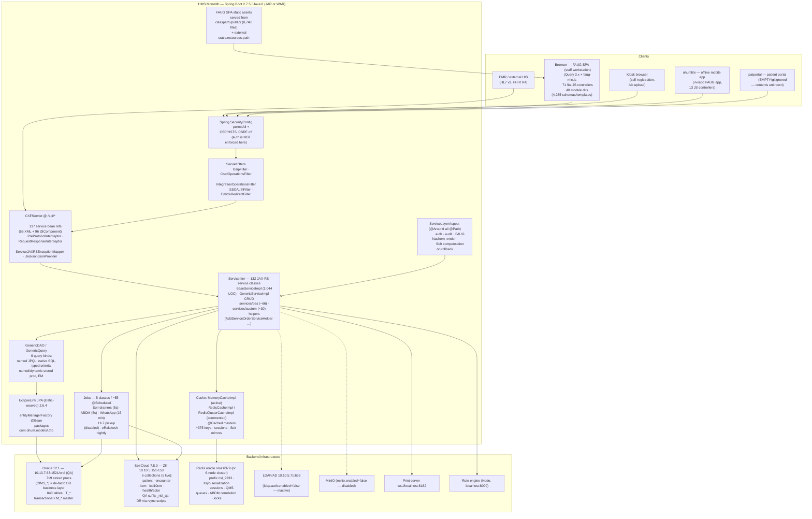

# C2 — Container Diagram: iHMS / OHUM PAS NG

> **Document type:** C4 Level 2 (Containers) — synthesized from discovery docs; no new code exploration.
> **Inputs:** `01-system-landscape.md`, `_discovery/agent-01/findings.md`, `04-backend-architecture.md`, `07-integrations-and-search.md`, `10-target-architecture.md` (TO-BE).
> **Status:** AS-IS evidence-based; TO-BE sections marked **PRELIMINARY**.

---

## 1. AS-IS Container Diagram (C2)

### 1.1 Container inventory (AS-IS)

| Container | Technology | Purpose | Key facts |
|---|---|---|---|
| **FAUG SPA (browser)** | jQuery 3.x, Bootstrap 3, faug-min.js, highstock, fullcalendar, tinymce, qz-tray | All staff screens | 71 flat JS controllers; 40 module dirs; `fjs-config.json` (126 KB) + 41 per-module configs; REST contract `/IHMS/api/rest/**`; RBAC in frontend via `data-roleM` (2,078 keys) |
| **Kiosk** | Browser (FAUG subset) | Self-registration, appointments, lab upload | `modules/kiosk`, `/patient` kioskQueue endpoints |
| **ohumlite (mobile)** | Cordova-era FAUG app | Offline patient/clinical mobile | Self-contained (own index.html, fjs-config, 13 JS modules incl. abdm, appointment-token-flow) |
| **patportal** | Cordova scaffold | Patient portal | **Empty/gitignored — contents UNKNOWN** |
| **Monolith application** | Spring Boot 2.7.5 JAR (embedded Tomcat) or WAR (external Tomcat, JNDI) | Entire HMIS | Port 8080, context `/IHMS`; `docit.ctrl` watchdog; 3,003 REST endpoints; CXF bus at `/api/rest`; static SPA from classpath |
| **Oracle DB** | Oracle 12.1 (ojdbc7), EclipseLink JPA | System of record | 719 procs; JPA unit `ORCL` (JTA); QA `10.10.7.63:1521/orcl`; WAR mode uses JNDI `jdbc/orcl` |
| **SolrCloud** | Solr 7.5.0, 3 nodes, ZK | Search backbone | 6 collections (5 live); realtime+flag-drained indexing; encounter 3-day rolling window; DR rsync scripts |
| **Redis** | Redis (jedis), standalone or 6-node cluster | Cache, sessions, queues, locks | Checked-in bean is `MemoryCacheImpl`; Redis impls commented out (deploy-config ambiguity) |
| **LDAP/AD** | UnboundID LDAP SDK | AuthN (inactive) | `ldap.auth.enabled=false` |
| **MinIO** | MinIO SDK 5.0.2 | Object storage (disabled) | `minio.enabled=false` → filesystem fallback |
| **Print server** | WebSocket | Client-side printing (qz-tray) | `ws://localhost:8182` |
| **Rule engine** | Node.js (in-repo `ruler/`) | Rules evaluation (dev) | HTTP + ioredis, `localhost:8000` |

### 1.2 Routing layers inside the monolith (AS-IS)

Four distinct ways a URL reaches code — **critical for decomposition** (see `_discovery/reconciliation-notes.md` §1):

| # | Routing layer | Mechanism | Volume (evidence) |
|---|---|---|---|
| 1 | **Explicit `@Path` services** | CXF JAX-RS annotations on 132 service classes | 3,003 endpoints; 2,322 of 3,651 FE URLs matched |
| 2 | **Generic CRUD filter** | `CrudOperationsFilter` pattern `{context}/api/rest/([^/]+)(.*)` → `GenericServiceImpl.crudadd/crudupdate/crudget/crudgetAll` | 1,109 FE URLs; 659 `@CrudApi` entities |
| 3 | **Report dispatcher** | `IntegrationOperationsFilter` loads `reports.js` + `*.json` configs → serves `/api/rest/reports/<name>` → Velocity `generic_reports.vm` | All `reports/getXxxReport` URLs |
| 4 | **`/ext/api` mapping** | `ApiIntegrationMapping` rewrites `/ext/api/<mapped-path>` → internal `/api/rest/...`, gated by `ROLE_INTEGRATION` | Backend-controlled integration surface |

---

## 2. TO-BE Container Diagram (C2) — PRELIMINARY

```mermaid
flowchart TB
    subgraph Clients2["Clients"]
        D1["React SPA (staff)
            served as static build (CDN/static server)
            FAUG screens migrated progressively"]
        D2["Kiosk (React/web)"]
        D3["Mobile app (ohumlite successor)"]
        D4["Patient portal (web)"]
        D5["EMR / external HIS (HL7, FHIR)"]
        D6["Govt systems / ABDM / state APIs"]
    end

    subgraph Edge["Edge & platform (PRELIMINARY)"]
        GW["API Gateway
            authN (JWT) · rate limit · routing
            server-side authorization policy
            (fixes AS-IS frontend-only RBAC)"]
        IAM2["IAM & Security service (22)
            login · OTP · SSO · LDAP · user/role/grants"]
    end

    subgraph Services2["Application services (candidate 29 — see 10-target-architecture §2)"]
        S1["Patient Identity & Registration (1)"]
        S2["Appointment & Encounter (2)"]
        S3["ADT & Bed (3)"]
        S4["Ordering & Prescription (4)"]
        S5["Billing & Settlement (5)"]
        S6["Payments & Refunds (6)"]
        S7["Lab (7) · Radiology (8)"]
        S8["Pharmacy (9) · Inventory (10)"]
        S9["OT (11) · Nursing (12) · Blood Bank (13)"]
        S10["Diet · CSSD · Linen · Transport · Equipment · BMW (14-19)"]
        S11["Grievance (20)"]
        S12["Reference Master Data (21)"]
        S13["RCM (23) · RMRS/PMRD (24) · Govt Programs (28)"]
        S14["Interop & Notifications (25)"]
        S15["Reporting & Analytics (26)"]
        S16["Search & Index (27) — Solr pipeline"]
        S17["Queue & Kiosk (29)"]
    end

    subgraph Backends2["Backend infrastructure (PRELIMINARY)"]
        PG["PostgreSQL — schema-per-service
            ihms_patient · ihms_billing · ihms_master …
            strangler: Oracle coexistence during transition"]
        KFK["Kafka — event backbone
            PatientRegistered · EncounterCreated · InvoiceGenerated
            LabResultFinalized · PaymentReceived · InventoryUpdated …"]
        SOLR2["Solr 9.x — 6 collections (owned by Search 27)"]
        REDIS2["Redis — cache/lookup + short-lived state only"]
        MINIO2["MinIO — document/blob storage
            (replaces DB BLOB + filesystem fallback)"]
        OBS["Observability — logs · metrics · traces
            (ELK/Prometheus/Grafana/Jaeger — platform-neutral)"]
        CFG["Config & secrets — vault / config server"]
    end

    D1 --> GW
    D2 --> GW
    D3 --> GW
    D4 --> GW
    D5 --> GW
    D6 --> GW
    GW --> IAM2
    GW --> S1
    GW --> S2
    GW --> S3
    GW --> S4
    GW --> S5
    GW --> S6
    GW --> S7
    GW --> S8
    GW --> S9
    GW --> S10
    GW --> S11
    GW --> S12
    GW --> S13
    GW --> S14
    GW --> S15
    GW --> S16
    GW --> S17
    S1 --> PG
    S2 --> PG
    S3 --> PG
    S4 --> PG
    S5 --> PG
    S6 --> PG
    S7 --> PG
    S8 --> PG
    S9 --> PG
    S10 --> PG
    S11 --> PG
    S12 --> PG
    S13 --> PG
    S14 --> PG
    S15 --> PG
    S16 --> SOLR2
    S17 --> PG
    S1 -.-> KFK
    S2 -.-> KFK
    S3 -.-> KFK
    S4 -.-> KFK
    S5 -.-> KFK
    S6 -.-> KFK
    S7 -.-> KFK
    S8 -.-> KFK
    S12 -.-> KFK
    S14 -.-> KFK
    S16 -.-> KFK
    S14 --> MINIO2
    S15 --> MINIO2
    S14 -.-> OBS
    S12 -.-> REDIS2
    S1 -.-> REDIS2
    S2 -.-> REDIS2
    S17 -.-> REDIS2
    S5 -.-> REDIS2
```

### 2.1 Container inventory (TO-BE, PRELIMINARY)

| Container | Technology (candidate) | Responsibility | Legacy replacement for |
|---|---|---|---|
| React SPA | React + TypeScript static build | All screens (FAUG retired per screen via strangler) | FAUG SPA (classpath:/public/) |
| API Gateway | Gateway (e.g., Spring Cloud Gateway / Kong — platform-neutral) | authN, rate-limit, routing, server-side authz policy | CXF bus + `IntegrationOperationsFilter` routing |
| ~29 microservices | Spring Boot (candidate) | Bounded contexts per `10-target-architecture.md` §2 | 132 JAX-RS god-classes |
| PostgreSQL | PG 14+ (candidate) | Schema-per-service system of record | Oracle + 719 procs (phased conversion) |
| Kafka | Kafka (candidate) | Event backbone + outbox consumers | `T_WHATSAPPMESSAGEQUEUE`, `T_ABDMREQUESTQUEUE`, `T_OUTBOUNDHIS` DB-pollers |
| Solr 9.x | Solr (retained, hardened) | Search pipeline service (owned by Search 27) | Same, plus explicit commits/circuit breakers |
| Redis | Redis (retained) | Cache/lookup + short-lived state only | Same (resolve Memory vs Redis ambiguity) |
| MinIO | MinIO (retained) | Document/blob store (enabled) | DB BLOB (`savePdfToTable`), filesystem fallback |
| Observability | ELK/Prometheus/Grafana/Jaeger | Logs, metrics, traces (replaces `logs/` + MDC-only) | logback-spring 3 appenders |
| Config/secrets | Vault + config server | Externalized config; **purge plaintext secrets** | `application.properties` (1,506 lines, secrets in clear) |

### 2.2 Key container-level decisions (AS-IS → TO-BE)

| Decision | AS-IS evidence | TO-BE (PRELIMINARY) |
|---|---|---|
| Search stays Solr | `07` §1 — Solr is load-bearing (registration search, ABDM consent discovery, ICD-10 lookup) | Retain; index via Kafka pipeline; explicit softCommit; archive collection instead of 3-day encounter deletion |
| Cache impl ambiguity | `MemoryCacheImpl` checked in; Redis impls commented; prod cluster config exists (`07` §2.2) | Single explicit topology; Redis cache-only; invalidation events from Reference Master |
| Rendering coupled to API | FAUG Nashorn rendering inside `ServiceLayerAspect` (agent-10 §1.1) | Decouple first: JSON API + SPA; FAUG HTML retired per screen |
| One mega-transaction | `AddServiceOrderServiceHelper.java:341-516` (Order→Bill→Lab→Rad→DoctorShare→EMR→HL7) | Saga + outbox; never a shared ACID unit across services |
