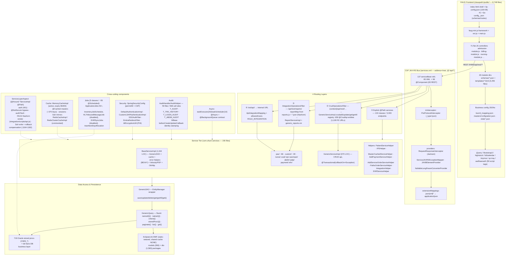
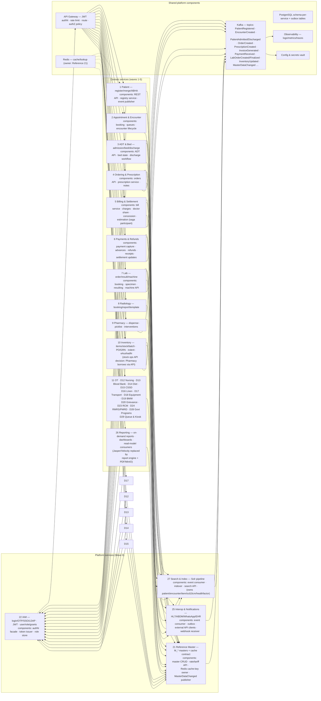

# C3 — Component Diagram: iHMS / OHUM PAS NG

> **Document type:** C4 Level 3 (Components inside the monolith / per-service for TO-BE).
> **Inputs:** `01-system-landscape.md`, `_discovery/agent-01/findings.md` (§2-§3), `04-backend-architecture.md`, `_discovery/reconciliation-notes.md` (§1), `10-target-architecture.md`, `08-security-rbac-audit.md`.
> **Status:** AS-IS evidence-based; TO-BE sections marked **PRELIMINARY**.

---

## 1. AS-IS Component Diagram

### 1.1 Component inventory (AS-IS) — with evidence

| Layer | Component | Role | Evidence |
|---|---|---|---|
| Frontend | FAUG engine (`faug-min.js` + `fjs-config.json` 126 KB + 41 module configs) | Schema-driven SPA framework (routes/schemas in JSON) | 01 §5; agent-01 §3.4 |
| Frontend | 71 flat JS controllers | UI logic per domain (admission-, billing-, pharmacy-module.js…) | 01 §5 |
| Frontend | 40 module dirs (4,255 schemas/templates) | Form/template definitions rendered client-side | agent-01 §3.4 |
| Frontend | Business config JSONs | tiuxml mapping, vitals config, masters config | agent-01 §3.4 |
| Bus | CXF `restServices` @ `/rest` under CXFServlet `/api/*` | Single REST bus; 137 refs; extension mapping | agent-01 §2.3; 04 §1 |
| Routing ① | Explicit `@Path` service classes (132, 3,003 endpoints) | Conventional REST | 04 §10 |
| Routing ② | `CrudOperationsFilter` → `GenericServiceImpl` | Data-driven CRUD over 659 `@CrudApi` entities | reconciliation §1 |
| Routing ③ | `IntegrationOperationsFilter` report dispatcher | `/reports/<name>` → ReportServiceImpl + Velocity | reconciliation §1 |
| Routing ④ | `/ext/api` mapping (`ApiIntegrationMapping`, `ROLE_INTEGRATION`) | Backend-gated integration surface | reconciliation §1, §5 |
| Service | `BaseServiceImpl` (1,044 LOC) | Shared service plumbing (DAO, cache, errors, print helpers, OkHttp) | 04 §2 |
| Service | `GenericServiceImpl` (370 LOC) | Generic CRUD ops; `crudaddMultiple` REQUIRES_NEW per item | 04 §2, §4 |
| Service | Domain services (pas/custom/nurse/cssd/ejs/aasmaan/abdm/patp/payment/ehr) | Business logic containers (no controller/service separation) | 04 §2 |
| Service | Helpers (8 named) | Cross-cutting workflow logic (e.g., AddServiceOrderServiceHelper) | 04 §2 |
| Data | `GenericDAO` + `GenericQuery` | The only query interface (6 kinds) | 04 §4 |
| Data | EclipseLink EMF | JPA provider (static-weaved; Hibernate excluded); packages models+dto | agent-01 §5 |
| Data | 719 stored procs (`generated-procs/`) | DB-side business layer; ~30 called from Java; rest UNKNOWN usage | reconciliation §4 |
| Cross | `ServiceLayerAspect` | The real "framework": auth, audit, FAUG render, Solr compensation, background queue | 04 §5,§8; agent-10 §1.1 |
| Cross | Cache impls | MemoryCacheImpl active; Redis variants commented | 07 §2.2 |
| Cross | Jobs | 5 classes, ~55 schedules (Solr drainers, ABDM, WhatsApp, eRaktkosh) | 04 §7 |
| Cross | Security stack | Spring Security inert (permitAll); custom token auth; frontend RBAC | 08 §2-§3 |
| Cross | Audit | Manual service-authored events flushed per request | 08 §5 |

### 1.2 God-components (decomposition pressure — evidence from 04 §9, agent-10)

| Component | Size | Coupling |
|---|---|---|
| `NursingServiceImpl` | 300 endpoints / 17,350 LOC / 349 graph edges | Encounter/Admission reads, orders, vitals |
| `PathoOrderServiceImpl` | 133 endpoints / 14,280 LOC | Billing txn, WhatsApp, KDL machines |
| `MasterCachedServiceImpl` | 264 endpoints / 12,710 LOC / **514 edges** | ~30 services consume its cache keys |
| `InventoryServiceImpl` | 235 endpoints / 12,070 LOC / 250 edges | Stock ops, Pharmacy dual-write |
| `UploadFileServiceImpl` | 294 edges | All modules' document upload |
| `AddServiceOrderServiceHelper` | one method chains 12+ procs | Order→Bill→Lab→Rad→DoctorShare→EMR→HL7 |

---

## 2. TO-BE Component Diagram (C3) — PRELIMINARY

Per-service component summary for the candidate 29-service landscape (`10-target-architecture.md` §2). Components shown at summary level; numbering matches the candidate service list.

### 2.1 TO-BE per-service component shape (PRELIMINARY)

Every candidate service follows the same internal skeleton (all names candidates):

| Component | Responsibility | Replaces (AS-IS) |
|---|---|---|
| **REST API layer** | Exposes `/…` endpoints to the gateway; JSON only | JAX-RS `@Path` methods (FAUG HTML rendering removed) |
| **Domain service core** | Business logic currently inside `*ServiceImpl` + procs on the extraction path | `services/` god classes + `CIMS_*` procs |
| **DB adapter** | PostgreSQL schema owned by this service only; no cross-service DB access | GenericDAO/GenericQuery + EclipseLink EMF (Oracle) |
| **Outbox writer** | Transactional write to local outbox for each emitted event | In-txn side-effect calls (Solr/HL7/WhatsApp) |
| **Event publisher/consumer** | Kafka producers/consumers per `10-target-architecture.md` §4 | DB-queue pollers (`ApplicationJobs`) |
| **Cache client** | Read-through Redis lookups (keys owned by Reference 21) | `cacheImpl` reflective lookups |
| **External client** | HTTP/SDK clients (ABDM, eSanchar, e-Aushadhi, print…) | `IntegrationServiceImpl`, `HttpUtil` |
| **Read-model** | Local copies of borrowed data (encounterId, tariff snapshot) fed by events | Direct table joins (`T_ENCOUNTER` joins from every module) |

### 2.2 Cross-cutting component changes (TO-BE, PRELIMINARY)

| Concern | AS-IS | TO-BE |
|---|---|---|
| Authorization | Frontend `data-roleM` + commented-out aspect check (`08` §3) | Gateway/API policy layer keyed on `Role → ModulePermissionMaster`; re-enabled server-side check |
| Authentication | Opaque cache token, 30-min sliding, password check disabled | JWT (HttpOnly+Secure cookie or signed token) + real password hashing |
| Audit | Manual `audit.getAudits().add()` (568 sites) → T_AUDIT per request | Standardized event-driven audit stream (annotation/filter-level) |
| Rendering | FAUG Nashorn inside `ServiceLayerAspect` | JSON APIs + React SPA |
| Caching | ~375 reflective `@CrudCached` keys, per-node invalidation | Declared cache (Caffeine + Redis pub/sub) owned by Reference |
| Search indexing | Realtime in-txn `addBean` + flag drainers | Event-driven indexing pipeline with explicit commits |
