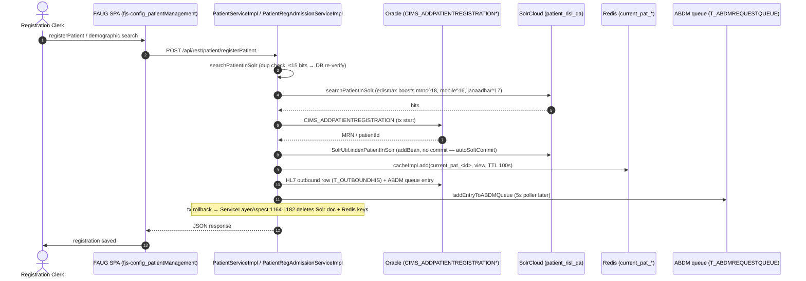
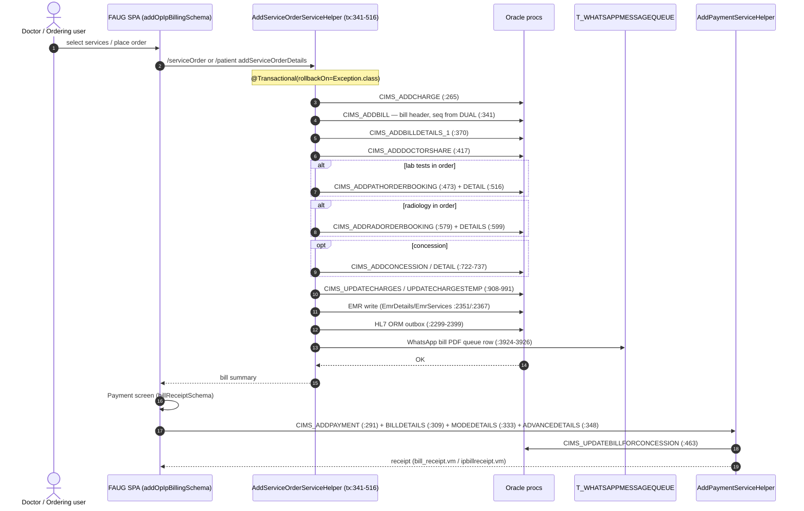
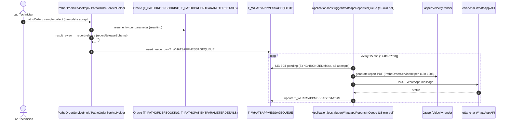
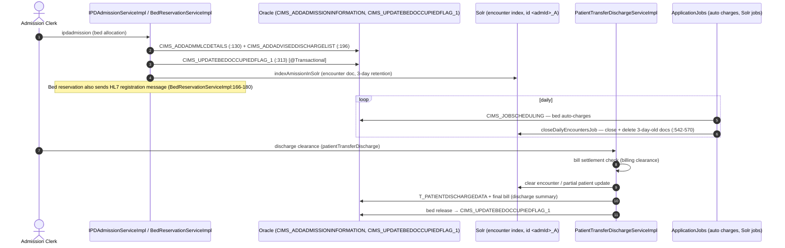
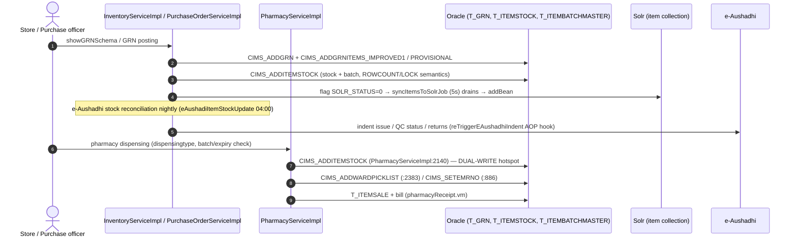
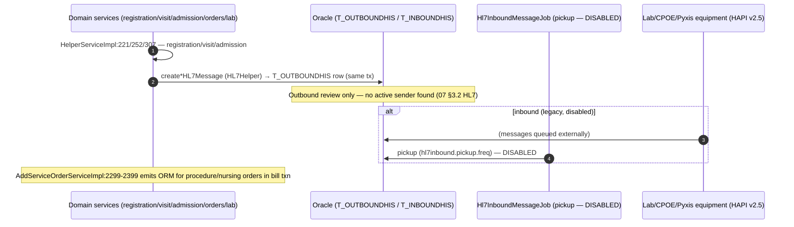
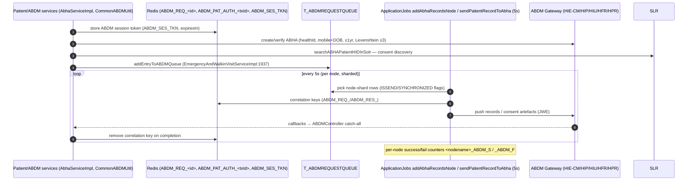

# C4 — Key Data Flows: iHMS / OHUM PAS NG

> **Document type:** C4 Level 4 (sequence-level data flows) — synthesized from discovery docs; no new code exploration.
> **Inputs:** `07-integrations-and-search.md` (§1.3, §3.2), `_discovery/agent-10/findings.md` (§2 transaction boundaries), `10-target-architecture.md`, `04-backend-architecture.md`.
> **Status:** AS-IS flows evidence-based (file:line cited); TO-BE adaptations marked **PRELIMINARY**.

---

## 1. Flow F1 — Patient Registration → Solr Index → ABDM/HL7 side effects

**AS-IS:** registration saves to Oracle, synchronously indexes Solr, mirrors to Redis, enqueues ABDM/HL7 — all inside the same Spring transaction; on rollback the aspect compensates by deleting Solr doc + Redis keys.

**Evidence:** `PatientServiceImpl.java:5610` (solr index on save), `SolrUtil.java:174-333`, `07` §1.3; `HelperServiceImpl.java:221` (HL7); `EmergencyAndWalkinVisitServiceImpl.java:1937` (ABDM queue); aspect compensation `ServiceLayerAspect.java:1164-1182`.

**TO-BE (PRELIMINARY):** register → local outbox (PG) → Kafka `PatientRegistered` → Search(27) indexes Solr, Interop(25) sends HL7/ABDM. No in-txn Solr writes.

---

## 2. Flow F2 — Service Order → Bill → Payment → Receipt (the mega-transaction)

**AS-IS:** one `@Transactional(rollbackOn=Exception.class)` method in `AddServiceOrderServiceHelper.java` chains 12+ stored-proc calls spanning four future bounded contexts (Ordering, Billing, Lab, Radiology) plus EMR, doctor share, package subscription and HL7 ORM messages.

**Transaction-boundary hotspot table** (from agent-10 §2.1):

| Line span | Proc calls | Crosses future service boundary |
|---|---|---|
| `:265` | CIMS_ADDCHARGE | Billing (5) |
| `:341`, `:370` | CIMS_ADDBILL(+DETAILS) | Billing (5) |
| `:417` | CIMS_ADDDOCTORSHARE | Billing/Doctor share (5) |
| `:473`, `:516` | CIMS_ADDPATHORDERBOOKING(+DETAIL) | **Lab (7)** |
| `:579`, `:599` | CIMS_ADDRADORDERBOOKING(+DETAILS) | **Radiology (8)** |
| `:722-737` | CIMS_ADDCONCESSION(+DETAIL) | Billing (5) |
| `:908-991` | CIMS_UPDATECHARGES(+TEMP) | Billing (5) |
| `:2351/:2367` | EMR write | **Ordering/Clinical (4)** |
| `:2299-2399` | HL7 ORM outbox | **Interop (25)** |
| `:3924-3926` | WhatsApp queue row | **Interop (25)** |

**TO-BE (PRELIMINARY):** saga choreography — OrderCreated (4) → Billing(5) computes charges → InvoiceGenerated → Payments(6) → PaymentReceived; Lab/Rad order creation becomes LabOrderCreated/RadOrderCreated events consumed by Billing for bill lines. Compensations already exist as procs (CIMS_SETTLEDBILLCANCELLATION / CIMS_UNSETTLEDBILLCANCELLATION, `BillServiceImpl.java:70-91`).

---

## 3. Flow F3 — Lab Order → Result → WhatsApp Report

**AS-IS:** lab order is booked inside the billing mega-txn; results flow through review/release; released reports are queued to `T_WHATSAPPMESSAGEQUEUE` and drained by a 15-minute poller (window 14:00–07:00), which generates PDF and sends via eSanchar.

**Evidence:** `PathoOrderServiceHelper.java:1130-1208` (sendCategoryWiseReportOnWhatsApp), `ApplicationJobs.java:1598-1643` (poller, max trigger 5), `07` §3.1#15, agent-10 §4.3.

**TO-BE (PRELIMINARY):** `LabResultFinalized` event → Interop(25) consumes and sends; `T_WHATSAPPMESSAGEQUEUE` replaced by Kafka topic (proven DB-poll → topic pattern).

---

## 4. Flow F4 — Admission → Bed → Discharge → Bill

**AS-IS:** admission procs lock bed occupancy and write MLC/advised-discharge; discharge clears the encounter (Solr) and settles bills; bed auto-charges run by scheduled job.

**Evidence:** `IPDAdmissionServiceImpl.java:130,196,313`, `PatientTransferDischargeServiceImpl.java:698-3282,4400-4413`, `ApplicationJobs.java:283` (CIMS_JOBSCHEDULING), `:542-570` (encounter close/delete), agent-10 §2.4.

**TO-BE (PRELIMINARY):** PatientAdmitted/BedChanged events drive bed state (3) and billing auto-charges (5); discharge events feed Billing settlement and EHR; encounter archive collection replaces 3-day deletion.

---

## 5. Flow F5 — Inventory: GRN → Stock → Dispense

**AS-IS:** GRN posting adds stock via procs; pharmacy dispensing decrements stock — **including a dual-write** where Pharmacy calls `CIMS_ADDITEMSTOCK` directly (the classic Pharmacy/Inventory boundary problem).

**Evidence:** `CIMS_ADDITEMSTOCK.sql` (updates T_ReceivedItemAgainstIssue/ReturnDetails + inserts T_ItemStock), `PharmacyServiceImpl.java:2140` (CIMS_ADDITEMSTOCK), agent-10 §3 row 4, `07` §3.1#8.

**TO-BE (PRELIMINARY):** Inventory(10) owns stock; Pharmacy(9) calls stock API or consumes `InventoryUpdated`; **open decision** — single stock service vs per-store ownership (`10` §7.1). GRN→stock stays a local Inventory transaction; e-Aushadhi sync via Interop/Inventory events.

---

## 6. Flow F6 — HL7 Inbound / Outbound

**AS-IS:** outbound messages are created synchronously inside domain transactions into `T_OUTBOUNDHIS` (no active sender found); inbound pickup job is disabled in checked-in config. Registration/visit/admission/orders/lab results are the emitting events (ADT/ORM/ORU/DFT/REF/OMP).

**Evidence:** `HL7Helper.java:217-1091`, `HelperServiceImpl.java:221,252,307`, `Hl7InboundMessageJob.java:39-205`, `07` §3.1#10.

**TO-BE (PRELIMINARY):** domain events → Interop(25) outbox → HL7 sender (idempotent); inbound re-enabled deliberately (decision needed — dormant today). Keep outbox on PG with idempotent senders (`10` §7.2).

---

## 7. Flow F7 — ABDM: ABHA Linking / Consent / HIE Exchange

**AS-IS:** dual-version ABDM paths (v2+v3), Redis correlation store, DB queue with 5s node-sharded pollers, and catch-all callback controller.

**Evidence:** `CommonABDMUtil.java:350-394,444-499,569-591`, `ApplicationJobs.java:1661-1688,2033-2034`, `07` §3.2 ABDM.

**TO-BE (PRELIMINARY):** ABDM flows owned by Interop(25) consuming domain events; Kafka replaces T_ABDMREQUESTQUEUE; single ABDM API version (v3) retained; Redis stays as short-lived correlation store only.

---

## 8. Transaction-boundary hotspot register (for decomposition)

Every row below is a place where one Spring transaction crosses what will become multiple service boundaries (`_discovery/agent-10/findings.md` §2):

| # | Hotspot | Single txn spans | Evidence |
|---|---|---|---|
| H1 | **Mega-txn** AddServiceOrderServiceHelper | Order, Bill, Lab, Rad, DoctorShare, EMR, HL7, WhatsApp | `:265-991`, `:2299-2399` |
| H2 | Payment txn AddPaymentServiceHelper | Bill settlement, payment, modes, advances, concession | `:291-463` |
| H3 | Visit/encounter txn EmergencyAndWalkinVisitServiceImpl | Encounter, queue, MLC, FPV, HL7 A45, corona, diagnosis, Solr, ABDM | `:1379-1937` |
| H4 | Admission txn IPDAdmissionServiceImpl | Admission, MLC, advised-discharge, bed flag | `:130-461` |
| H5 | Registration side-effect chain | Registration, HL7, Solr | `HelperServiceImpl:221,252,307`; `BedReservationServiceImpl:166-180` |
| H6 | Stock dual-write | Inventory + Pharmacy stock decrement | `PharmacyServiceImpl.java:2140` |
| H7 | Billing↔encounter status coupling | Bill creation updates visit/bill state; BillSummary reads Solr | `AddPaymentServiceHelper:463`; `BillSummaryServiceImpl:811` |
| H8 | Job-driven cross-module writes | Auto-charges (bed→bill), Solr drainers, WhatsApp poller | `ApplicationJobs` (14 @Transactional methods) |

**Guiding rule (TO-BE, PRELIMINARY):** every row above becomes either (a) a local transaction + outbox event, or (b) a saga participant with compensation. In-txn remote calls (Solr, HL7, ABDM) must move behind the outbox.
