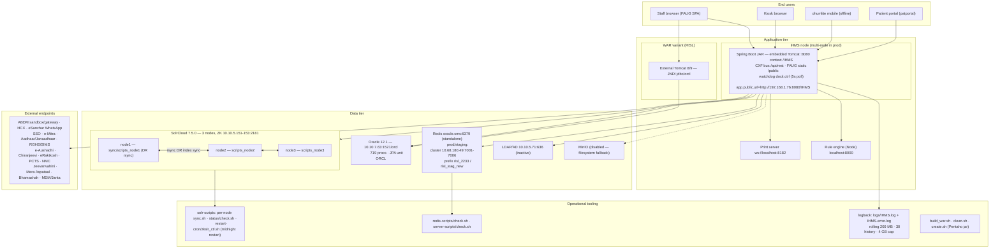
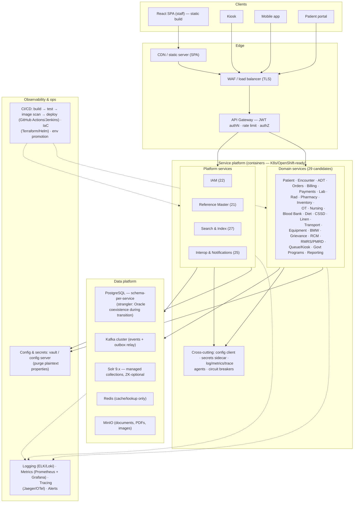

# C4 — Deployment: iHMS / OHUM PAS NG

> **Document type:** C4 Level 4 (Deployment) — synthesized from discovery docs; no new code exploration.
> **Inputs:** `01-system-landscape.md` (§3), `_discovery/agent-01/findings.md` (§1.4, §4), `07-integrations-and-search.md` (§1, §2.2), `10-target-architecture.md`.
> **Status:** AS-IS evidence-based; TO-BE sections marked **PRELIMINARY** and platform-neutral.

---

## 1. AS-IS Deployment

### 1.1 Two packaging modes

| Mode | Build | Runtime | Datasource | Evidence |
|---|---|---|---|---|
| **JAR (default, dev/QA)** | `mvn package` — spring-boot-maven-plugin repackage | Embedded Tomcat, port **8080**, context **`/IHMS`** | JDBC `jdbc:oracle:thin:@//10.10.7.63:1521/orcl` (QA); EMF built programmatically in `App.java` | pom.xml (jar packaging); App.java:79,153-156 |
| **WAR (RISL production overlay)** | `build_war.sh` — overlays `artifacts/risl/{pom.xml, App.java, persistence.xml, application.properties, public/*}`, runs `mvn package -DskipTests`, restores originals | External Tomcat 8/9; JNDI datasource | `jdbc/orcl` via `JndiDataSourceLookup`; jakarta/javax bridge deps | build_war.sh:3-19; artifacts/risl/pom.xml:9 |

Both modes share the same `App` class (`SpringBootServletInitializer`).

### 1.2 AS-IS deployment diagram

### 1.3 AS-IS infrastructure inventory

| Component | Configuration | Evidence |
|---|---|---|
| Oracle | `10.10.7.63:1521/orcl` (QA creds in properties); WAR mode JNDI `jdbc/orcl`; shared cache NONE | application.properties:77; persistence.xml |
| SolrCloud | 3 nodes, ZK `10.10.5.151-153:2181`; 6 collections (5 live); QA suffix `_risl_qa`, prod bare names; **DR via rsync scripts** (`scripts_node1_78_198` etc.); per-minute health checks; **midnight restart cron** (`zkslr_ctl.sh`) | 07 §1; agent-01 §3.6 |
| Redis | Standalone `oracle.sms:6379` (checked-in); prod/staging cluster `10.68.180.49:7001-7006` (prefix `risl_stag_new`); jedis pool max-active 200; Kryo serialization | 07 §2.2; application.properties:109-153 |
| Print server | WebSocket `ws://localhost:8182/`; qz-tray client signing keys in repo | application.properties:726 |
| MinIO | `minio.enabled=false` → filesystem fallback for uploads | application.properties:750-766 |
| LDAP/AD | `10.10.5.71:636`; `ldap.auth.enabled=false` | 08 §2.2 |
| Rule engine | Node HTTP + ioredis, `rules.engine.url=http://localhost:8000` | application.properties:914 |
| File paths | Velocity templates `vm.template.path=D:/RISL/ihms`; `int.files.path=D:/RISL/ihms/integration` | agent-01 §2.5 |
| Logging | logback-spring 3 appenders; rolling 200 MB/file, 30 history, 4 GB cap; MDC meth/uri/corr/rip; committed `logs/` up to 118 MB/day | agent-01 §2.4 |
| Watchdog | `docit.ctrl` created by `main()`; 5 s poll; deletion → clean shutdown | App.java:266-286 |
| ABDM sharding | 8-node sharded processing (`<nodename>_ABDM_S/_F` counters); ABDM queue pollers every 5 s | 07 §3.2; 07 §2.1 |

### 1.4 AS-IS operational risks (deployment-specific)

1. **Multi-node prod running MemoryCacheImpl** (checked-in bean) = per-node divergent master data, tokens, Solr mirrors — deploy-config risk (`07` §2.2).
2. **Solr DR = rsync + midnight restart cron** — fragile; rsync of live index; restart gap (`07` §1.7).
3. **WAR/JAR divergence** — `build_war.sh` overlay must stay in sync; JNDI unit `ORCL` vs programmatic EMF.
4. **Encounter Solr retention 3 days** — post-discharge lookups unreachable via search (`07` §1.6).
5. **Secrets in `application.properties`/pom.xml** and hard-coded integration tokens — any shared/enhanced environment is at risk (`01` §7).

---

## 2. TO-BE Deployment (PRELIMINARY — platform-neutral)

Conceptual deployment for the target landscape. **Not tied to a specific platform** (K8s/OpenShift-ready design; container images as the unit of deployment).

### 2.1 TO-BE deployment diagram

### 2.2 TO-BE deployment decisions (PRELIMINARY)

| Concern | AS-IS | TO-BE (candidate) | Notes |
|---|---|---|---|
| Frontend | FAUG SPA served from monolith classpath | React SPA static build on CDN/static server | Decouple from API tier (`10` §5) |
| API edge | CXF servlet + servlet filters inside app | API Gateway (authN, rate limit, routing, server-side authZ) | Fixes frontend-only RBAC (`08` §10) |
| App runtime | Single JAR/WAR on Tomcat | Container images (Spring Boot), orchestrator-agnostic (K8s/OpenShift-ready) | 29 candidate services per wave (`10` §6) |
| DB | Oracle 12.1 single instance | PostgreSQL schema-per-service; Oracle retained during strangler | Proc conversion phased (`10` §3, §5) |
| Async | DB-queue pollers (WhatsApp 15 min, ABDM 5 s, HL7 outbox) | Kafka topics + outbox (PG logical/Debezium) | Proven patterns map cleanly (agent-10 §4.3) |
| Search | SolrCloud 7.5.0 + rsync DR + midnight restart | Solr 9.x managed; proper replication/balancing; archive collections | `07` §1.7 |
| Cache | Memory vs Redis ambiguity | Redis only; single explicit topology | `07` §2.3 |
| Files | DB BLOB + filesystem fallback | MinIO enabled (blob store) | `07` §3.1#13 |
| Config/secrets | `application.properties` (1,506 lines, plaintext secrets) | Vault/config server; secrets purged | `01` §7; `08` §9 |
| Logging | logback 3 appenders → local files | Structured logs → ELK/Loki; MDC fields retained (meth/uri/corr/rip) | agent-01 §2.4 |
| Metrics/tracing | None (M_B_API/M_A_API memory counters only) | Prometheus/Grafana + OpenTelemetry tracing | 08 §5.1 |
| CI/CD | build_war.sh overlay + Sonar scanner | Standard pipeline: build → test → scan → deploy per service | `01` §3.4 |
| Watchdog | `docit.ctrl` kill-switch | Replaced by orchestrator health probes/liveness | App.java:266-286 |
| DR | Solr rsync scripts; single Oracle | Per-service backups; PG replication; Kafka replication; multi-AZ | `07` §1.7 |

### 2.3 Migration-wave deployment order (from `10-target-architecture.md` §6)

| Wave | Contexts | Deployment exit criteria |
|---|---|---|
| 0 — Foundation | 21 Reference, 22 IAM, 27 Search, 25 Interop | Master/cache contract live; JWT auth; event backbone; FAUG→JSON first screens |
| 1 — Admission Front | 1 Patient, 2 OPD, 3 ADT, 29 Queue/Kiosk | Patient/Encounter/Admission streams live; Solr fed by events |
| 2 — Revenue | 4 Clinical, 5 Billing, 6 Payments, 23 RCM | Mega-txn split into saga; InvoiceGenerated/PaymentReceived live |
| 3 — Clinical Care | 7 Lab, 8 Rad, 9 Pharmacy, 11 OT, 12 Nursing, 13 Blood Bank | Lab/Rad/Prescription streams live |
| 3b — Support Clinical | 14 Diet, 15 CSSD, 16 Linen, 19 BMW | Independent schemas live |
| 4 — Facilities | 10 Inventory, 17 Transport, 18 Equipment | Stock API contract live (Pharmacy uses it) |
| 5 — External & Govt | 28 Govt Programs, 24 RMRS/PMRD, 26 Reporting | PaymentReceived→RMRS stream; report read-models on PG |
