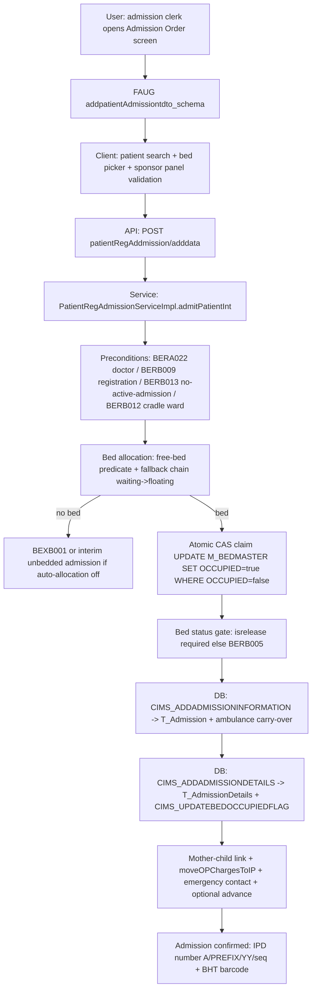

# Workflow: IPD Admission & Bed Allocation

**Source evidence:** `_discovery/agent-06/findings.md` §1.3 (steps 1–10) · `04-api-catalog.md` (patientRegAddmission) · `05-database-catalog.md` (CIMS_ADDADMISSION*) · `10-target-architecture.md:30` (ADT service)
**Target service:** ADT & Bed

## Purpose
Convert a patient into an inpatient admission: validate preconditions, allocate a bed (auto or manual), generate the IPD number, link mother-child where applicable, move OP charges, and record emergency contact / ambulance details.

## Actors
Admission clerk · Bed manager · Ward nurse · Nursing station · Doctor (admitting)

## Steps

| Step | Layer | Component (file:line) | Action | Data/Table | Notes |
|---|---|---|---|---|---|
| 1 | UI | `ip:admissionOrder` / `ip:admissionOrderEmer` (`addpatientAdmissiontdto_schema.json`) | Admission form: patient search, bed picker, sponsor panel, emergency panel | – | 16 `patientRegAddmission.*` refs (03 §2.3) |
| 2 | API | `POST api/rest/patientRegAddmission/adddata` → `admitPatient` → `admitPatientInt` (`custom/PatientRegAdmissionServiceImpl.java:237-241`) | Submit | – | |
| 3 | SVC | Preconditions (`:249-281`) | admitting doctor → `BERA022` (`:249-251`); `allowDirectAdmission` off → registration required → `BERB009` (`:256-260`); active admission exists → `BERB013` (`:261-266`); baby → cradle ward → `BERB012` (`:267-275`); attending defaults to admitting | T_Admission (read) | BR-IPD-001 |
| 4 | SVC | Bed allocation (`:283-359`) | free = `OCCUPIED=0` AND status=true AND `isnoncensus/isot/ispreop/ispostop=false`; fallback chain same-building+category → waiting → floating → waiting+floating (`:311-342`); atomic `UPDATE M_BEDMASTER SET OCCUPIED=true WHERE ID=? AND OCCUPIED=false` (`:344`); none → `BEXB001` (`:357`); auto-allocation off + fromBedId=0 → interim ward admission (`:290-293`) | M_BEDMASTER | BR-IPD-002 |
| 5 | SVC | Bed status gate (`:1289-1301`) | `M_BedStatusMaster.isrelease=true` required else `BERB005` | M_BEDSTATUSMASTER | BR-IPD-003 |
| 6 | SVC | IPD number (`:1236-1252`) | `A/<PREFIX>/<YY>/<00001>` from `ipdNoTemplate`; seq per unit | T_Admission | BR-IPD-004 |
| 7 | DB | `CIMS_ADDADMISSIONINFORMATION` (`:1265-1268`; `generated-procs/CIMS_ADDADMISSIONINFORMATION.sql:105-187`) | Insert T_Admission; ambulance carry-over (visit ≤6h + IsAmbulanceServiceAvailed → copies T_AmbulanceServiceDetails) | T_Admission, T_AmbulanceServiceDetails | BR-IPD-004, BR-IPD-006; R4: `resultStatus==-1 → APP015` is dead (proc ends 0) |
| 8 | DB | `CIMS_UPDATEBEDOCCUPIEDFLAG` (`:1303`); baby re-ward to cradle ward (`:1305`) | Mark bed occupied; cradle remap | M_BEDMASTER | |
| 9 | DB | `CIMS_ADDADMISSIONDETAILS` (`:1481`) | Insert T_AdmissionDetails (bedId, status=true, IsClosed default 0) | T_AdmissionDetails | |
| 10 | SVC | Mother-child linking (`:1518-1541`); OP charges → IP (`billingHelper.moveOPChargesToIP` `:1546`); advance payment possible (`:1879`) | Link babies; move charges; collect advance | T_AdmissionDetails, T_Charges, T_Advance | |
| 11 | DB | `CIMS_ADDADMISSIONADDEMERGENCYCONTACT` (`:1571`) | Emergency contact | T_AdmissionDetails (contact) | |
| 12 | SVC | Temp-MRN promotion (`:378-386`) | Permanent MRN for temp patients | T_Registration_Int | BR-PAT-001 |
| 13 | INT | `CIMS_ADDADMISSIONINFORMATION` ambulance copy + admission summary paths | (ambulance carried) | – | BR-IPD-006 |

## Flowchart

## Business rules involved
BR-IPD-001 (preconditions), BR-IPD-002 (bed allocation algorithm), BR-IPD-003 (bed status release gate), BR-IPD-004 (IPD number), BR-IPD-005 (auto-abscond — job, downstream), BR-IPD-006 (ambulance carry-over, ADDED), BR-PAT-001 (temp-MRN promotion), BR-OPD-001 (non-residential tariff at admission)

## Edge cases
- Interim admission (no bed, `BEDID=0/null`) → auto-absconded after 3 days by job (`ApplicationJobs.java:991-1019`, BR-IPD-005).
- Baby admission requires cradle ward; babies re-warded to cradle ward.
- Ambulance visit ≤ 6h before admission + `IsAmbulanceServiceAvailed` → service details carried over.
- Concurrent admission of the same patient: guarded only by `BERB013` pre-check — **no DB-level guard** (RISK R4).

## Unknowns
- `CIMS_ADDADMISSIONINFORMATION` resultStatus semantics beyond the dead APP015 check (R4).
- Advance-payment-at-admission amount rules not traced in findings (only that it is possible, `:1879`).
