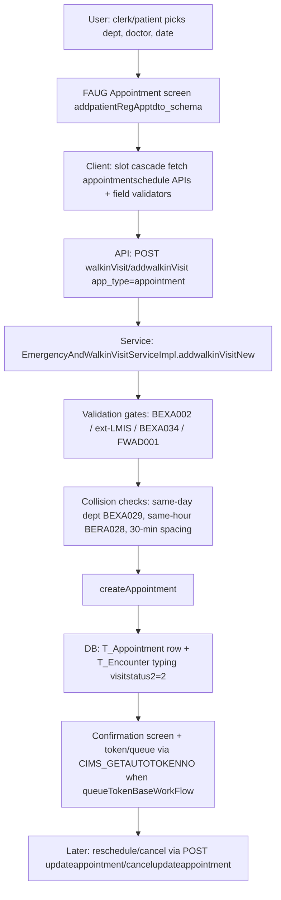

# Workflow: Appointment (OPD booking / reschedule / cancel)

**Source evidence:** `_discovery/agent-06/findings.md` §1.2 (slot rules, appointment path) · `03-legacy-frontend-inventory.md` §2.1 (OP routes) · `04-api-catalog.md` (walkinVisit, appointmentschedule, updateappointment) · `10-target-architecture.md:29`
**Target service:** Appointment & Encounter (OPD)

## Purpose
Book a future/same-day appointment for an existing or new patient, enforce slot collision rules, and track the appointment through the visit lifecycle (including cancellation).

## Actors
Front office clerk · Patient (phone/kiosk) · Doctor scheduler · Kiosk/self-service

## Steps

| Step | Layer | Component (file:line) | Action | Data/Table | Notes |
|---|---|---|---|---|---|
| 1 | UI | `op:addAppointment/:doctor_id/:department_id/:app_date/...` (`appointment-module.js`) | Pick unit→dept→building→cabin→doctor→slot cascade | – | `useAppointmentSlotCascade` pattern; least-full-cabin policy |
| 2 | JS | Schema events chain (`addpatientRegApptdto_schema.json`, `doctor-appintment-slots-schema.json`) | `DoctorAppointmentSlots.getSlotsWithoutDoctor`, `appointmentschedule.getDayWiseBuildingMasterByDepartmentId`, `getCabinWiseApointmentSlotCount` | – | |
| 3 | API | `POST api/rest/walkinVisit/addwalkinVisit?pat_token_no&app_type` (`EmergencyAndWalkinVisitServiceImpl.addwalkinVisit` `:302-309` → `addwalkinVisitNew`) | Submit appointment DTO | – | also `api/rest/appointment` / `patientRegAppt` variants |
| 4 | SVC | `addwalkinVisitNew` input validation (`EmergencyAndWalkinVisitServiceImpl.java:315-378`) | Script-injection check → `BEXA002`; ext-LMIS address+mobile; duplicate PCTS → `BEXA034`; active-admission walk-in → `FWAD001` | T_Encounter, T_Admission (read) | BR-OPD-009 |
| 5 | SVC | Slot collision checks (`EmergencyAndWalkinVisitServiceImpl.java:477-626`) | (a) same-day same-dept active encounter → `BEXA029` (`:537-546`); (b) same-hour window → `BERA028` (`:582-589`); (c) ≥30 min apart (`:563`); slot duration `config.appointmentslot` default 15 (`:423-426`) | T_Encounter, T_Appointment | BR-OPD-002 |
| 6 | SVC | `createAppointment` (`EmergencyAndWalkinVisitServiceImpl.java:606-624`) | Create appointment (telemedicine variant too) | T_Appointment | `appointmentAgainstUnitHead` doctor resolution |
| 7 | SVC | Appointment typing (`:947-1156`) | encounter type=2 emergency / 1 normal (`:998-1002`); `visitstatus2="2"` default (`:1039`); appointmentTypeId 1 online / 0 walk-in (`:1204-1208`) | T_Appointment, T_Encounter | statuses per STATUS-CODE-DICTIONARY |
| 8 | SVC | Temp-MRN promotion (`:678-684`) | `IsTempMrno=1` patient gets permanent MRN at booking | T_Registration_Int | BR-PAT-001 |
| 9 | API | `POST api/rest/updateappointment/cancelupdateappointment` (`custom.AddUpdateAppointmentServiceImpl.canceladdappt`) | Reschedule / cancel appointment | T_Appointment | `iscancelled` flag |
| 10 | UI | `op:appointment_confirmed` / appointment lists (`op:appointmentList`, `appointmentListOnline`, `appointmentListNhnc`) | Confirmation; face sheet PDF (`patientRegAppt/pdfAppointmentFaceSheet`); kiosk/queue reads `walkinVisit/getLastVisitStatus` | – | kiosk variant uses `markandaddvisit/checkin` |

## Flowchart

## Business rules involved
BR-OPD-002 (slot collision rules), BR-OPD-004 (visit-type sequence at visit time), BR-OPD-006 (doctor required for walk-in path), BR-OPD-007 (billed → VisitStatus 11 at payment), BR-OPD-009 (validation gates), BR-PAT-001 (temp-MRN promotion), BR-PAT-003 (family/member pairing)

## Edge cases
- Same-hour appointment in same dept → `BERA028`; same-day same-dept active encounter → `BEXA029`.
- Online (app_type=1) vs walk-in (0) appointmentTypeId.
- Telemedicine appointment variant shares the same creation path.
- Kiosk/queue reads VisitStatus from **T_Appointment** (`getLastVisitStatus`) — see R1 split-brain (STATUS-CODE-DICTIONARY §VisitStatus).

## Unknowns
- Appointment cancellation state flags: `iscancelled=0` is used in collision predicates (active appointment definition); the full cancel state machine (who can cancel, rebook) not traced.
- Slot-window semantics for multi-day bookings (hour-window rule is same-day only per evidence).
- `appointmentschedule` slot add/remove master ops (`addOrRemoveSlots`) not traced in findings.
