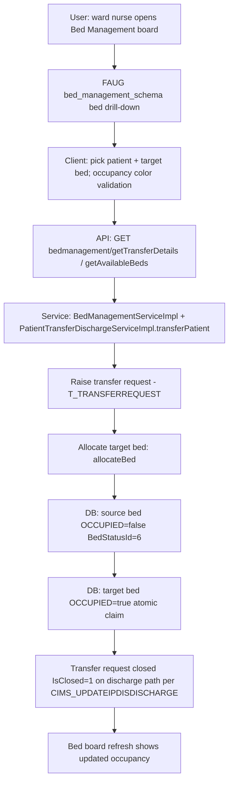

# Workflow: Bed Transfer (ward-to-ward / bed-to-bed, incl. baby & OT transfers)

**Source evidence:** `_discovery/agent-06/findings.md` §1.10 (M_BedMaster status evidence) · `04-api-catalog.md` (patientTransferDischarge transfer*, bedmanagement) · `03-legacy-frontend-inventory.md` §2.3 (bed management screens) · `06-business-rules-catalog.md` A5
**Target service:** ADT & Bed (10-target-architecture.md:30)

## Purpose
Move an admitted patient between beds/wards (including babies and pre-OT staging), release the source bed and claim the target bed, and record the transfer request lifecycle (T_TransferRequest).

## Actors
Ward nurse / nursing station · Bed manager · Attendant desk

## Steps

| Step | Layer | Component (file:line) | Action | Data/Table | Notes |
|---|---|---|---|---|---|
| 1 | UI | `ip:bedManagement/:class_id/:ward_id/:bed_id/:building_id/:filterId`, `ip:transferReqList` (`bed_management_schema.json`, `bedTransferSchema.json`) | Bed board drill-down (building→ward→class→bed, occupancy colors); raise transfer | – | 34 `bedmanagement/*` endpoints (03 §2.3) |
| 2 | API | `GET/POST bedmanagement/getTransferDetails` (`BedManagementServiceImpl.getTransferDetails`) | List pending transfers | T_TRANSFERREQUEST (read) | |
| 3 | API | `POST api/rest/patientTransferDischarge/transfer` (`transferPatient`) | Submit transfer | T_TRANSFERREQUEST | |
| 4 | API | `POST api/rest/patientTransferDischarge/transferBaby` (`transferBaby`) | Baby transfer (mother-child linkage preserved) | T_TRANSFERREQUEST, T_AdmissionDetails | |
| 5 | API | `POST api/rest/patientTransferDischarge/transferToPreOtPatient` (`transferToPreOtPatient`) | Pre-OT staging transfer | T_TRANSFERREQUEST | Tx: Y |
| 6 | API | `POST api/rest/patientTransferDischarge/allocateBed` (`allocateBed`) | Target bed claim | M_BEDMASTER | |
| 7 | DB | `PatientTransferDischargeServiceImpl.java:3811,4162` (BedStatusId=6 on transfer); `:1074,1096,1102,3831` (BedStatusId=0 reset) | Source bed released (`BedStatusId=6`); cancel/rollback paths reset to 0 | M_BEDMASTER | BR-DIS-003 semantics reused; R5 hard-coded 6 |
| 8 | API | `PUT api/rest/patientTransferDischarge/releaseBed` (`updateBedOccupiedFlag`) | Manual bed release | M_BEDMASTER | `BedOccupiedFlagDto` |
| 9 | SVC | `PatientTransferDischargeServiceImpl.java:5082,5186` (BedStatusId=6 paths) | OT-bed and post-op return paths also release to 6 | M_BEDMASTER | |
| 10 | UI | `ip:bedReservation`, `ip:unReservedBedList`, `bedmanagement/getIsRetainable`, `getOTTransferDetails` | Reservation + retention checks; OT transfer list | – | `getIsRetainable` Tx: Y |

## Flowchart

## Business rules involved
BR-DIS-003 (bed release semantics — BedStatusId=6 contract; R5 hard-coded literal risk), BR-IPD-002 (bed claim atomicity), BR-IPD-003 (isrelease gate on any allocation)

## Edge cases
- Transfer cancellation resets source bed to `BedStatusId=0` (`:1074,1096,1102,3831`).
- OT transfers: `transferToPreOtPatient`; OT-bed release paths at `:5082,5186`.
- Retainable beds (`getIsRetainable`) block release logic.
- Baby transfers keep mother-child linkage (`transferBaby`).

## Unknowns
- Full T_TransferRequest status machine (requested→approved→rejected→completed values) not enumerated in agent-06 findings; only closure (`IsClosed='1'`) is evidenced (CIMS_UPDATEIPDISDISCHARGE).
- Reservation expiry / auto-cancel rules for `ip:bedReservation` not traced.
