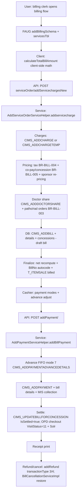

# Workflow: Billing (order → bill → finalize → payment → refund/cancel)

**Source evidence:** `_discovery/agent-06/findings.md` §1.5 (steps 1–23) · `03-legacy-frontend-inventory.md` §2.2 (billing screens, `calculateTotalBillAmount` billing-module.js:2050) · `06-business-rules-catalog.md` BR-BILL-001..008 · `10-target-architecture.md:32-33`
**Target service:** Billing & Settlement + Payments & Refunds (InvoiceGenerated / PaymentReceived events)

## Purpose
The revenue core: add charges, build the bill (draft→final), apply tax/concession/co-pay, settle via payments (cash/modes/advances), print receipts, and handle refunds/cancellation with restore semantics.

## Actors
Billing clerk · Cashier · Insurance/company desk · Refund desk · Finance

## Steps

| Step | Layer | Component (file:line) | Action | Data/Table | Notes |
|---|---|---|---|---|---|
| 1 | UI | `billing:billingFlow` / `ipBillingFlow` / `opIpBillingFlow` (`startBillingFlow` billing-module.js:707) | Service search typeahead; `#servicesTbl` (rate×qty, tax1-3, concession, self/non-self, package coverage); totals recomputed client-side `calculateTotalBillAmount` (billing-module.js:2050) | – | 03 §2.2 12-point doc |
| 2 | API | `POST serviceOrder/addServicechargesNew` (`AddServiceOrderServiceImpl.addServices`) | Submit charges | – | |
| 3 | SVC | `addservicecharge` (`custom/AddServiceOrderServiceHelper.java:195-843`) | Per-charge: `CIMS_ADDCHARGE` (consumed) or `CIMS_ADDCHARGETEMP` (`:259-275`; `AddServiceOrderServiceImpl.java:2233-2241`); bill header defaults `Status=true, IsSettled=false, BillNo='000000000000000', CashCounterId=1` (`:224-227`) | T_CHARGES / T_CHARGES_TEMP, T_Bill | BR-BILL-001 |
| 4 | SVC | Pricing (`:2767-2851`) | Tax (BR-BILL-004); co-pay/concession split (BR-BILL-005); sponsor re-pricing after bill (`:764-836`): priority-1 sponsor + class → `findAllServicesForBill`; `concession=false → concessionPercent=0`; `deductablePercent = 100 − deductable` for self company | T_BILLDETAILS | BR-BILL-004/005 |
| 5 | SVC | Doctor share (`:383-419`) | Skip if tariff-service `otProcedure=true`; share%>0 → `CIMS_ADDDOCTORSHARE` (CEILING/HALF_UP) | T_DOCTORSHARE | BR-BILL-002 |
| 6 | SVC | Lab/Rad auto-orders (`:421-633`) | patho/rad charge → booking creation | T_PATHORDERBOOKING, T_RADIOLOGYORDERBOOKING | BR-BILL-003 |
| 7 | SVC | Finalize (`:333-345`, `:636-644`) | Net = Total − Tax − Concession; BillNo from `getLatestAutocodeSeq("T_OPDBill", op.bill.no.template)` (`:335`); OPD `T_ITEMSALE` ISBILLED=true + BILLID (`:344-345`); package charges zeroed; charge IsBilled | T_Bill, T_ITEMSALE | BR-BILL-001 |
| 8 | DB | `CIMS_ADDBILL` + `CIMS_ADDBILLDETAILS_1` (`:370`) | Bill header/details; `CIMS_ADDCONCESSION` + detail per charge with concession>0 (`:704-744`) | T_Bill, T_BillDetails, T_Concession | |
| 9 | UI | `billing:addPayment` / `opBillPayment` (`showPaymentModes`) | Payment modes modal; advance-adjust toggle | – | partial payments |
| 10 | API | `POST api/rest/addPayment/` (`AddPaymentServiceImpl.addBillPaymentNew`) → `AddPaymentServiceHelper.addBillPayment` (`:62-521`) | Payment orchestration | – | |
| 11 | SVC | Advance FIFO (`:178-203`, `:313-349`) | advances → self balance in id order; mode 7 + `CIMS_ADDPAYMENTADVANCEDETAILS` | T_Advance | BR-BILL-007 |
| 12 | SVC | Payment record (`:255-309`) | `finalTrxAmount = (balSelf − newBalSelf) + (balNonSelf − newBalNonSelf)`; `transactionType=2` (`:270`); receipt via `getLatestAutocodeSeq("Payments", receipts.no.template)` (`:267-282`); `CIMS_ADDPAYMENT` + `CIMS_ADDPAYMENTBILLDETAILS` billType=1 (`:293-309`); cash rule: mode>1 needs bank (`:367-374`); capped at remaining (`:376-384`); MIS `addUserWiseCollection` (`:390-403`) | T_Payment, T_PaymentModeDetails | BR-BILL-006 |
| 13 | SVC | Settlement (`:438-506`) | balances ≤ 0 → `CIMS_UPDATEBILLFORCONCESSION` IsSettled=true (`:438-463`); OPD checkout: `T_Encounter.isCheckout=true` + Solr + `VisitStatus=11` (`:440-447`, `:477-478`); `invstopdpostbilling` → item-sale payment + `changeAmount` (`:480-506`) | T_Bill, T_Appointment, T_Encounter | BR-BILL-006, BR-OPD-007 |
| 14 | UI | Receipts (`billing:OPDbillReceipt` / `IPDbillReceipt`, `billReceiptSchema.json`) | Print receipt | – | |
| 15 | API | `POST api/rest/addRefund/refund` (`AddRefundServiceImpl.addRefund` `:82-155`) | Advance refund (transactionType=3, `BEXAR002` if balance ≤ 0); bill refund (transactionType=4) | T_Refund, T_Advance | BR-BILL-008 |
| 16 | SVC | Bill cancellation (`custom/BillCancellationServiceImpl.java:231-295, 347, 455-509`) | Restore T_Advance; charges ← `*BeforeFinalization` + `IsCancelled=true`; `T_Itemsale BillID=0, IsBilled=false`; doctor-share false; `cancelbill` marker | T_Bill, T_Charges, T_ITEMSALE | BR-BILL-008; R6 |

## Flowchart

## Business rules involved
BR-BILL-001 (creation & numbering), BR-BILL-002 (doctor share), BR-BILL-003 (patho/rad orders), BR-BILL-004 (tax), BR-BILL-005 (co-pay/concession — R2 asymmetry), BR-BILL-006 (settlement & OPD checkout), BR-BILL-007 (advance FIFO), BR-BILL-008 (refund/cancel restore), BR-OPD-007 (VisitStatus 11), BR-PATH-001 (charge removal guard), BR-OT-002 (OT pre-billing)

## Edge cases
- Partial payments: ordering `compayPayment → nonSelf first, then self` (`:215-253`).
- Deductable 0 → 100 → full self-pay.
- Non-self concession **replaces** bill% (R2) vs self company **adds** — pricing divergence for corporate patients.
- Settled-bill cancellation restores from `*BeforeFinalization` snapshots; missing snapshot breaks restore (R6).
- Change returned on T_Bill when `invstopdpostbilling`.

## Unknowns
- Max-concession / corporate approval validation lives client-side (billing-module.js) — server-side enforcement depth not traced.
- Package (RGHS) billing rules beyond "package charges zeroed on bill" (`:637-644`).
- Credit-note flow (`serviceOrder/saveCreditNote`, `addPackageRefund`) steps not traced in agent-06 findings.
