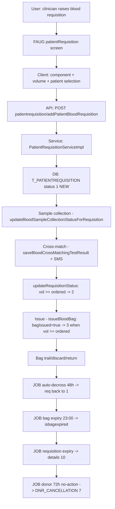

# Workflow: Blood Bank (requisition → cross-match → issue + donor)

**Source evidence:** `_discovery/agent-06/findings.md` §1.9 (steps 1–6) · `06-business-rules-catalog.md` BR-BLD-001..005 · `04-api-catalog.md` (patientrequisition, bloodtestmaster) · `02-business-module-catalog.md` M13 · `10-target-architecture.md:40`
**Target service:** Blood Bank — BloodRequisitionCreated / BloodIssued events

## Purpose
Request blood for a patient (component-specific), collect and test the sample, cross-match available bags, issue bags, and let scheduled jobs police expiry (bag/requisition/donor) and auto-decrossing.

## Actors
Clinician (requests) · Blood bank technician · Medical officer (donor exam) · Blood bank in-charge

## Steps

| Step | Layer | Component (file:line) | Action | Data/Table | Notes |
|---|---|---|---|---|---|
| 1 | UI | `bloodBank:patientRequisition(+external)` (`patientRequisitionDetails.json`, blood-bank-module.js) | Requisition form: component, volume, urgency | – | |
| 2 | API | `POST patientrequisition/addPatientBloodRequisition` (`pas.PatientRequisitionServiceImpl.addPatientBloodRequisition`) | Create requisition — status 1 (NEW) | T_PATIENTREQUISITION(+DETAILS) | `addBloodComponantForRequisition` for components; `checkAutologousTypeOrders` for autologous |
| 3 | SVC | Sample collection status: `PUT patientrequisition/updateBloodSampleCollectionStatusForRequisition` | Sample collected/rejected | T_PATIENTREQUISITIONDETAILS | rejection w/ reasonId |
| 4 | API | `POST bloodtestmaster/saveBloodCrossMatchingTestResult` (`BloodBankServiceImpl.saveBloodCrossMatchingTestResult` `:2615-2714`) | Cross-match result; `CrossMatchingTestNo` from autocode `t_bloodcrossmatchingresult`; SMS notification; count incremented (`:2700-2703`) | T_BLOODCROSSMATCHINGRESULT(+DETAILS) | |
| 5 | SVC | `updateRequisitionStatus` (`BloodBankServiceImpl.java:6290-6317`) | cumulative cross-matched vol ≥ ordered → 2, else stays 1 | T_PATIENTREQUISITION | BR-BLD-001 |
| 6 | SVC | Extraction validity gate (`BloodBankServiceImpl.java:2255`) | bag extraction hours < `bloodBagExtractionValidityPeriod` (8) | T_BLOODBAG | config |
| 7 | API | `POST bloodtestmaster/issueBloodBag` (`BloodBankServiceImpl.issueBloodBag` `:3593-3595`) | Issue; `BloodCrossMatchResultDetails.bagIssued=true`; cumulative bag vol ≥ ordered → requisition 3 | T_BLOODBAGISSUE, T_PATIENTREQUISITION | BR-BLD-001 |
| 8 | SVC | Issuable-bag predicate (`BloodBankServiceImpl.java:2273-2277`) | `isreserved=false, isbagextracted=false, isdiscard=false, isdiscarded=false, isissued=false, istested=true, iscrossmatched=false` | T_BLOODBAG (read) | |
| 9 | JOB | Auto-decross `${bloodbag.auto.decross}` 00:00 (`ApplicationJobs.java:1045-1061`; `BloodBankServiceImpl.java:7657-7701`) | ≥2880 min crossmatched & not decrossed → decross, req → 1, `BloodBagDecross` reason 0 | T_BLOODBAG, T_BLOODBAGDECROSS | BR-BLD-002 |
| 10 | JOB | Bag expiry `${bloodbag.expiry.schedule}` (`ApplicationJobs.java:769-815`) | expiry today → `isbagexpired=true`; issued skipped; crossmatched unissued → decross + req 1 | T_BLOODBAG | BR-BLD-003 |
| 11 | JOB | Requisition expiry `${bloodorder.cancellation.schedule}` (`ApplicationJobs.java:734-766`) | `requesteddate + orderValidationPeriod(h) ≤ sysdate` & no sample & status 1 → details 10, `isorderexpired=true`, "Order is expired" | T_PATIENTREQUISITIONDETAILS | BR-BLD-004; R7 asymmetry |
| 12 | JOB | Donor cancellation `${donor.cancellation.schedule}` (`ApplicationJobs.java:832-848`) | DNR_NEW(1)/DNR_FIT(2) >72h no action → 7 | T_BLOODDONORREGISTRATION | BR-BLD-005 |
| 13 | UI | `bloodBank:donorRegistration`, `donorList`, `campDonation` | Donor registry; med-exam result via `POST bloodtestmaster/saveDonorMedicalExaminationResult` | T_BLOODDONORREGISTRATION(+DETAILS), T_DONORMEDICALEXAMINATIONRESULT | donor statuses per STATUS-CODE-DICTIONARY §Donor |
| 14 | UI | `bloodBank:bloodBagTrail`, `bloodBagDiscard`, `retrunBloodbag`, `eraktkoshRequest` | Trail/discard/return; e-Raktkosh network | T_BLOODBAG* | |
| 15 | UI | `bloodBank:crossMatchingList`, `crossMatchedBags`, `newCrossMatchingTest` | Cross-match screens | – | |

## Flowchart

## Business rules involved
BR-BLD-001 (requisition status machine 1/2/3/10), BR-BLD-002 (auto-decross 48h), BR-BLD-003 (bag expiry), BR-BLD-004 (requisition expiry), BR-BLD-005 (donor auto-cancel)

## Edge cases
- Partial cross-match stays 1; full → 2; issue → 3 (volume-based, not count-based).
- **R7 asymmetry**: requisition-expiry job writes *details* status 10; header 10 (REQ_CANCELLATION) is only used at creation/cancel.
- Autologous orders (`checkAutologousTypeOrders`), cross-unit orders (`placeCrossUnitOrder`), external hospital/storage-center requisitions.
- Donor statuses 3 (UNFIT == VOLUNTORY) and 5 (REJECTED == DONATED) are **literal collisions** (STATUS-CODE-DICTIONARY §Donor).

## Unknowns
- Requisition urgency/priority codes and component matching rules not traced.
- e-Raktkosh sync mechanics (nightly jobs, `ApplicationJobs.java:1205,1383`) — field mapping not traced.
- Donor screening/medical-exam pass criteria (which results → FIT vs UNFIT) not traced.
