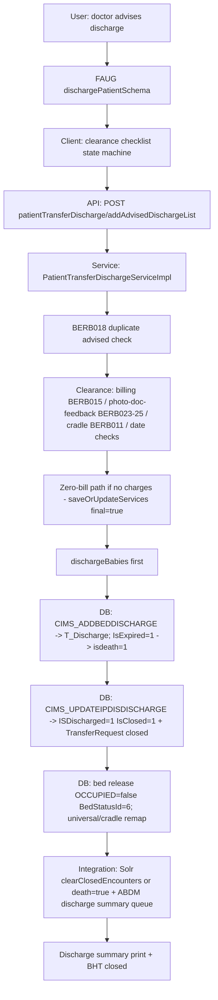

# Workflow: Discharge (advise → clearance → execution → bed release)

**Source evidence:** `_discovery/agent-06/findings.md` §1.4 (steps 1–10) · `04-api-catalog.md` (patientTransferDischarge) · `06-business-rules-catalog.md` BR-DIS-001..003 · `10-target-architecture.md:30`
**Target service:** ADT & Bed (PatientDischarged event)

## Purpose
Advise discharge, run clearance (billing/photo/doc/feedback), execute the discharge (incl. death handling and zero-bill path), close the admission, release the bed, and trigger Solr/ABDM side effects.

## Actors
Doctor (advises) · Discharge desk / ward nurse · Billing (clearance) · Mortuary (death cases) · Bed manager

## Steps

| Step | Layer | Component (file:line) | Action | Data/Table | Notes |
|---|---|---|---|---|---|
| 1 | UI | `ip:updateDischargeStatus` / `dischargePatientSchema.json`, `discharge_clearance_schema.json` (`clearanceTab.html`) | Advise discharge; clearance tabs | T_AdviseDischarge | 24 `patientTransferDischarge.*` refs (09-react-migration-design.md:104) |
| 2 | API | `POST patientTransferDischarge/addAdvisedDischargeList` (`PatientTransferDischargeServiceImpl.java:907-946`) | Advise; duplicate active advised → `BERB018`; re-advise updates Status=true; babies advised too (`:949+`) | T_AdviseDischarge | BR-DIS-001 |
| 3 | API | `POST patientTransferDischarge/discharge` (`:389-902`) | Execute discharge | – | BR-DIS-001 preconditions |
| 4 | SVC | Precondition bundle (`:389-509`) | dates ≥ admission (`:392-400`); advised required → `BERB023` (`:402-405`); photo/doc/feedback triple → `BERB023/024/025` (`:406-416`); `validatePatientDischarge` → `BERB014` (`:423-425`); pending amount >0 excl. gate-pass → `BERB015` (`:426-438`); cradle baby unfinalized bill → `BERB011` (`:450-453`); discharge date ≥ last charge (`:454-460`); "TRANSFER TO OTHER HOSPITAL" → inter-hospital admission request + COVID referral (`:463-508`) | T_AdviseDischarge, T_Discharge | BR-DIS-001 |
| 5 | SVC | Zero-bill discharge (`:511-668`) | Final zero bill via `addServiceOrderServiceImpl.saveOrUpdateServices` (serviceOrderDto.final=true + all charges) | T_Bill, T_Charges | RISK R6: snapshot restore |
| 6 | SVC | `helper.dischargeBabies` (`:671-704`) | Babies discharged first | T_AdmissionDetails | |
| 7 | DB | `CIMS_ADDBEDDISCHARGE` → T_Discharge (`generated-procs/CIMS_ADDBEDDISCHARGE.sql:24-41`) | Insert discharge; death type (`IsExpired=1`) → `t_registration_details.isdeath=1` | T_Discharge, T_Registration_Details | BR-DIS-002 |
| 8 | SVC | Death handling (`:752-769`) | T_Discharge IsDeath/DeathDate/HandOvrDate; PatientDeathDetails saved | PatientDeathDetails | |
| 9 | DB | `CIMS_UPDATEIPDISDISCHARGE` (`:771-777`; proc `generated-procs/CIMS_UPDATEIPDISDISCHARGE.sql`) | `ISDischarged=1`, `IsClosed='1'` (+ babies); T_TransferRequest `IsClosed='1'` | T_AdmissionDetails, T_TransferRequest | BR-DIS-002 |
| 10 | DB | Bed release (`:782-793`; `CIMS_UPDATEBEDOCCUPIEDFLAG`) | `OCCUPIED=false` + `BedStatusId=6`; universal bed → origin (`:796-798`); cradle bed → cradle ward (`:800-803`) | M_BEDMASTER | BR-DIS-003; R5 |
| 11 | INT | Solr (`:808-812`, `:820-825`) | death → patient `death=true`; else `clearClosedEncounters` | Solr | |
| 12 | INT | ABDM (`:881`) | Discharge summary queue entry | T_OUTBOUNDHIS (ABDM queue) | |
| 13 | API | `POST patientTransferDischarge/cancelDischarge`, `updateDischargeDetails`, `markAsNotReported`, `addAbscondDischarge` | Post-execution corrections | T_Discharge | |

## Flowchart

## Business rules involved
BR-DIS-001 (preconditions incl. transfer-to-other-hospital), BR-DIS-002 (execution + death), BR-DIS-003 (bed release), BR-BILL-008 (cancellation/refund interplay after discharge — R6)

## Edge cases
- Death discharge → isdeath flag, PatientDeathDetails, Solr `death=true`, encounters NOT cleared.
- Baby decoupling on discharge; cradle beds re-mapped.
- Zero-bill discharge rebuilds a full final bill — any charge missing `*BeforeFinalization` snapshot breaks later cancellation restore (R6).
- "TRANSFER TO OTHER HOSPITAL" triggers inter-hospital admission request + COVID referral.
- Abscond discharge (`addAbscondDischarge`) and mark-as-not-reported paths.

## Unknowns
- Clearance sub-statuses (which departments must clear before discharge is allowed) not enumerated in agent-06 findings.
- Discharge summary content/formatting handled in templates (`Common_Dis_Form`, diagnosis/surgery/medicine variants) — content rules not traced.
