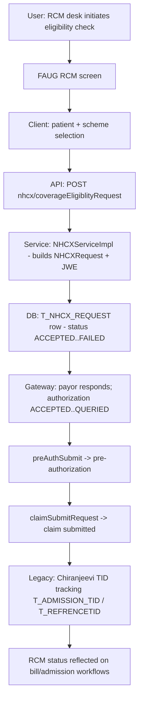

# Workflow: Insurance & RCM (eligibility → pre-auth → claims)

**Source evidence:** `_discovery/agent-06/findings.md` §1.10 (NHCX/authorization enums) · `04-api-catalog.md` (ABDM module NHCX endpoints) · `05-database-catalog.md` §3.5 (T_NHCX_REQUEST, T_ELIGIBILITYCHECK, T_ADMISSION_TID) · `10-target-architecture.md:49` (RCM service) · `02-business-module-catalog.md` (RCM/chiranjeevi)
**Target service:** RCM & Claims — ClaimSubmitted / EligibilityChecked events

> **Fidelity note:** This workflow has the *thinnest* agent-06 evidence of all 17 workflows. Internal step ordering (who calls what, state transitions) is **NOT fully evidenced**; the table below documents only what the source docs pin down. Treat step order as provisional until agent-06/deeper discovery covers `RcmServiceImpl` / `NHCXServiceImpl`.

## Purpose
Check payer eligibility, run pre-authorization, and submit claims via the NHCX (National Health Claims Exchange) — the ABDM-era RCM path — plus legacy Chiranjeevi/RGHS scheme handling.

## Actors
RCM/insurance desk · Corporate/insurance company · NHCX gateway · Chiranjeevi app (external)

## Steps

| Step | Layer | Component (file:line) | Action | Data/Table | Notes |
|---|---|---|---|---|---|
| 1 | API | `POST /nhcx/coverageEligiblityRequest` (`abdm.NHCXServiceImpl.checkCoverageEligiblityRequest`) | Coverage eligibility request | T_NHCX_REQUEST (create) | request types 0–4 per GenericConstants (see STATUS-CODE-DICTIONARY §NHCX) |
| 2 | API | `POST /nhcx/insurancePlanRequest` (`fetchInsurancePlanRequest`) / `GET /nhcx/insurancePlanRequestById` (`fetchInsurancePlanRequestById`) | Plan request + query | T_NHCX_REQUEST | |
| 3 | API | `POST /nhcx/fetchPolicies` (`fetchPolicies`) | Policy details from payor | T_NHCX_REQUEST | |
| 4 | API | `POST /nhcx/preAuthSubmit` (`preAuthSubmit`) | Pre-authorization submission | T_NHCX_REQUEST | |
| 5 | API | `POST /nhcx/claimSubmitRequest` (`claimSubmit`) | Claim submission | T_NHCX_REQUEST(+DETAILS) | |
| 6 | API | `POST /nhcx/allParticipants` (`getAllParticipants`); `POST /nhcx/fetchPayorCerts` (`fetchPayorCerts`) | Payor discovery + certs (JWE via Nimbus) | – | 04-backend-architecture.md:5 |
| 7 | API | `GET /nhcx/previousEligiblities` (`fetchPreviousEligiblities`); `GET /nhcx/showNhcxDocument` | History + document view | T_NHCX_REQUEST | |
| 8 | SVC | `GenericConstants.java:47-60` | Authorization states ACCEPTED=0..QUERIED=8 (payor side) | – | STATUS-CODE-DICTIONARY §Authorization |
| 9 | SVC | `GenericConstants.java` (NHCX block) | Request status ACCEPTED=0..FAILED=3 | T_NHCX_REQUEST | |
| 10 | INT | `T_REFRENCETID`, `T_ADMISSION_TID`, `BENEFICIARY_ENROLMENT_IHMS` (05 §3.5); chiranjivi.* (07-integrations-and-search.md:214) | Legacy Chiranjeevi TID tracking + enrolment | T_ADMISSION_TID, T_REFRENCETID | scheme INSURANCESCHEMEID=2 |
| 11 | UI | RCM routes (`rcm` module, `chiranjeeviapp`); eligibility screens (`rghsEligibilityCheckSchema`) | Desk screens | – | thin evidence |

## Flowchart

## Business rules involved
(No BR-* from the 06 catalog maps to this workflow — it is integration-driven.) Enums in play: NHCX request types 0–4; NHCX status 0=ACCEPTED..3=FAILED; Authorization 0=ACCEPTED..8=QUERIED (STATUS-CODE-DICTIONARY §Other enums).

## Edge cases
- Payor cert refresh (`fetchPayorCerts`) — JWE-encrypted exchange.
- Dual paths: ABDM-era NHCX vs legacy Chiranjeevi/RGHS schemes (INSURANCESCHEMEID=2).
- Previous-eligibility history lookup for re-verification.

## Unknowns
- **Internal state machine of T_NHCX_REQUEST is not evidenced** (request→eligibility→pre-auth→claim transitions; retry/poll semantics).
- Which bill/admission events *trigger* claim submission automatically vs manually — not traced.
- Chiranjeevi enrolment callback handling (`T_REFRENCETID`) — 07 doc cites `PatientServiceImpl.java:298-320`; admission/discharge flows update TID — detail not in agent-06.
- Authorization enum consumption site (which service reads ACCEPTED..QUERIED) — not traced.
