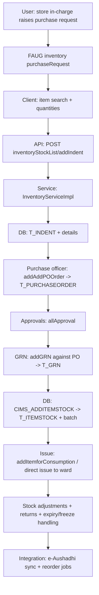

# Workflow: Inventory & Procurement (indent → PO → GRN → stock/issue)

**Source evidence:** `03-legacy-frontend-inventory.md` §2.8 (57 routes) · `04-api-catalog.md` (inventoryStockList endpoints) · `05-database-catalog.md` §7 (T_ITEMSTOCK/T_ITEMCLINIC graph) · `10-target-architecture.md:37` (Inventory service) · `02-business-module-catalog.md` M14
**Target service:** Inventory & Procurement — InventoryUpdated / PurchaseOrderPlaced / GRNPosted events

> **Fidelity note:** agent-06 findings do NOT trace the inventory step order. This workflow is synthesized from the frontend route inventory (03), the API catalog (04), and the target architecture (10). The step *sequence* (indent → PO → GRN → stock → issue) follows the standard procurement cycle implied by those sources; status codes beyond the ones noted are UNKNOWN (02-business-module-catalog.md:701 explicitly defers status extraction to agent 06 — which did not enumerate them).

## Purpose
Maintain item masters, batches and stock: raise indents, convert to purchase orders, receive goods (GRN), adjust stock, and issue items to wards/departments (incl. pharmacy stock consumption and e-Aushadhi integration).

## Actors
Store in-charge · Purchase officer · GRN clerk · Department/ward requisitioner · Finance (approvals) · e-Aushadhi system (external)

## Steps

| Step | Layer | Component (file:line) | Action | Data/Table | Notes |
|---|---|---|---|---|---|
| 1 | UI | `inventory:purchaseRequest`, `inventory:consolidatePurchaseRequest`, `inventory:indentListofStore` | Raise requisition / consolidate | – | inventory-module.js (1.08 MB, 301+ API refs) |
| 2 | API | `POST inventoryStockList/addIndent` (`InventoryServiceImpl.addIndent`, Tx: Y) | Create indent | T_INDENT, T_INDENTDETAILS | |
| 3 | UI | `inventory:reOrderList`, `inventory:currentPO`, `inventory:raiseDirectPO`, `inventory:poByHQ` | PO creation from indent/reorder | – | |
| 4 | API | `POST inventoryStockList/addAddPOOrder` (`addPurchaseOrder`, Tx: Y) / `addAddPOIndent` (`addAddPOIndent`) | Create PO | T_PURCHASEORDER | |
| 5 | UI | `inventory:allApproval` | PO approvals | – | |
| 6 | API | `POST inventoryStockList/addGRN` (`addGRN`, Tx: Y); `GET getPoNumberforGRN` | Receive goods against PO | T_GRN, T_GRNDETAILS | `addConsignmentGRN` variant |
| 7 | SVC | `checkLastGrnDetails` / `checkPORaisedDetails` | Pre-GRN validation | – | |
| 8 | DB | `CIMS_ADDGRN`, `CIMS_ADDITEMSTOCK` (10-target-architecture.md:37 legacy sources) | Stock postings; batch creation | T_ITEMSTOCK, T_ITEMBATCHMASTER | stock concurrency hotspot (10 §3.4) |
| 9 | API | `POST inventoryStockList/addItemforConsumption` / issue endpoints (`getIndentIssueDetailsById`, direct issue) | Issue to departments/wards | T_ITEMSTOCK | |
| 10 | API | `POST inventoryStockList/addGRNReturn`, `addtemSaleReturn` (itemsales) | Returns to supplier / from wards | T_GRN | |
| 11 | SVC | `freezItemBatchStatus` (Tx: Y), `recallExpiredItem`, `expiryItemReturnList` | Batch freeze + expiry handling | T_ITEMBATCHMASTER | `expiryitem/*` 47 endpoints |
| 12 | API | `inventoryStockList/startEAushadhiItemUpdateJob`, `getEAushadiItemStockDetails`, `getStoreIdByEashadiStoreId` | e-Aushadhi sync | – | `eAushadiItemStockUpdate.schedule=0 0 4 * * ?` |
| 13 | INT | `InventoryJobSchedule` (5 jobs, 04-backend-architecture.md:130) | Reorder-level summary, auto-indent triggers | t_reorderlevelsummery | |
| 14 | UI | `inventory:itemSummary`, `itemStockList`, `stockTransfer`, `StoreStockAdjustment` | Stock views / transfers / adjustments | T_ITEMSTOCK | |

## Flowchart

## Business rules involved
(No BR-* from the 06 catalog maps to inventory — agent-06 did not cover procurement. BR-PHAR-002/BR-BLD rules touch stock only indirectly.)

## Edge cases
- Consignment GRN vs regular GRN (`addConsignmentGRN`).
- PO scanning (`getPoNumberForPoScanGrn`) and multi-unit PO (`poRaisedForOtherUnit`).
- Batch freeze blocks dispensing; expired batches recalled (`recallExpiredItem`).
- e-Aushadhi item/stock sync runs nightly (04 §7).

## Unknowns
- **Status codes**: indent/PO/GRN statuses flagged as UNKNOWN (02-business-module-catalog.md:701: "agent 06 should extract code lists from DB seed scripts, not code" — agent-06 did not cover inventory). Verification method: extract `STATUS` literals from T_INDENT/T_PURCHASEORDER/T_GRN seed data.
- Approval matrix (who approves what amount) not traced.
- Stock-adjustment reason codes (`StockAdjustmentDetailsPrint`) not traced.
