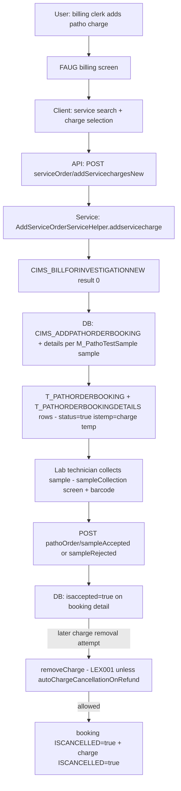

# Workflow: Lab Order (order creation → sample collection → accept/reject)

**Source evidence:** `_discovery/agent-06/findings.md` §1.5 step 9 (bill-time auto-creation) + §1.7 (steps 1–3) · `03-legacy-frontend-inventory.md` §2.6 (pathology routes) · `04-api-catalog.md` (pathoOrder) · `10-target-architecture.md:34`
**Target service:** Lab (Pathology) — LabOrderCreated event

## Purpose
Create the pathology order booking (normally auto-created when the patho charge is billed), collect samples with barcode identity, accept or reject them, and gate charge removal on the sample state.

## Actors
Billing clerk (triggers order) · Lab technician (collect/accept/reject) · Pathologist

## Steps

| Step | Layer | Component (file:line) | Action | Data/Table | Notes |
|---|---|---|---|---|---|
| 1 | SVC | `addservicecharge` (`custom/AddServiceOrderServiceHelper.java:421-519`) | Patho charge (specialization=1) → `CIMS_BILLFORINVESTIGATIONNEW`; result 0 → order booking | – | BR-BILL-003 |
| 2 | DB | `CIMS_GETPATHOTESTLISTFORBILL` → `CIMS_ADDPATHORDERBOOKING` (testType=1) + `CIMS_ADDPATHORDERBOOKINGDETAIL` per sample | Booking rows `status=true`, `istemp` mirrors charge temp-ness; details: `SampleCollectionNO=1..n`, `SampleNo=0`, `IsOutSourced=false`, `PathologistId=0` | T_PATHORDERBOOKING, T_PATHORDERBOOKINGDETAILS, M_PathoTestSample | BR-BILL-003 |
| 3 | UI | `pathology:sampleCollection/:opdipd/:mrnNo/:catg(/:date)` (patho-booking-module.js) | Worklist of orders awaiting collection | – | barcode scanning (`qrcodeScanner.html`) |
| 4 | API | `POST pathoOrder/sampleAccepted` (`custom.PathoOrderServiceImpl.saveAccepted`) | Mark sample accepted | T_PATHORDERBOOKINGDETAILS | |
| 5 | API | `POST pathoOrder/sampleRejected` (`custom.PathoOrderServiceImpl.sampleRejected`) | Reject sample | T_PATHORDERBOOKINGDETAILS | Tx: Y |
| 6 | SVC | `getSampleStatus` (`custom/AddServiceOrderHelper.java:3693-3719`) | `isaccepted=true` on latest booking detail gates removal | T_PATHORDERBOOKINGDETAILS | BR-PATH-001 |
| 7 | API | `DELETE api/rest/serviceOrder/removeCharge` (`AddServiceOrderServiceImpl.removeCharge`) | Charge removal attempt | T_Charges | BR-PATH-001: accepted sample + no `autoChargeCancellationOnRefund` → `LEX001`; else booking `ISCANCELLED=true`; charge `ISCANCELLED=true` |
| 8 | UI | `pathology:sampleGenerateBarcode`, `pathology:workLoadList`, `pathology:LabN` | Barcode labels; workload | – | KDL machine verification path (`kdlVerify`) |
| 9 | API | `POST serviceOrder/updateOrderStatus`, `updateServiceStatus` | Order/service status updates | T_PATHORDERBOOKING | |

## Flowchart

## Business rules involved
BR-BILL-003 (patho order auto-creation at billing), BR-PATH-001 (sample collection locks charge removal, LEX001)

## Edge cases
- 0 samples defined for the test → booking without details.
- Temp (unconsumed) charges create temp bookings (`istemp` mirror).
- Rejected samples: `sampleRejected` path (Tx) — re-collection/retest flows via `sampleRetestSchema`.
- Out-sourced tests (`IsOutSourced=false` default; outsourcing toggles not traced).

## Unknowns
- `CIMS_BILLFORINVESTIGATIONNEW` non-zero return semantics (what other result values mean).
- Sample-collection time-window / expiry rules for uncollected orders (lab side) not in agent-06 findings (contrast: blood requisition expiry is traced — BR-BLD-004).
- Sample numbering/accession rules beyond `SampleCollectionNO` sequence.
