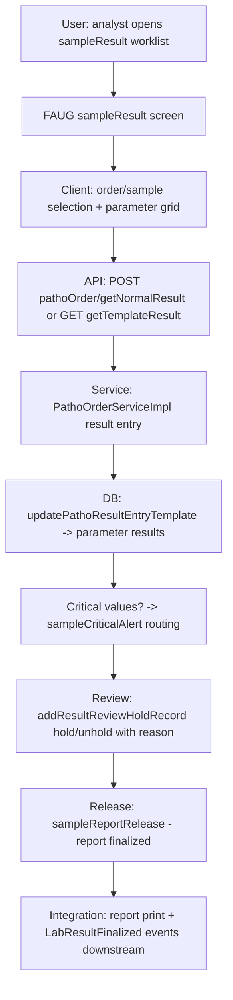

# Workflow: Lab Result (result entry → review/hold → release)

**Source evidence:** `_discovery/agent-06/findings.md` §1.7 step 4 · `03-legacy-frontend-inventory.md` §2.6 (sampleResult, sampleCriticalAlert, sampleResultReview, sampleReportRelease, showStatus) · `04-api-catalog.md` (pathoOrder endpoints) · `10-target-architecture.md:34` (LabResultFinalized)
**Target service:** Lab (Pathology) — LabResultFinalized event

## Purpose
Enter test results per sample (normal or template-driven), review with hold/release control, handle critical alerts, and produce the final report — with machine (KDL) result verification.

## Actors
Lab technician / analyst · Pathologist (review & sign-off) · Machine (KDL LIS)

## Steps

| Step | Layer | Component (file:line) | Action | Data/Table | Notes |
|---|---|---|---|---|---|
| 1 | UI | `pathology:sampleResult/...`, `pathology:sampleMachineWiseResult(/:...)` (patho-modules.js) | Result worklist per order | – | 114 `pathoOrder/*` refs (03 §2.6) |
| 2 | API | `POST pathoOrder/getNormalResult` (`custom.PathoOrderServiceImpl.getNormalResult` `:380-1092` region) | Load normal test result grid | T_PATHOPATIENTPARAMETERDETAILS (read) | |
| 3 | API | `GET pathoOrder/getTemplateResult` (`getTemplateResult`) | Load template-driven result form (patho-modules.js:4999 `templatePreResultFunc`) | – | also used for review |
| 4 | API | `POST pathoOrder/updatePathoResultEntryTemplate` (`updatePathoResultEntryTemplate`) | Save entered results | T_PATHOPATIENTPARAMETERDETAILS | |
| 5 | API | `POST pathoOrder/addResultReviewHoldRecord` (+Notes) (`addResultReviewHoldRecord`, `:380-1092`) | Review hold/unhold with reason (`resultHoldUnholdFunc` patho-modules.js:4912) | review/hold records | Tx: Y |
| 6 | API | `POST pathoOrder/sampleRejected` variants / retest | Reject-to-retest on bad results | T_PATHORDERBOOKINGDETAILS | sampleRetestSchema |
| 7 | UI | `pathology:sampleCriticalAlert/...` (criticalAlertResultSchema) | Critical-value alert routing | – | |
| 8 | UI | `pathology:sampleReportRelease/...` (reportReleaseSchema) | Finalize + release report | T_PATHORDERBOOKINGDETAILS | release/finalize state owned server-side (03 §3) |
| 9 | INT | `api/rest/kdl` `getResultsFromKDL` (`/patient`) (02-business-module-catalog.md:264) | Machine result verify | – | KDL machine interface |
| 10 | UI | `pathology:printAllReport`, `pathology:showLabResult`, `pathology:showStatus`, `updateOrderStatus`, `updateServiceStatus` | Print / status | – | |

## Flowchart

## Business rules involved
BR-PATH-001 (sample-state gating — result entry only on accepted samples), BR-BILL-003 (order must exist from billing)

## Edge cases
- Template-driven tests (profile/panel) use template results; hold/review before release.
- Machine-wise results (KDL) verified before acceptance.
- Retest path via `sampleRejected`/`sampleRetestSchema` after result issues.
- Critical alerts route to designated staff — exact routing rules not traced.

## Unknowns
- The exact release/finalize status transitions and their numeric codes (release/finalize states "owned by server" per 03 §3; numeric values not in agent-06 findings).
- Hold reasons / review authority matrix not traced.
- Result validation ranges (reference ranges per parameter) live in masters — rules not traced.
