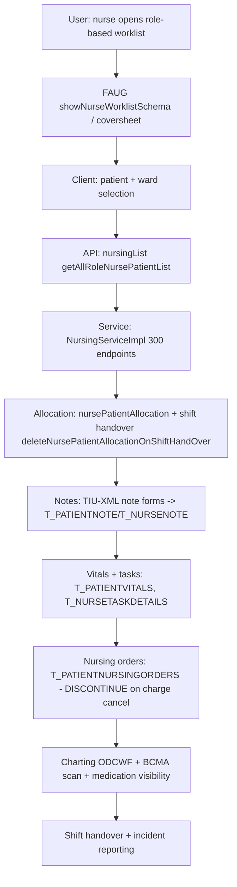

# Workflow: Nursing (allocation → notes/vitals → tasks → shift handover)

**Source evidence:** `03-legacy-frontend-inventory.md` §2.4 (nursing routes, nursingList ~293 endpoints) · `_discovery/agent-03/findings.md:156` (nursing module API refs) · `02-business-module-catalog.md` M15 · `10-target-architecture.md:39` (Nursing service)
**Target service:** Nursing & Inpatient Care — VitalsRecorded / NurseTaskCompleted events

> **Fidelity note:** agent-06 findings do NOT trace the nursing step order (nursing was out of its scope). This workflow is synthesized from the frontend inventory (03), the business module catalog (02), and the target architecture (10). No BR-* rules from the 06 catalog apply directly; the only linkage is BR-PATH-001's `T_PATIENTNURSINGORDERS.orderstatus=DISCONTINUE` write on charge cancellation.

## Purpose
Allocate nurses/patients, record notes and vitals, manage care plans and nursing orders, plan and execute care tasks, and hand over across shifts — the largest API surface in the system (~293 `nursingList/*` endpoints).

## Actors
Nurse · Nursing in-charge · Ward clerk · Doctor (co-signs orders/notes) · Allied staff (physio etc.)

## Steps

| Step | Layer | Component (file:line) | Action | Data/Table | Notes |
|---|---|---|---|---|---|
| 1 | UI | `nursing:roleNurse`, `roleNurseIncharge`, `rolePatientCoversheet/:patientId/:admId/...` (showPatientCoversheetSchema.json) | Role-based patient lists + coversheet | – | nursing-module.js 795 KB |
| 2 | API | `nursingList/getAllRoleNursePatientList`, `getPatient` | Patient list per role/ward | T_Encounter/T_Admission (read) | agent-03 findings:156 |
| 3 | API | Allocation: `nursingList/deleteNursePatientAllocationOnShiftHandOver`, `getAllocatedNursesByPatientId`, `nurseDoctorDeAllocation`; screens `rolePatientAllocation`, `nurseWardAllocation`, `nursePatientAllocation` | Allocate/deallocate nurse↔patient; shift handover | T_NURSEPATIENTDETAILS (seq `T_nursePatientDetails_seq`, 05 §4) | 03 §2.12 Allocation |
| 4 | API | `nursingList/addAquityByPatientDetails`, `getPatientEDOD` | Acuity + EDOD (expected date of discharge) | – | agent-03 findings:156 |
| 5 | UI | Notes engine: `tiuxml.js` + `tiuxml.json` (219 KB) + `tiuxml_mapping.json`; routes `patientNotes/:...`, `rolePatientNote` | TIU-XML note forms | T_PATIENTNOTE, T_NURSENOTE | 03 §2.4 notes engine |
| 6 | API | `nursingList/*` vitals/tasks: `getPatientVitals`, task list/save endpoints (04-api-catalog nursing bucket) | Vitals recording; task planning | T_PATIENTVITALS, T_NURSETASKDETAILS, T_NURSETASKFREQUENCYDETAILS | tables per 02 M15 |
| 7 | API | `nursingList/getLabAndRadOrderDetails`, `serviceOrder/allServiceFastByGet`, `pharmacy/getMedications` | Cross-module order/medication visibility | – | agent-03 findings:156 |
| 8 | SVC | `T_PATIENTNURSINGORDERS.orderstatus = DISCONTINUE` (`custom/AddServiceOrderServiceHelper.java:3819`) | Nursing order discontinued when its charge is cancelled | T_PATIENTNURSINGORDERS | BR-PATH-001 linkage |
| 9 | UI | `nursing:NursePrescriptionList/:tab`, `nursing:orderingSet` | Nurse medication orders; order sets | T_PATIENTMEDICATION, T_PATIENTEORDER | |
| 10 | UI | Charting: `charting:chartingApp`/`chartingExpand` (ODCWF_*.json 29 formats); BCMA: `bcma:unitDose`, `bcma:scanWristband/:patientMrn` | Charts (ANC, coronary, transfusion…); bedside medication scan | – | 03 §2.4 |
| 11 | UI | `nursing:multipleShiftHandOff` (shift handover); `nursing:incidentReporting` | Handover; incident report/resolve | incident tables | 03 §2.12 |
| 12 | UI | `nursing:showMortuary`, `nursing:showTransfer`, `nursing:showDischarge` | Mortuary/transfer/discharge views | – | |

## Flowchart

## Business rules involved
BR-PATH-001 (nursing-order DISCONTINUE on charge cancellation — the only direct nursing rule in the 06 catalog). No other BR-* applies; nursing is workflow-heavy, rule-light in the current catalog.

## Edge cases
- Shift handover deletes allocations (`deleteNursePatientAllocationOnShiftHandOver`) — re-allocation next shift.
- Nurse medication orders flow into pharmacy prescription workflows (NursePrescriptionList).
- Mortuary view for deceased patients (post-discharge).
- BCMA scanning validates patient + medication at bedside.

## Unknowns
- **Nursing task status codes** (planned/started/complete/skipped) not enumerated (02 M15 statuses; agent-06 did not cover).
- Nursing-order status semantics beyond the DISCONTINUE literal (TaskConstants.DISCONTINUE) — full `orderstatus` code list unknown.
- Acuity scoring inputs/algorithm (`addAquityByPatientDetails`) not traced.
- Note title/approval workflows (which roles must sign notes) not traced.
