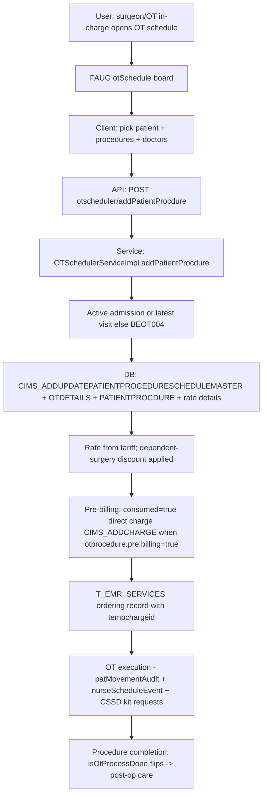

# Workflow: OT & Surgery (schedule → procedure → pre-billing → completion)

**Source evidence:** `_discovery/agent-06/findings.md` §1.8 (steps 1–3) · `04-api-catalog.md` (otscheduler) · `03-legacy-frontend-inventory.md` §2.11 (OT routes) · `10-target-architecture.md:38` (OT & Surgery)
**Target service:** OT & Surgery — ProcedureScheduled / SurgeryCompleted events

## Purpose
Schedule an OT session for an admitted (or last-visit) patient, record procedures with tariff rates and dependent-surgery discounts, create the pre-bill charge when enabled, and track procedures through completion (`isOtProcessDone`).

## Actors
Surgeon · Anesthesiologist · OT in-charge / nurse · Billing desk

## Steps

| Step | Layer | Component (file:line) | Action | Data/Table | Notes |
|---|---|---|---|---|---|
| 1 | UI | `ot:surgList`, `ot:otSchedule/:otId/:tableId`, `ot:addNewSurg`, `ot:surgDetails` (operation-theatre.js 324 KB) | OT schedule board; procedure list | – | 79 `otscheduler/*` endpoints (03 §2.11) |
| 2 | API | `POST otscheduler/addPatientProcdure` (`pas.OTSchedulerServiceImpl.addPatientProcdure` `:596-800`) | Submit schedule + procedures | – | also called from billing (`billing-module.js:9852,9878`) |
| 3 | SVC | Patient context (`:616-631`) | active admission, else latest visit; none → `BEOT004` | T_Admission / T_Encounter (read) | BR-OT-001 |
| 4 | DB | `CIMS_ADDUPDATEPATIENTPROCEDURESCHEDULEMASTER`; `CIMS_ADDUPDATEOTDETAILS`; per procedure `CIMS_ADDUPDATEPATIENTPROCDURE` (+ rate details); `CIMS_ADDUPDATEOTDETAILSDOCDETAILS` | Schedule master, OT details, procedure rows, doctor rows | T_OTSCHEDULE, T_OTDETAILS, T_PATIENTPROCEDURE, T_PATIENTPROCEDURERATEDETAILS | BR-OT-001 |
| 5 | SVC | Rate & discount (`:731-736`, `:759-768`) | procedure rate from `getServicePriceDetails` (0 if none); dependent-surgery discount% | T_PATIENTPROCEDURERATEDETAILS | |
| 6 | SVC | Pre-billing (`custom/AddServiceOrderServiceImpl.java:2202-2204`) | `otprocedure.pre.billing=true` → procedure charge `consumed=true` → `CIMS_ADDCHARGE` direct (NOT temp) | T_Charges | BR-OT-002 |
| 7 | SVC | Doctor share skip (`AddServiceOrderServiceHelper.java:383-386`) | OT tariff services never produce doctor-share rows | T_DOCTORSHARE | BR-OT-002 |
| 8 | SVC | Ordering record (`OTSchedulerServiceImpl.java:4069-4077`) | `T_EMR_Services` is the ordering row; `tempchargeid` links to charge; ordered-procedure query filters `isOtProcessDone=false`, `sm.otprocedure=true` | T_EMR_SERVICES | |
| 9 | UI | `ot:surgSchedule`, `ot:procPerformance`, `ot:patMovementAudit`, `ot:itemDetailsEvent`, `nurseScheduleEvent` | Surgery execution, movement audit, events | – | |
| 10 | INT | CSSD/Inventory interplay (`procedureCssd*` requests, item sales for OT `itemsales/getItemSalesForOT`) | Kit requests + consumables | T_PROCEDURECSSD*, T_ITEMSALE | 10 §2.1 row 11/15 |

## Flowchart

## Business rules involved
BR-OT-001 (scheduling prerequisites, BEOT004), BR-OT-002 (OT pre-billing, doctor-share skip, isOtProcessDone filter), BR-BILL-002 (doctor share skip for OT tariff services)

## Edge cases
- OPD-visit patients (no admission) can still be scheduled using the latest visit.
- No tariff rate → rate 0 (charge may be zeroed at billing).
- `isOtProcessDone=false` filter ensures pending procedures re-list.
- Pre-billing creates direct (consumed) charges so OT bills upfront.

## Unknowns
- `isOtProcessDone` transition points (which step flips it) not pinned in agent-06 findings.
- Surgery completion/notes workflows (surgerynotes, anesthesianotes) content rules not traced.
- OT equipment/table assignment rules (`otconfig/*` 35 endpoints) not traced.
