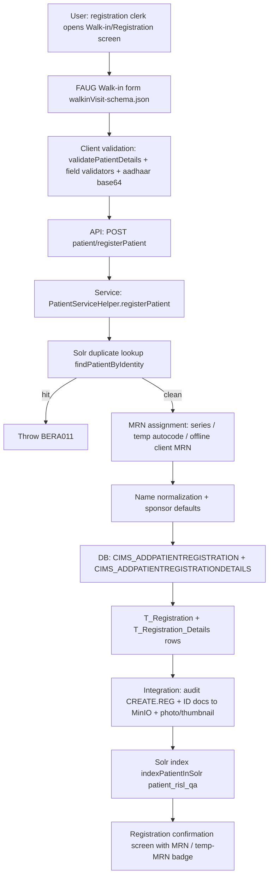

# Workflow: Patient Registration

**Source evidence:** `_discovery/agent-06/findings.md` §1.1 (steps 1–12) · `03-legacy-frontend-inventory.md` §2.1 · `04-api-catalog.md` (registerPatient) · `05-database-catalog.md`
**Target service:** Patient Identity & Registration (10-target-architecture.md:28)

## Purpose
Create the patient master record (T_Registration/T_Registration_Details) with identity-deduplication, MRN assignment (three modes), sponsor defaults, ID-document/photo storage, and Solr indexing — the root record every other workflow keys off.

## Actors
Registration clerk / Front office operator · Patient or attendant (kiosk/self mode) · Unit staff (offline mode)

## Steps

| Step | Layer | Component (file:line) | Action | Data/Table | Notes |
|---|---|---|---|---|---|
| 1 | UI | FAUG walk-in form, `walkinVisit-schema.json:4` dynamicAspects (`appointment-module.js:156`) | Enter demographics; `gvar@isExtLMISEnabled` forces mobileNo/resAddress; `gvar@app_type_w` s/k variants | – | 60-field form; patient-search typeahead first |
| 2 | JS | `setWalkinObject` (schema beforeOp) | Assemble `AddPatientRegistrationDto`; aadhaar base64 (`encodeAdharToBase64`) | – | schema serialize function |
| 3 | API | `POST api/rest/patient/registerPatient` (`pas/PatientServiceImpl.java:3519`) | Batch register; `@Transactional(rollbackOn=Exception.class)` | – | |
| 4 | SVC | `PatientServiceHelper.registerPatient` (`custom/PatientServiceHelper.java:232-987`) | Delegates per-DTO | – | |
| 5 | SVC | `PatientServiceHelper.java:288-296` | Name normalization: first 3 tokens → firstName, 4th+ → lastName | – | |
| 6 | SVC | `PatientServiceHelper.java:661-669` | Duplicate check via Solr `findPatientByIdentity(0L, body)`; hit → `BERA011` | Solr `patient_risl_qa` | BR-PAT-002 |
| 7 | SVC | `PatientServiceHelper.java:373-425` | MRN generation: series mode / temp MRN via `cims_getlatestautocodeandincremetitbyone('T AppoinmentTempMrn')` / offline client-MRN; blank series → `IsTempMrno=true` | M_MRNSeries | BR-PAT-001; `:378` flag |
| 8 | SVC | `PatientServiceHelper.java:281-291` | Sponsor defaults (tariffId, insuranceSchemeId/planId fallback) | T_PATIENTSPONSOR | BR-OPD-005 link |
| 9 | DB | `CIMS_ADDPATIENTREGISTRATION` (`PatientServiceHelper.java:726-729`) | Insert T_Registration (patientId, MRNo) | T_Registration | |
| 10 | DB | `CIMS_ADDPATIENTREGISTRATIONDETAILS` (`PatientServiceHelper.java:802-804`) | Insert T_Registration_Details | T_Registration_Details | |
| 11 | SVC | `PatientServiceHelper.java:825-829` | Emergency: `isDeath=broughtDead` | T_Registration_Details_int | BR-OPD-008 link |
| 12 | INT | `PatientServiceHelper.java:730-762` | Audit `CREATE.REG` (`:734-738`); ID docs → MinIO (`:730-749`); photo+thumbnail (`:750-762`) | MinIO | |
| 13 | SVC | `PatientServiceHelper.java:783-790` | HealthId duplicate check → `BEXA040` with existing MRN | Solr | BR-PAT-002 |
| 14 | INT | `solrUtil.indexPatientInSolr` (`PatientServiceHelper.java:849`; `util/SolrUtil.java:198-203`) | Index patient | Solr `patient_risl_qa` | `solrEnabled` flag |
| 15 | SVC | `PatientServiceHelper.java:817-933` (update path, patientId>0) | Delta-update details/registration (insurance, address, name, mobile, DOB); `indexUpdPatientInSolrMinimal` | T_REGISTRATION(+DETAILS) | same endpoint handles edits |
| 16 | UI | Confirmation screens (`op:appointment_confirmed`, `op:walkin_confirmed`) | Show MRN / proceed to visit | – | `afterOp.func: setViewOpdChargesRoute` |

## Flowchart

## Business rules involved
BR-PAT-001 (MRN generation, 3 modes + permanent upgrade), BR-PAT-002 (Solr duplicate detection, BERA011/BEXA040), BR-PAT-003 (familyId/memberId pairing, BERP007), BR-OPD-005 (sponsor defaults at registration), BR-OPD-008 (brought-dead → isdeath, emergency path), BR-OPD-009 (validation gates)

## Edge cases
- Same patient re-registered concurrently → only one passes the Solr duplicate check.
- MRN from series blank → `IsTempMrno=true`; must be promoted on first visit/admission (`EmergencyAndWalkinVisitServiceImpl.java:678-684`, `PatientRegAdmissionServiceImpl.java:378-386`).
- Offline unit → client-supplied MRN used as-is (no dedup against Solr).
- Emergency brought-dead registration → isdeath flag on details.

## Unknowns
- Solr availability: if Solr is down/unreachable, is duplicate-check skipped or fatal? (`solrEnabled` flag exists — behavior when disabled not traced.)
- MinIO failure handling (rollback vs degrade) not traced.
- Exact `dynamicAspects` merge semantics of the walk-in schema branches (03-legacy-frontend-inventory.md open Q7).
