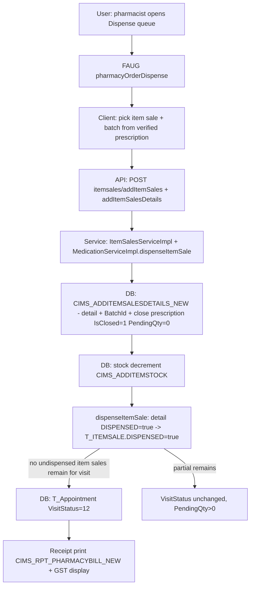

# Workflow: Pharmacy Dispensing (item sale → visit completion)

**Source evidence:** `_discovery/agent-06/findings.md` §1.6 (steps 2–6) · `06-business-rules-catalog.md` BR-PHAR-001/002 · `04-api-catalog.md` (medication, itemsales) · `10-target-architecture.md:36`
**Target service:** Pharmacy & Dispensing (DispensingCompleted event)

## Purpose
Dispense prescribed medications against an item sale, record batch-level sale details, close the prescription, decrement stock, and — when nothing remains undispensed for the visit — advance the visit to VisitStatus 12.

## Actors
Pharmacist / dispensing clerk · Ward pharmacist (cart fill)

## Steps

| Step | Layer | Component (file:line) | Action | Data/Table | Notes |
|---|---|---|---|---|---|
| 1 | UI | `pharmacy:pharmacyOrderDispense`, `pharmacyOrderDispenseD`, `pharmacy:opPharmacyFlow`, `pharmacy:cartFillFlow/:ward_id/:patient_dfn` | Dispense queue / cart fill | – | |
| 2 | API | `POST itemsales/addItemSales` (`pas.ItemSalesServiceImpl.addItemSales`) | Create item sale (visit-linked) | T_ITEMSALE | |
| 3 | API | `POST itemsales/addItemSalesDetails` (`addItemSalesDetails`) | Create item-sale detail per line | T_ITEMSALEDETAILS | |
| 4 | DB | `CIMS_ADDITEMSALESDETAILS_NEW` (`generated-procs/CIMS_ADDITEMSALESDETAILS_NEW.sql:103-121`) | Insert detail with BatchId; close prescription: `T_PrescriptionDetails IsClosed='1', PendingQty=0` (or `PendingQty−=qty`); `T_PrescriptionMaster IsClosed='1'`; compound details closed | T_ITEMSALEDETAILS, T_PRESCRIPTIONDETAILS, T_PRESCRIPTIONMASTER, T_ITEMCOMPOUNDDETAILS | BR-PHAR-002 |
| 5 | DB | `cims_getitemanditembatchlistbyvisitid_new3` (`DTOQueries_4.java:762`) | Batch availability/expiry pre-check | T_ITEMBATCHMASTER | |
| 6 | API | `PUT api/rest/medication/dispenseItemSale` (`custom/MedicationServiceImpl.java:799-821`) | Per-detail `DISPENSED=true`; all details → `T_ITEMSALE.DISPENSED=true`; no undispensed item sales remain for visit → `T_Appointment.VisitStatus=12` (`:812`) | T_ITEMSALEDETAILS, T_ITEMSALE, T_Appointment | BR-PHAR-001; JS `dispenseItems` item-category-module.js:2715 |
| 7 | DB | `CIMS_ADDITEMSTOCK` (10-target-architecture.md:36, Inventory legacy sources) | Stock decrement at sale | T_ITEMSTOCK | Pharmacy writes stock today — boundary decision (§6.3 open Q) |
| 8 | UI | `pharmacy:itemSaleList`, `pharmacy:itemSaleReturnList`; labels `printMedLabel` | Sale list; returns (IP return flow) | – | |
| 9 | INT | `CIMS_RPT_PHARMACYBILL_NEW`; GST via `getGstApplicable` (`MedicationServiceImpl.java:1080`) | Pharmacy bill print with GST | – | |

## Flowchart

## Business rules involved
BR-PHAR-001 (dispensing completes visit → VisitStatus 12), BR-PHAR-002 (prescription closure on sale), BR-BILL-006 (item-sale payment path `addPayment/itemSalePayment`)

## Edge cases
- Partial dispensing → detail-level DISPENSED flags, `ispartialdispense`, PendingQty reduced; VisitStatus stays < 12.
- Last item sale of the visit dispensed → VisitStatus 12 (boundary).
- Batch expiry surfaced to pharmacist; expired batches not selectable.
- Returns (`addtemSaleReturn`) reverse stock — rules not traced in agent-06.
- R1 note: VisitStatus 12 written to T_Appointment — same-code collision with T_Encounter statuses (STATUS-CODE-DICTIONARY §VisitStatus).

## Unknowns
- Stock decrement atomicity details (T_ITEMSTOCK row locking) live in the procs; 10-target-architecture.md:103 flags the concurrency hotspot.
- `medication.amount.show` affects only display; pricing source for item sales not traced beyond tariffs.
- Pharmacy billing vs service billing interplay (`ipPharmacyBilling` separate bill) not fully traced in findings.
