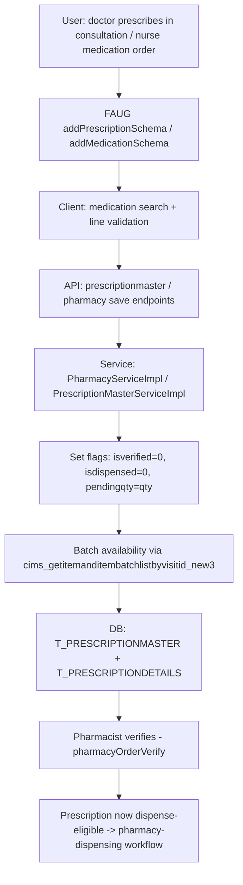

# Workflow: Prescription (order → verify → dispense-eligibility)

**Source evidence:** `_discovery/agent-06/findings.md` §1.6 (steps 1–6) · `03-legacy-frontend-inventory.md` §2.5 (pharmacy screens) · `04-api-catalog.md` (pharmacy, itemsales, medication) · `10-target-architecture.md:36` (Pharmacy service)
**Target service:** Ordering & Prescription (Clinical) → Pharmacy & Dispensing

## Purpose
Record the medication order (master + details with dispense flags and pending quantity), allow verification, and prepare for dispensing — the dispense step itself is the pharmacy-dispensing workflow.

## Actors
Doctor (prescribing) · Nurse (nurse medication orders) · Pharmacist (verify)

## Steps

| Step | Layer | Component (file:line) | Action | Data/Table | Notes |
|---|---|---|---|---|---|
| 1 | UI | `pharmacy:addPrescription`, `pharmacy:medicationOrder`, `pharmacy:NursePrescriptionList/:tab` (`addPrescriptionSchema`, `addMedicationSchema(+FromNurse)`) | Compose prescription lines | – | 98 `pharmacy/*` refs (03 §2.5) |
| 2 | JS | `pharmacy-module*.js` (4 files) | DTO assembly; medication search | – | |
| 3 | API | `pharmacy/*`, `prescriptionmaster/*`, `prescription/*`, `drug/*` (per 02-business-module-catalog.md:127) | Save prescription master + details | T_PRESCRIPTIONMASTER, T_PRESCRIPTIONDETAILS | |
| 4 | SVC | `custom/PharmacyServiceImpl.java:536,574,624,735-746,768` | Set flags: `isverified`, `isdispensed`, `ispartialdispense`, `pendingqty`, `flagged/flagreason`, `isacknowledge` | T_PRESCRIPTIONDETAILS | BR-PHAR-002 |
| 5 | SVC | `PharmacyServiceImpl.java:735-746` | Detail-level closure bookkeeping on sale (see dispensing workflow) | T_PRESCRIPTIONDETAILS | BR-PHAR-002 |
| 6 | SVC | Batch/expiry availability via proc `cims_getitemanditembatchlistbyvisitid_new3` (`DTOQueries_4.java:762`); batch expiry as `ibm.expirydate` (`PharmacyServiceImpl.java:2622`) | Stock/batch eligibility for each line | M_ITEMMASTER, T_ITEMBATCHMASTER | |
| 7 | SVC | `util/auth/DefaultAuthenticationImpl.java:140` | `medication.amount.show=false` → hide amounts in session UserView | – | config-driven |
| 8 | UI | `pharmacy:pharmacyOrderVerify` | Pharmacist verification step | T_PRESCRIPTIONDETAILS | verify → dispense hand-off |
| 9 | INT | `medication.getGstApplicable` (`MedicationServiceImpl.java:1080`); `CIMS_RPT_PHARMACYBILL_NEW` | GST display; pharmacy bill report | – | GST rule per STATUS-CODE-DICTIONARY |

## Flowchart

## Business rules involved
BR-PHAR-002 (closure on sale: IsClosed/PendingQty, compound details), BR-PHAR-001 (dispensing completion → VisitStatus 12, downstream)

## Edge cases
- Compound prescriptions: compound details closed together with master on full sale.
- Partial dispensing keeps `PendingQty` > 0 and sets `ispartialdispense`.
- Flagged lines (`flagged/flagreason`) block or warn dispensing — exact enforcement not traced.
- IV/compounding orders (`ivPharm`, `prepareCompound`) reuse prescription rows.

## Unknowns
- Prescription status code list: 02-business-module-catalog.md:124 notes "prescription status; … UNKNOWN-14 code lists" — the numeric status values beyond IsClosed 0/1 and the dispense flags are not enumerated in agent-06 findings.
- `isacknowledge` semantics (nurse acknowledgement?) not explained in findings.
- Prescription upload/scan path (`prescriptionUpload`) validation rules not traced.
