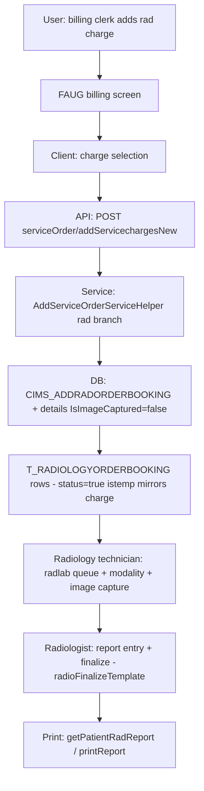

# Workflow: Radiology Order (booking → report)

**Source evidence:** `_discovery/agent-06/findings.md` §1.5 step 9 (rad analog of patho auto-creation) · `03-legacy-frontend-inventory.md` §2.6 (radiology routes) · `04-api-catalog.md` (radiology) · `10-target-architecture.md:35` (Radiology service)
**Target service:** Radiology — RadOrderCreated / RadResultFinalized events

## Purpose
Create the radiology order booking when the rad charge is billed (mirror of the pathology path), run the modality workflow, enter the report (with images), finalize and print.

## Actors
Billing clerk (triggers order) · Radiology technician · Radiologist (report & finalize)

## Steps

| Step | Layer | Component (file:line) | Action | Data/Table | Notes |
|---|---|---|---|---|---|
| 1 | SVC | `addservicecharge` rad branch (`custom/AddServiceOrderServiceHelper.java:551-601`) | Rad charge (specialization=2) → `CIMS_BILLFORINVESTIGATIONNEW` analog; create booking + details with `IsImageCaptured=false` | T_RADIOLOGYORDERBOOKING, T_RADIOLOGYORDERBOOKINGDETAILS | BR-BILL-003 (rad analog) |
| 2 | UI | `radiology:radlab(/:p_id/:order_no/:date/:opd_ipd)` (patho-booking-module.js / operation-theatre.js rad rows) | Order list; modality queue (`getRadiologyQueueNew` `getRadiologyCabinQueueNew`) | – | |
| 3 | API | `GET /radiology/getRadiologyQueue` / `getRadiologyQueueNew` (`pas.RadiologyServiceImpl`) | Queue per cabin | T_RADIOLOGYORDERBOOKING (read) | |
| 4 | UI | `radiology:reSchedule`, `radiology:radReTest` (radRescheduleSchema, radRetestSchema) | Reschedule / retest | T_RADIOLOGYORDERBOOKING | |
| 5 | UI | `radiology:printReport` (radioFinalizeTemplate.html, showRadiologyReport.html) | Report entry + finalize | – | images via `showRadSampleImg.html` |
| 6 | API | `GET /radiology/getPatientRadReport` (`getPatientRadReport`; getRadiologyReports schema) | Fetch finalized report for print (`isReportPrint=false` param) | T_RADIOLOGYORDERBOOKINGDETAILS (read) | |

## Flowchart

## Business rules involved
BR-BILL-003 (rad order auto-creation at billing — rad analog), BR-PATH-001 (sample/charge-removal guard applies to rad bookings too — `getSampleStatus` covers patho+rad)

## Edge cases
- `IsImageCaptured=false` default; retest (`radReTest`) and reschedule paths.
- Rad order removal follows the same `LEX001` guard when a study has been captured.
- Queue-driven workflow per radiology cabin.

## Unknowns
- Radiology result status transitions (captured→reported→finalized) numeric values not traced in agent-06 findings.
- Modality / machine interface (PACS?) not traced — no PACS evidence in the source docs.
- Report template rules (radiology templates) not traced.
